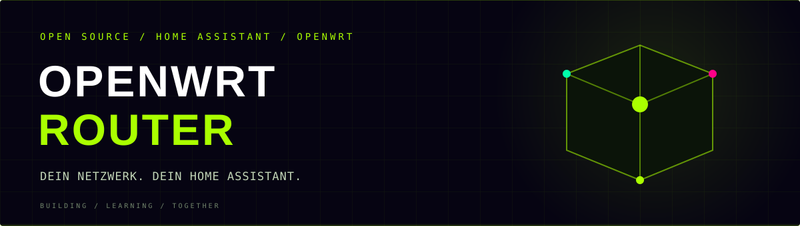

  

  <strong>Dein OpenWrt-Netzwerk im Blick – direkt in Home Assistant.</strong> 
  Eine Community-Integration für Router, Access Points und verbundene Geräte.

  
  
  
  

  <a href="#01--auf-einen-blick">Übersicht</a> ·
  <a href="#03--installation">Installation</a> ·
  <a href="#04--projektstand">Projektstand</a> ·
  <a href="#05--mitmachen">Mitmachen</a> ·
  <a href="https://github.com/magicx78/ha-openwrt-router/blob/main/INSTALL.md">Dokumentation</a>

---

> [!IMPORTANT]
> **Wir lernen noch – und freuen uns über Hilfe!** Wir sind Anfänger und entwickeln dieses Projekt mit viel Neugier, Ausprobieren und Unterstützung durch KI: eben **Vibe Coding**. Das Projekt wächst aktiv weiter. Fehler, Verbesserungsideen, Code-Reviews und freundliche Hinweise sind ausdrücklich willkommen.

## `01 /` Auf einen Blick

**OpenWrt Router** verbindet deine OpenWrt-Geräte über die lokale **ubus/rpcd-Schnittstelle** mit Home Assistant. So siehst du wichtige Informationen über dein Netzwerk an einem Ort und kannst ausgewählte Funktionen direkt aus Home Assistant bedienen.

| | Was dich erwartet |
| :--- | :--- |
| 🕸️ **Netzwerk-Topologie** | Eine interaktive Karte für Gateway, Access Points, Verbindungen und Clients. |
| 📊 **Monitoring** | Sensoren für Systemzustand, Netzwerkverkehr, WLAN und weitere Routerdaten. |
| 📡 **WLAN & Geräte** | Verbundene Clients und Gerätestatus im Blick; WLAN-Funktionen steuern. |
| 🩺 **Netzwerkdiagnose** | Ereignisse, Vorfälle und Health-Scores helfen bei der Fehlersuche. |
| 🗂️ **Konfiguration** | Optionale Backups, Versionsvergleich und Erkennung von Änderungen. |
| 🛡️ **Security Center** | Optionale, beobachtende Sicherheitshinweise für das Netzwerk. |
| 🔎 **Network Diagnostics** | Optionale Prüfung der Kette Router, Gateway, WAN, Internet und DNS (Panel: „Netzwerkdiagnose“). |
| 📈 **Traffic Analytics** | Optionale Verkehrsanalyse je Router: WAN, Ports, VLANs, WLAN-Clients (nur als Pseudonym), Verlauf und Auffälligkeiten. |

Welche Daten verfügbar sind, hängt unter anderem vom Router, seinen Berechtigungen und der Einrichtung ab.

## `02 /` Ein Netzwerk. Mehr Überblick.

### 🕸️ Topologie-Panel

Die Netzwerkansicht zeigt Router und Access Points, ihre Verbindungen und Clients. Suche, Filter und Detailansichten helfen dabei, einzelne Geräte näher zu betrachten. Unterstützt werden unter anderem Ansichten für Status, VLANs und Datenverkehr.

**Gut zu wissen:** Das Panel und seine Snapshot-API sind standardmäßig nur für Administratoren zugänglich. Der Zugriff kann in den Integrationsoptionen erweitert werden; normale Home-Assistant-Entitäten folgen den üblichen Zugriffsregeln von Home Assistant.

### 🩺 Network Intelligence & Client-Stabilität

Die Diagnose wertet vorhandene Daten aus und zeigt Ereignisse, Vorfälle und mögliche Ursachen. Ein Health-Score fasst den Zustand zusammen, sofern genügend aktuelle Daten vorliegen. Für WLAN-Clients gibt es zusätzlich eine Stabilitätsansicht.

➡️ [Network Intelligence](https://github.com/magicx78/ha-openwrt-router/blob/main/docs/network-intelligence.md) · [Client-Stabilität](https://github.com/magicx78/ha-openwrt-router/blob/main/docs/client-stability.md)

### 🗂️ Configuration Manager

Routerkonfigurationen sichern, Versionen vergleichen und Änderungen erkennen: Der Configuration Manager ist pro Router optional und standardmäßig ausgeschaltet. **Die Wiederherstellung erfolgt derzeit manuell.**

➡️ [Zum Configuration Manager](https://github.com/magicx78/ha-openwrt-router/blob/main/docs/configuration-manager.md)

### 🛡️ Security Center

Das optionale Security Center sammelt und bewertet Sicherheitshinweise. Es ist standardmäßig deaktiviert und arbeitet beobachtend.

➡️ [Zum Security Center](https://github.com/magicx78/ha-openwrt-router/blob/main/docs/security-center.md)

### 🔎 Network Diagnostics (Netzwerkdiagnose, ab 1.47.0)

Prüft die Kette Router → Gateway → WAN → Internet → DNS und nennt je Glied „gesund“, „beeinträchtigt“, „ausgefallen“ oder „unbekannt“; fehlende Daten gelten nie als gesund. Das Modul ist standardmäßig ausgeschaltet; dann gibt es keine Messung und keine Schreibvorgänge. Es macht keinen zusätzlichen Router-Aufruf je Poll und braucht keine neuen Router-Rechte. Gemessen wird nur von Home Assistant aus (TCP, DNS, HTTP) gegen Ziele, die ein Administrator einrichtet; Tests auf dem Router gibt es noch nicht.

➡️ [Zur Netzwerkdiagnose](https://github.com/magicx78/ha-openwrt-router/blob/main/docs/network-diagnostics.md)

### 📈 Traffic Analytics (ab 1.49.0)

Zeigt den Verkehr über WAN, Ports, Schnittstellen, VLANs und WLAN-Clients, mit Verlauf, Top Talkers, Auffälligkeiten und Uplink-Auslastung (Panel-Tab „Traffic Analytics“). Die Zahlen kommen aus den Zählern, die die Integration ohnehin abfragt; es gibt keine Paketanalyse und keine DNS- oder Webadressen.

- **Einschalten je Router** in den Integrationsoptionen (`traffic_enabled`, standardmäßig aus). Ausgeschaltet gibt es keinen Speicher und keine Entität. Drei Zusatzabfragen (iwinfo, sysfs, Flow-Offloading) haben eigene Schalter; neue Router-Rechte braucht keine davon.
- **Sensoren**: WAN-Download, WAN-Upload, WAN-Verkehr gesamt und Spitze (24 h) am Gateway, Uplink-Auslastung und -Fehler je Router, zwei Flottensensoren, optional bis zu 20 Client-Sensoren „WLAN-Verkehr am AP“.
- **Verlauf**: Profil `compact` (Standard) oder `standard`, beide mit stündlichen Werten für 14 Tage. Gemessen: zusammen ca. 1,7 MB (`compact`) bzw. 3,3 MB (`standard`) auf der Platte für eine Testflotte mit 6 Routern.
- **Externer Collector** (optional): schickt Flows über HTTPS mit einem eigenen Benutzer ohne Admin-Rechte und langlebigem Token. Home Assistant ruft keinen Collector auf. Zusammengefasste Collector-Werte werden in dieser Version abgelehnt.
- **Datenschutz**: Clients, Router und Benutzer erscheinen nur als Pseudonym, auch für Administratoren. Keine MAC, kein Hostname und keine IP in Entitäten, Log oder Diagnose.
- **Grenzen**: Client-Zähler am AP sind kein Internetverbrauch. Noch nicht an echten Routern und nicht im Browser geprüft.

➡️ [Zu Traffic Analytics](https://github.com/magicx78/ha-openwrt-router/blob/main/docs/traffic-analytics.md)

## `03 /` Installation

**Voraussetzungen**

- Home Assistant **2026.2.0 oder neuer**
- OpenWrt **19.07 oder neuer**; laut Projektdokumentation auf 25.12.1 getestet
- `rpcd` und `rpcd-mod-rpcsys` auf dem Router sowie passende Berechtigungen
- Optional `lldpd` und SSH für eine genauere Erkennung der Verbindungen zwischen Routern

### Über HACS

1. Öffne den Button oder füge `https://github.com/magicx78/ha-openwrt-router` in HACS unter **Benutzerdefinierte Repositories** als Integration hinzu.
2. Suche nach **OpenWrt Router** und installiere die Integration.
3. Starte Home Assistant neu.
4. Füge **OpenWrt Router** unter **Einstellungen → Geräte & Dienste** hinzu und folge dem Einrichtungsdialog.

Eine manuelle Installation ist ebenfalls möglich. Routervorbereitung, Berechtigungen und weitere Details findest du in der [Installationsanleitung](https://github.com/magicx78/ha-openwrt-router/blob/main/INSTALL.md).

## `04 /` Projektstand

> [!NOTE]
> **Aktiv in Entwicklung.** Viele Funktionen aus unserer TODO-Liste sind bereits umgesetzt. Gleichzeitig gibt es offene Punkte, weitere Ideen und Tests auf echter Hardware, an denen wir arbeiten.

**Bereits umgesetzt:** Topologie-Panel, Network Intelligence, Client-Stabilität sowie die ersten Versionen von Configuration Manager, Security Center, Network Diagnostics und Traffic Analytics.

**Daran arbeiten wir unter anderem:** weitere Hardware- und Frontend-Tests, Verbesserungen bei Sicherheit und Zuverlässigkeit sowie zusätzliche Funktionen. Ein automatischer Restore und die Verschlüsselung lokaler Konfigurationsarchive stehen noch aus.

➡️ [Aktuelle TODO-Liste](https://github.com/magicx78/ha-openwrt-router/blob/main/TODO.md) · [Änderungsprotokoll](https://github.com/magicx78/ha-openwrt-router/blob/main/CHANGELOG.md) · [Releases](https://github.com/magicx78/ha-openwrt-router/releases)

## `05 /` Mitmachen

**Du kennst dich mit Home Assistant, OpenWrt, Python oder Frontend-Entwicklung aus – oder möchtest mit uns lernen?** Wir freuen uns über Unterstützung jeder Art.

- 🐛 **Fehler gefunden?** [Erstelle ein Issue](https://github.com/magicx78/ha-openwrt-router/issues/new) und beschreibe, was passiert ist.
- 💡 **Eine Idee oder Verbesserung?** Teile sie in einem [Issue](https://github.com/magicx78/ha-openwrt-router/issues).
- 🔧 **Du möchtest Code oder Dokumentation beitragen?** Ein [Pull Request](https://github.com/magicx78/ha-openwrt-router/pulls) ist willkommen.
- 🧪 **Du testest auf anderer Hardware?** Deine Erfahrungen helfen uns, das Projekt besser zu machen.

Wir sind keine Profis und behaupten auch nicht, dass schon alles perfekt ist. Wir lernen mit jedem Beitrag dazu und freuen uns über einen respektvollen Austausch. 💚

## `06 /` Links

| | |
| :--- | :--- |
| 📖 **Einrichtung** | [INSTALL.md](https://github.com/magicx78/ha-openwrt-router/blob/main/INSTALL.md) |
| 🔍 **Technische Referenz** | [Ausführliche Funktions- und Entitätenübersicht](docs/REFERENZ.md) |
| 🗺️ **Offene Aufgaben** | [TODO.md](https://github.com/magicx78/ha-openwrt-router/blob/main/TODO.md) |
| 📝 **Was sich geändert hat** | [CHANGELOG.md](https://github.com/magicx78/ha-openwrt-router/blob/main/CHANGELOG.md) |
| 🐛 **Fehler & Ideen** | [GitHub Issues](https://github.com/magicx78/ha-openwrt-router/issues) |
| 📦 **Versionen** | [GitHub Releases](https://github.com/magicx78/ha-openwrt-router/releases) |
| ⚖️ **Lizenz** | [Lizenzdatei](https://github.com/magicx78/ha-openwrt-router/blob/main/LICENSE) |

---

<strong>OPEN SOURCE · VIBE CODING · COMMUNITY</strong> Mit Neugier entwickelt. Gemeinsam besser gemacht. 💚

