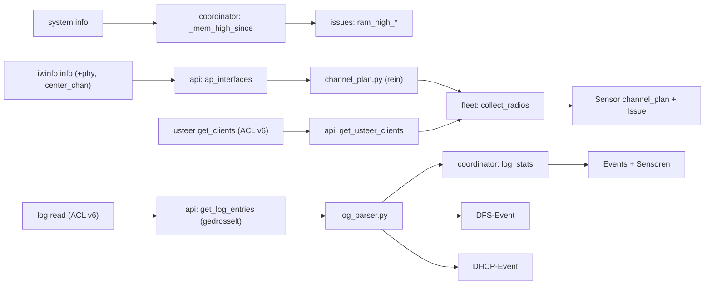

# Plan: WLAN-Diagnose-Features (Restprogramm 9, 2, 6, 3, 5, 4, 8)

<!-- Ablage: docs/plans/ · wird mit dem ersten umsetzenden PR (Feature 9) committet,
     spätere PRs aktualisieren den Status-Kopf. Keine IPs, MACs, Hostnamen echter
     Geräte, Passwörter oder Tokens. -->

## Status

- **Stand:** 2026-10-27 · **Phase:** freigegeben, in Umsetzung
- **Branch/PR:** gestapelt auf v1.30.0 (PR #22, enthält #19 und #20)
  - P1 `feature/ram-pressure-repairs` · 1.31.0 · PR #23
  - P2 `feature/channel-plan` · 1.32.0 · PR #24
  - P3 `feature/log-ingest` · 1.33.0 · PR #25
  - P4 `feature/dfs-events` · 1.34.0 · PR folgt
- **Erledigt (außerhalb dieses Plans):** Feature 1 (#19), Feature 7 (#20), Feature 10 (#22), rpcd-Leck (#21)
- **Erledigt:** P1 (F9, PR #23), P2 (F2, PR #24), P3 (F6 + ACL v6, PR #25), P4 (F3, lokal grün)
- **Offen:** P5–P7
- **Blocker:** —
- **Nächster Schritt:** P5 (Feature 5, DHCP-Health) auf `feature/dhcp-health`

## Problem und Zielverhalten

Die Live-Diagnose vom 2026-10-27 hat Fehler gezeigt, die in HA nicht sichtbar waren:
- doppelt belegter DFS-Kanal, HE160 überall,
- klebende IoT-Clients,
- Clients ohne Lease,
- rpcd mit 110 MB RSS auf einem Dumb-AP.

Ziel: Solche Zustände erscheinen künftig in HA als Sensor, Event oder Reparatur-Hinweis, ohne SSH-Diagnose. Jedes Feature ist ein eigener, gestapelter PR.

**Nicht-Ziele:**
- Änderungen an Router-Konfigurationen.
- Feature 8 Stufe 2 (Tracker zusammenführen).
- SSH-Fallback als Repairs-Issue und Notification-i18n (bleiben im TODO).
- Ein persistenter Verlauf über HA-Neustarts.

## Akzeptanzkriterien

- [x] AK1 (F9) Speicherdruck = 1 − available/total. Liegt er länger als 15 min über 85 % oder `available` unter 16 MB, erscheint das Issue `ram_high_<entry_id>`. Es verschwindet unter 80 % und beim Entladen des Eintrags. Die Formel des bestehenden Sensors `memory_usage` bleibt unverändert, er bekommt die Attribute `available_mb` und `pressure_pct`.
- [x] AK2 (F2) Diagnosesensor `<entry_id>_channel_plan` pro Router, Attribut `findings[]`:
  - `same_channel`, `overlap` (auch 40 MHz: 44/48 sind ein Block; 160 MHz auf 36 umfasst 36–64), `non_standard_24` (außerhalb 1/6/11), `dfs` (Teilkanal in 52–144)
  - zwei SSIDs auf demselben Funkmodul ergeben kein Finding
  - Issue `channel_plan_conflict` erst nach zwei Auswertungen in Folge, ohne `dfs`
- [x] AK3 (F6) Log-Abruf alle 2 Polls über ubus `log read` mit Duplikat-Erkennung über die `id`.
  - Zeilen, die beim ersten Abruf schon im Puffer stehen, werden nur gezählt, ohne Events.
  - Events `openwrt_router_wifi_event` / `openwrt_router_dhcp_event`, begrenzt auf höchstens 10 pro Abruf und 5 min Sperre je Typ und MAC.
  - Ist die Methode nicht freigegeben, steht `log_status` auf `unavailable` und der Poll schlägt nicht fehl.
- [x] AK4 (F3) Kanalwechsel pro Funkmodul zwischen zwei Polls oder eine DFS-Logzeile löst `openwrt_router_dfs_event` aus. `dfs_related` ist nur mit Beleg wahr. Dazu kommt der Sensor `dfs_events_24h`.
- [ ] AK5 (F5)
  - (a) `dhcp_missing` nur, wenn alles zutrifft: seit mindestens 180 s assoziiert, keine Lease bei irgendeinem Router, nicht in der ARP-Tabelle irgendeines Routers. Ein statischer `host` ohne Lease ergibt `static_no_lease`.
  - (b) Sensor für die Pool-Auslastung in % pro aktivem Pool.
  - (c) dnsmasq NAK/DECLINE/„no address available“ lösen ein Event aus.
- [ ] AK6 (F4)
  - Tracker-Attribute `associations_24h` und `reconnects_24h`, Sensor `unstable_clients` (Top 10).
  - Binary-Sensor `sticky_clients` pro Router: Mit usteer heißt das „anderer AP hört ihn mindestens 8 dB stärker, und das seit N min“, ohne usteer „Alternative im selben Band vorhanden“.
- [ ] AK7 (F8 Stufe 1) Lokal administrierte MACs bekommen das Attribut `random_mac` und keinen OUI-Hersteller.
- [ ] AK8 (alle) Neue unique_ids enthalten nicht `_rate`, `_ap_`, `_port_`, `_radio_`, `_iface_`, wegen des Teilstring-Musters der Legacy-Migration.

## Befunde im Code (verifiziert, Stand #22 @ 83533be)

- `issues.py` und `fleet.py` (aus #20) bieten den Issue-Wrapper und die Flottensicht. Wiederverwenden.
- `sensor.py:155-171`: `memory_usage` = `_calc_memory_pct(data.memory)`, rechnet (total − free)/total.
- `coordinator.py:538` (History) und `:836-846` (Timeline, Schwelle 90 %) verwenden je eine eigene Formel. Bestandsaufnahme: drei Formeln.
- `api.py:1502`/`:1516`: Für `ap_interfaces` aus `iwinfo info` werden `htmode`, `channel` und `frequency` übernommen. `phy` und `center_chan1/2` liegen in derselben Antwort, werden aber verworfen.
- `acl_provisioning.py:36`: `ACL_VERSION = 5`; weder `log` noch `usteer` sind freigegeben. `file/exec` gilt nur für `/etc/init.d/rpcd`.
- Kein `logbook.py` vorhanden. Neue Events brauchen ihn, damit sie im Logbuch lesbar erscheinen.

**Live-Probe 2026-10-27, lesend, Profile `openwrt`, `ap2`, `ap4`, OpenWrt 25.12.1:**
- `ubus call system info`: `memory` = {total, free, shared, buffered (0), available, cached}. Speicherdruck nach dem rpcd-Fix 43–48 % auf allen drei Routern. Vorher auf `ap4` ca. 93 % (rpcd 110 MB): F9 hätte das Leck gemeldet.
- `ubus -v list log`: `read {lines, stream, oneshot}`. `log read {"lines":2,"stream":false}` liefert `{"log":[{msg,id,priority,source,time}]}` mit monotoner `id` und `time` in ms.
- `ubus call iwinfo info {"device":"phy1-ap0"}` auf dem Gateway: `phy`, `channel`, `center_chan1`, `htmode` sind vorhanden.
- `ubus call usteer get_clients` auf `ap2`: pro Client-MAC eine Map aus Knoten (lokal `hostapd.<ifname>`, entfernt `<ip>#hostapd.<ifname>`) → `{connected, signal}`. usteer läuft seit 2026-10-27 auf allen drei Routern.

## Komponenten und Datenfluss

**Poll-Kosten:**
- F9: keine zusätzlichen Calls.
- F2: keine zusätzlichen Calls (Felder aus vorhandener Antwort).
- F6: 1 Call alle 2 Polls pro Router, ca. 15–40 KB JSON.
- F4: `usteer get_clients` alle 2 Polls, nur auf Routern, auf denen usteer läuft.
- F5b: `uci get dhcp` alle 10 Polls, nur auf dem Gateway.

**ACL-Änderung:** einmal, in P3 (F6): ACL v6 mit `"log": ["read"]` und `"usteer": ["get_clients"]`, `scripts/ha-openwrt-router.json` mitziehen. Beim Installieren des Releases startet rpcd einmal pro Router neu.

## Alternativen

| Option | Vorteile | Nachteile |
|---|---|---|
| A Ein PR pro Feature, gestapelt | kleine Reviews, einzeln mergbar, Releases fein | viele Versionssprünge, Stapel muss in Reihenfolge gemergt werden |
| B Ein großer PR für alle | ein Release | schwer zu reviewen, ein Fehler blockiert alles |
| C Release-Branch `release/1.31.0` bündelt die Feature-PRs | ein öffentliches Release | mehr Git-Verwaltung |

**Empfehlung:** A. Das ist so wie bisher (#19–#22), jedes Paket ist klein genug für ein unabhängiges Review. Bündeln über C bleibt beim Release möglich.

## Risiken und Kompatibilität

- **HA-Floor (`hacs.json`):** unverändert. `issue_registry` und `logbook` gibt es seit Langem.
- **OpenWrt 24.x/25.x:**
  - `log read` mit `stream:false` nur auf 25.12 geprüft. Auf älteren Versionen fällt F6 auf `log_status=unavailable` zurück.
  - Ohne usteer fällt F4 auf die Variante ohne Signalvergleich zurück.
  - Dumb-APs ohne DHCP-Server: F5b nur auf dem Gateway.
- **Mehrere Router:** F2, F4 und F5a rechnen über `fleet.py`. Entity liest Daten anderer Entries (Muster `device_tracker.py`). Berechnung beim Lesen, nicht im Poll.
- **`unique_id`/Registry:** nur neue Entities, keine Migration. Namensregel siehe AK8.
- **ACL v6 (P3):** Risikoauslöser. Der Deploy startet rpcd pro Router neu, und nach #21 gibt es keine rpcd-Last mehr durch `rc list`.
- **Logs und Events:** Event-Payloads enthalten MACs und Hostnamen (wie die Tracker), aber keine Zugangsdaten. Diagnostics bleiben redigiert.

## Arbeitspakete

| ID | Rolle | Inhalt | Dateien (Kern) | Hängt ab von | Aufwand | Definition of Done |
|---|---|---|---|---|---|---|
| P1 | HA | F9 RAM-Warnung | `coordinator.py`, `issues.py`, `sensor.py`, `__init__.py`, Texte | #22 | S | AK1, Tests für Haltezeit, Hysterese, Ersatzformel ohne `available`, Unload |
| P2 | HA+OpenWrt | F2 Kanalplan | `api.py`, `channel_plan.py` (neu), `fleet.py`, `sensor.py`, Texte | P1 | M | AK2, `tests/test_channel_plan.py` mit allen Fällen |
| P3 | OpenWrt+HA | F6 Log-Ingest + ACL v6 | `acl_provisioning.py`, `scripts/ha-openwrt-router.json`, `api.py`, `log_parser.py` (neu), `coordinator.py`, `logbook.py` (neu), `sensor.py`, Texte | P2 | M | AK3, ACL-Sync-Test, Parser-Tests mit echten Beispielzeilen (ohne MACs) |
| P4 | HA | F3 DFS | `coordinator.py`, `log_parser.py`, `sensor.py` | P2, P3 | S | AK4 |
| P5 | HA | F5 DHCP-Health | `fleet.py`, `dhcp_health.py` (neu), `api.py`, `device_tracker.py`, `sensor.py` | P3 | M | AK5 |
| P6 | HA | F4 Client-Stabilität | `api.py` (usteer), `coordinator.py`, `fleet.py`, `device_tracker.py`, `binary_sensor.py`, `sensor.py` | P3 | M | AK6 |
| P7 | HA | F8 Stufe 1 | `mac_utils.py` (neu), `api.py`, `device_tracker.py` | – | S | AK7 |

Pro Paket: eigener Branch auf dem vorherigen, eigener PR, CHANGELOG-Eintrag, Minor-Version +1 (1.31.0 …). README-Abschnitt nur, wenn sich Entities oder Options sichtbar ändern.

## Validierungsplan

- **Lokal (G3):** `python ~/.claude/skills/project/scripts/checks.py --repo <worktree> --ruff-ci` (ruff wie die CI, gepinnt auf 0.17.3, plus pytest), dazu neue Tests je Paket.
- **CI:** tests (Py 3.13/3.14), hassfest, hacs nach PR-Erstellung; Auto-fix auf jedem PR.
- **Hardware, nur lesend:**
  - P2: `iwinfo info` aller Funkmodule.
  - P3: `log read` auf allen drei Routern, Größe der Antwort bei `lines:200`.
  - P6: `usteer get_clients`.
  - Keine Router-Änderung, kein ACL-Deploy von Hand.
- **Review (G4):** pro PR unabhängig (`/code-review` oder frischer Agent, der nur Diff und AK bekommt). P3 wegen ACL und Poll-Pfad zwingend.
- **Lücke:** Das Verhalten in einer echten HA-Instanz prüft erst die Installation des Releases. Die Tests sind MagicMock-basiert, `pytest-homeassistant-custom-component` gibt es nicht.

## Entscheidungen

- 2026-10-27 – F9 mit festen Konstanten (85 %, 15 min, Hysterese 5 %, < 16 MB), keine neue Option – keine Änderung an der Struktur der Options (Risikoauslöser), später erweiterbar – vom Nutzer freigegeben (2026-10-27)
- 2026-10-27 – Nur ein ACL-Sprung (v6 in P3) mit `log read` und `usteer get_clients` – nur ein rpcd-Neustart pro Router – vom Nutzer freigegeben (2026-10-27)
- 2026-10-27 – F8 nur Stufe 1 – Zusammenführen ist bei Familien-iPhones fehleranfällig – vom Nutzer freigegeben (2026-10-27)
- 2026-10-27 – Gestapelte PRs, ein Feature pro PR – wie #19–#22 – vom Nutzer freigegeben (2026-10-27)
- 2026-10-27 – P1: Das Issue verschwindet erst, wenn der Druck unter 80 % liegt **und** wieder mindestens 16 MB verfügbar sind – sonst würde ein kleiner Router (z. B. 64 MB, 79 %, 13 MB frei) im 15-min-Takt flattern; betrifft nur Router unter 80 MB RAM – Abweichung vom Wortlaut von AK1, vom Coordinator entschieden, im PR zur Bestätigung durch den Nutzer genannt
- 2026-10-27 – P2: Das Issue `channel_plan_conflict` ist flottenweit (eins für alle Router). „Zwei Auswertungen in Folge“ = zwei aufeinanderfolgende Polls desselben Routers, in denen er an einem Konflikt beteiligt ist; ausgewertet wird nach jedem Poll über einen Coordinator-Listener. Konflikt = alle Befundtypen außer `dfs`, also auch `non_standard_24` (wörtlich nach AK2) – Umsetzungsdetail
- 2026-10-27 – P4: Kanalwechsel = Kanal **oder** Kanalbreite eines Funkmoduls (phy, Band) ändert sich zwischen zwei Polls (Radar im Nebenkanal verkleinert oft nur die Breite); Beleg = DFS-Logzeile desselben Funkmoduls in den letzten 15 min; ein Kanalwechsel zieht den Log-Abruf vor und startet dessen Takt neu; `dfs_events_24h` zählt alle DFS-Logzeilen und Kanalwechsel; als Beleg zählen nur `radar_detected`, `new_channel`, `cac_failed` (ein manueller Wechsel auf einen DFS-Kanal startet auch einen CAC) – Umsetzungsdetail
- 2026-10-27 – P3 (nach Review): Status `not_permitted` statt `unavailable` – `unavailable` ist in HA reserviert (Frontend/Automationen zeigen ihn als Ausfall); Abweichung vom Wortlaut von AK3, vom Coordinator entschieden, im PR genannt
- 2026-10-27 – P3 (nach Review): Zeilenzahl adaptiv (zuerst 250, dann 1,5 × zuletzt gesehene Zeilen + 20, 100–700; nach Lücke 700); Events nach Priorität (PSK/Handshake/DHCP vor Inaktivität); logd-Neustart auch über die Zeit der letzten Zeile erkannt; unplausible Router-Zeit → Empfangszeit; `device_id` im Event fürs Geräte-Logbuch – Umsetzungsdetail
- 2026-10-27 – P3: Abruf mit `lines: 250` statt 200 – live füllt eine DHCP-DISCOVER-Schleife den Gateway-Puffer mit ~120 Zeilen/min, 250 Zeilen (~40 KB) decken 2 Polls ab; was trotzdem fehlt, zählt `missed_lines` – Umsetzungsdetail
- 2026-10-27 – P3: Events nur für Problemfälle (`psk_mismatch`, `inactivity_timeout`, `handshake_failed`, DHCP `nak`/`decline`/`no_address`); An-/Abmeldungen und DHCPACK nur zählen (Grundlage für P6) – sonst verdrängen Routine-Events bei 10 pro Abruf die Fehler – Umsetzungsdetail
- 2026-10-27 – P3: DHCP-Events aus AK5 (c) sind mit P3 umgesetzt, P5 nutzt sie – Umsetzungsdetail
- 2026-10-27 – P2 (nach Review): Funkmodule mit STA-/Mesh-Uplink (Repeater, 802.11s) sind `backhaul` und bilden nie `same_channel`/`overlap` – sie müssen den Kanal des Partners teilen; Issue wird erst nach zwei konfliktfreien Auswertungen aufgehoben, ein fehlgeschlagener Poll ändert nichts; Funkmodule nach (phy, Band) zusammengefasst; Band aus dem Namen wird über die Kanalnummer korrigiert – Umsetzungsdetail
- 2026-10-27 – P1 (nach Review): Grenzwerte gegen den ungerundeten Druck; nicht lesbares `available` (oder 0 bei freiem Speicher) → Ersatzformel statt 100 %; eine Lücke > 2 Poll-Intervalle ohne Messwert startet die Haltezeit neu – Umsetzungsdetail
- 2026-10-27 – P1: Ersatzformel ohne `available` = frei + Puffer + max(Cache − Shared, 0) – tmpfs-Seiten liegen im Cache, sind aber nicht freigebbar – Umsetzungsdetail

## Prüfprotokoll

- 2026-10-27 – Plan P1–P7 vom Nutzer freigegeben (Gate G2)

- 2026-10-27 `feature/extended-wifi-sensors-option@83533be` – Live-Probe lesend auf `openwrt`/`ap2`/`ap4` (s. Befunde) · CI #22: grün
- 2026-10-27 `feature/ram-pressure-repairs` (P1) – lokal: ruff 0.17.3 check/format ✓ · pytest grün (Py 3.13, HA 2026.2.3) · Hardware: keine neue Abfrage (Felder aus `system info`, Live-Probe oben) · Review: unabhängig (frischer Agent) – keine P0/P1; P2 (kaputtes `available`, Text zur 16-MB-Bedingung) und P3 (Rundung, Poll-Lücke, Test mit zwei Einträgen) behoben; offen P3: Wanduhr statt monotoner Zeit
- Doku geprüft: https://contributors.home-assistant.io/core/integrations/repairs/, 2026-10-27, `async_create_issue`/`async_delete_issue` unverändert, keine Deprecation
- 2026-10-27 `feature/channel-plan` (P2) – Live-Probe lesend `iwinfo info` aller AP-Interfaces auf `openwrt`/`ap2`/`ap4`: `phy`, `channel`, `center_chan1`, `htmode`, `frequency` vorhanden (20 MHz: `center_chan1` = Kanal; HE40 auf 36: 38). Aktueller Plan 1/6/11 und 36@40, 44, 48 → keine Befunde (als Test abgebildet) · lokal: ruff 0.17.3 ✓ · pytest 830 passed · Review: unabhängig – keine P0/P1; P2 (Issue-Flattern bei Fehl-Poll, Mesh/Repeater-Fehlalarm, Band/phy-Zuordnung) und P3 (eigene Funkmodule beim Setup, `band` im Attribut, Zähler beim Unload, Tests 1/5 und 144/149) behoben; offen P3: Sensor rechnet pro Zustandsschreiben zweimal (gering), UCI-Fallback kennt deaktivierte Funkmodule nicht
- 2026-10-27 `feature/log-ingest` (P3) – Live-Probe lesend `log read` auf `openwrt`/`ap2`/`ap4`: Antwort `{"log":[{msg,id,priority,source,time}]}`, `id` fortlaufend, `time` in ms; Puffer ~620–640 Zeilen, ~166 B/Zeile (200 Zeilen ≈ 32–34 KB); Zeitspanne des Puffers Gateway ~5,5 min (DHCP-DISCOVER/OFFER-Schleife eines Clients + SSH-Logins der Messung), APs 15–36 min. Zeilenformate hostapd/dnsmasq-dhcp/usteer als Tests abgebildet (ohne echte MACs) · lokal: ruff 0.17.3 ✓ · pytest grün · rpcd-RSS bei `log read` über HTTP nicht gemessen (braucht eine Session mit ACL v6, also Deploy) – Lücke · Review: unabhängig (Pflicht) – keine P0/P1; P2 (`unavailable` reserviert, 250 Zeilen auf dem Gateway zu wenig) und P3 (Fehler nach dem Abruf, logd-Neustart, Router-Zeit, Priorität, `--log-dhcp`/DUID, Logbuch-Name/`device_id`) behoben; offen P3: Standard-Timeout 10 s für `log read`
- 2026-10-27 `feature/dfs-events` (P4) – Live-Probe lesend `logread | grep DFS/radar/CAC` auf `openwrt`/`ap2`/`ap4`: keine DFS-Zeilen (aktuell kein DFS-Kanal in Benutzung); Zeilenformate daher aus hostapd übernommen (`DFS-RADAR-DETECTED freq=…`, `DFS-CAC-START freq=… chan=…`, `DFS-NEW-CHANNEL …`) – Lücke: nicht live gesehen · lokal: ruff 0.17.3 ✓ · pytest 935 passed · Review: unabhängig – keine P0/P1; P2 (Takt nach vorgezogenem Log-Abruf, Beleg-Zuordnung über iwinfo-`phy` und nur 5 GHz, Limiter-Schlüssel mit Frequenz) und P3 (vergessene Funkmodule, fehlendes `htmode`, Zeitbasis der Belege, Logbuch-Breite, eigener Zähler für Kanalwechsel, README, Beleg nur `radar_detected`/`new_channel`/`cac_failed`) behoben
