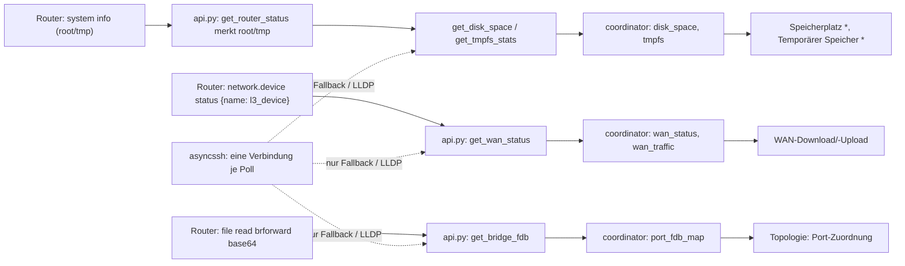

# Plan: SSH-Anmeldungen im Poll abstellen (N2) und Audit nach v1.38.2

<!-- Ablage: docs/plans/2026-10-28-ssh-polling-und-audit.md · wird im Branch fix/ssh-polling mit dem
     ersten PR committet. Keine IPs, MACs, Hostnamen echter Geräte, Passwörter oder Tokens;
     Router werden mit ihren SSH-Profilnamen (openwrt = Gateway, ap2, ap4 = Dumb-APs) genannt. -->

## Status

- **Stand:** 2026-10-28 (nachts) · **Phase:** freigegeben, in Umsetzung
- **Branch/PR:** **gemergt:** #37 (`5372d12`, v1.38.3), #38 A1 (`abf9e86`, v1.38.4), #39 A2 (`225ab22`, v1.38.5), #40 A11 (`85d93b4`, v1.38.6) am 2026-10-27, #41 A16 (`fadcca6`, v1.38.7) am 2026-10-28 — **offen:** A17 Hotfix `fix/fdb-port-map` · PR #42 (1.38.8) auf `main` (Worktree `../ha-openwrt-router-fdb-portmap`)
- **Erledigt:** B3 (Auswertung rpcd-Messung ACL v6, siehe Prüfprotokoll), Audit (a)–(c), Freigabe und E1, E3–E6 (2026-10-27), P1–P6 umgesetzt (1.38.3, Review ohne offene Befunde, PR #37), A1 umgesetzt (1.38.4, PR #38), A2 umgesetzt (1.38.5, PR #39), A11 umgesetzt (1.38.6, PR #40), A16 umgesetzt (1.38.7, PR #41, installiert, AK6 am Gateway erfüllt), Reviews A1, A2, A11 und A16 inkl. Fixes abgeschlossen, AK1–AK7 erfüllt, A17 umgesetzt (1.38.8, PR #42) · **Offen:** A17 Review und Merge-Freigabe, Hardware-Nachweis der Port-Zuordnung nach 1.38.8; A3–A10, A12–A14
- **Blocker:** –
- **Nächster Schritt:** Review zu PR #42 (A17) abschließen, CI, Merge-Freigabe durch den Nutzer, danach 1.38.8 installieren und die Port-Zuordnung in der Diagnose prüfen (`device_count` > 0 an den LAN-Ports des Gateways); dann A4 (WAN-Erkennung, E5) auf einem frischen Branch von `main`

## Problem und Zielverhalten

Seit v1.38.2 meldet sich Home Assistant bei jedem Poll mehrfach per Passwort über SSH an jedem
Router an, obwohl ubus funktioniert und ACL v7 aktiv ist. Gemessen am 2026-10-27 (lesend,
`logread`): Gateway `openwrt` 6 Anmeldungen je Minute (7 alle 10 Minuten, wenn LLDP dazukommt),
`ap2` und `ap4` je 5 je Minute, alle von derselben Quelle (dem HA-Host). Die dropbear-Zeilen
füllen den Log-Puffer der Router (APs: 150 von 622 Zeilen) und verdrängen das Router-Log, das
der Sensor „Router-Log“ liest. Nebenbefund: die Sensoren „Speicherplatz *“ und „Temporärer
Speicher *“ stehen auf allen Routern auf 0.0, weil der SSH-Pfad dafür ein Kommando benutzt, das
BusyBox nicht kennt.

Danach: Solange ubus funktioniert, öffnet ein normaler Poll keine SSH-Verbindung. WAN-Zähler,
Speicherplatz, tmpfs und Bridge-FDB kommen per ubus (alles mit der heutigen ACL v7 erlaubt, keine
ACL-Änderung). Daten, die es nur per SSH gibt (LLDP), werden wie heute höchstens alle 600 s
geholt. Fällt ubus aus, bleibt SSH der Fallback, dann aber mit einer Verbindung je Poll, die nach
dem Poll geschlossen wird. Die Speicher-Sensoren zeigen die echten Werte.

**Nicht-Ziele:** ~~ACL v8 (keine neuen ACL-Pfade nötig)~~ (aufgehoben durch E7, siehe A16), Host-Key-Prüfung für SSH (Produktentscheidung,
siehe E2, eigenes Paket später), Änderungen am Panel, neue Entities.

## Akzeptanzkriterien

- [x] AK1 Ein vollständiger Coordinator-Poll gegen eine `OpenWrtAPI` mit gemocktem ubus (alle Aufrufe
      erfolgreich, auch mit leeren, aber gültigen Antworten für FDB und ARP) ruft `asyncssh.connect`
      kein einziges Mal auf.
- [x] AK2 `get_wan_status` liefert `rx_bytes`/`tx_bytes` aus `network.device status` (Gerät =
      `l3_device` des WAN-Interfaces); schlägt das mit MethodNotFound fehl, aus `file read
      /sys/class/net/<dev>/statistics/*` (`data`-Feld richtig gelesen). SSH nur, wenn beide ubus-Wege
      nicht erlaubt sind.
- [x] AK3 `get_disk_space`/`get_tmpfs_stats` liefern die Werte aus `system info` (`root`/`tmp`, KiB)
      ohne zusätzlichen Aufruf; Sensoren zeigen z. B. am Gateway Overlay ≈ 3,3 MB gesamt statt 0.0.
      Fehlen die Felder (altes OpenWrt), läuft der SSH-Weg mit `df -Pk` (BusyBox-tauglich), höchstens
      alle 600 s, dazwischen aus dem Cache.
- [x] AK4 `get_bridge_fdb` liest `brforward` per `file read` mit `base64: true`; eine leere, aber
      gültige ubus-Antwort löst keinen SSH-Versuch aus; SSH nur, wenn der ubus-Zugriff gesperrt ist
      oder fehlschlägt (ACL, Methode, Timeout, kaputte Antwort). ARP analog.
- [x] AK5 Innerhalb eines Polls benutzen alle SSH-Kommandos dieselbe asyncssh-Verbindung
      (`connect` einmal je Poll); am Ende des Polls und beim Entladen wird sie geschlossen; eine
      serverseitig geschlossene Verbindung wird beim nächsten Kommando einmal neu aufgebaut.
- [x] AK6 Hardware nach Installation (lesend): je Router ≤ 1 dropbear-Anmeldung je 10 Minuten (LLDP
      am Gateway), keine im normalen Poll; das Router-Log zeigt wieder dnsmasq/hostapd-Zeilen statt
      dropbear; rpcd `VmRSS` über ≥ 1 h ohne Anstieg (Vergleich: B3-Werte unten).
      *Erfüllt 2026-10-28:* APs mit 1.38.3 (0 je Poll, Speicher flach über 65 min), Gateway mit
      1.38.7/ACL v8 (0 je Poll, nur die LLDP-Abfrage alle 10 min; Protokoll unten).
- [x] AK7 `checks.py --ruff-ci` grün, CI grün, unabhängiges Review ohne offene P0/P1.

## Befunde im Code (verifiziert 2026-10-27 an v1.38.2 und auf Hardware, lesend)

- `api.py:1596-1606` – `_call("file","read", …)` liefert `{"data": "…"}`; der Code prüft
  `isinstance(rx_result, str)` → immer `None` → `api.py:1611-1616` holt die Zähler per SSH
  (`cat /sys/class/net/<if>/statistics/…`) in **jedem Poll**. Die beiden ubus-Aufrufe laufen
  trotzdem (zwei vergebliche Calls je Poll). Hardware: `network.device status {"name": "wan"}`
  liefert `statistics.rx_bytes/tx_bytes` (Gateway, `l3_device` = `wan`, devtype `dsa`); ACL v6
  **und** v7 erlauben `network.device status` und `/sys/class/net/*` read (`git show
  v1.37.4:scripts/ha-openwrt-router.json`).
- `api.py:3454` und `api.py:3533` – Disk/tmpfs rufen `_call_file_read_shell` (`api.py:3612-3652`)
  auf, das **ohne ubus-Versuch** direkt SSH nimmt. Kommando `df -B 1048576`: BusyBox 1.37 auf
  allen drei Routern antwortet `df: unrecognized option: B` (rc 1) → leeres stdout →
  `_default_disk_space()`/`_default_tmpfs()` → Sensoren 0.0. Zwei nutzlose SSH-Anmeldungen je
  Poll. Hardware: `ubus call system info` liefert `root` und `tmp` mit `total/free/used/avail` in
  KiB (Gateway `root.total` 3328, `tmp.total` 119784 = `df -k /tmp`); `get_router_status`
  (`api.py:1337`) ruft `system info` ohnehin jeden Poll.
- `api.py:4016-4035` – brforward per `file read` **ohne** `base64: true`; die Antwort ist leer
  (Hardware: 43 Byte ohne, 1872 Byte mit `base64`), `_parse_brforward` liefert `{}` →
  `api.py:4038-4071` SSH-Fallback mit **zwei** Anmeldungen (Port-Map, brforward). rpcd bietet
  `read` mit `base64` an (`ubus -v list file`). Das ACL-Muster `/sys/class/net/*` deckt
  `/sys/class/net/br-lan/brforward` ab: rpcd `session.c` prüft mit `fnmatch(…, FNM_NOESCAPE)`
  ohne `FNM_PATHNAME`, `*` passt also über `/` hinweg (Quelle gelesen, Stand master).
- `api.py:2418-2443` – `_asyncssh_exec_once` öffnet **je Kommando** eine neue Verbindung
  (`asyncssh.connect`, `known_hosts=None`) und schließt sie danach. Es gibt keine Wiederverwendung.
  `async_close` (`api.py:949`) kennt keine SSH-Verbindung.
- `api.py:3866-3952` – LLDP: Cache 600 s (`LLDP_REFRESH_INTERVAL`), danach ein SSH-Kommando
  (`lldpcli`), nur wenn lldpd läuft (Gateway: ja). Das ist das „7 statt 6“ alle 10 Minuten und bleibt.
- `api.py:4096-4100` – ARP: `file read /proc/net/arp` funktioniert (Hardware: 4139 Byte, also am
  4-KiB-Limit von rpcd abgeschnitten, Einträge bleiben trotzdem übrig → kein SSH). Nebenbefund für
  Teil 2: große ARP-Tabellen werden abgeschnitten.
- Summe je Poll heute: WAN 1 + Disk 1 + tmpfs 1 + FDB 2 = 5 (APs, gemessen 4,9/min). Gateway 6:
  die sechste Anmeldung ist im Code noch nicht zugeordnet (**Annahme**, Kandidaten siehe
  Prüfprotokoll). AK1 (0 Verbindungen je Poll gegen den gemockten ubus) und die Hardware-Messung
  AK6 decken diesen Fall unabhängig davon ab.
- `coordinator.py:702-744` – Disk, tmpfs, FDB und ARP werden **jeden Poll** geholt (kein eigenes
  Intervall); `coordinator.py:1038` setzt im SSH-Fallback 300 s.

## Komponenten und Datenfluss

Betroffene Dateien: `api.py`, `coordinator.py` (Freigabe der SSH-Verbindung am Poll-Ende),
`const.py` (Intervall-Konstante), `tests/test_api.py`, `tests/test_api_port_parsers.py`,
`tests/test_ssh_transport.py`, `tests/test_coordinator.py`, neuer Test `tests/test_poll_no_ssh.py`,
`CHANGELOG.md`, `manifest.json`.

Poll-Kosten (je Router, 60 s): ubus-Aufrufe **sinken** um einen (WAN: 1 `network.device status`
statt 2 `file read`), Disk/tmpfs kosten 0 statt 2 SSH, FDB bleibt bei `list` + n×`port_no` + 1
`read` (heute schon so, nur der letzte Read ist leer), Antwort ~1,9 KB statt leer. SSH: 0 statt
5–6 je Poll. ACL-Änderung: **nein** (v7 bleibt; v6 reicht ebenfalls).

## Alternativen

| Option | Vorteile | Nachteile |
|---|---|---|
| A (Empfehlung) ubus-Quellen nutzen, die ACL v6/v7 schon erlauben; SSH nur noch Fallback mit einer Verbindung je Poll | kein rpcd-Neustart, weniger ubus-Calls als heute, Speicher-Sensoren werden repariert | `system info` liefert nur `/` und `/tmp` (keine weiteren Mounts; die Mount-Liste war bisher ohnehin leer) |
| B ACL v8 mit `file exec` für `df`/`lldpcli` | alles per ubus, auch LLDP | rpcd-Neustart auf jedem Router, `file exec` hatte Speicherlecks (PR #21), Produktentscheidung |
| C nur Intervalle verlängern (Disk/tmpfs/FDB alle 10 min per SSH) | kleinster Eingriff | behebt die 0.0-Werte nicht, weiterhin Passwort-Logins, Log weiter verrauscht |

**Empfehlung:** A. Sie braucht keine ACL-Änderung, senkt die Router-Last und erfüllt das Ziel
„keine SSH-Anmeldung im normalen Poll“ vollständig; LLDP bleibt der einzige, seltene SSH-Pfad.

## Risiken und Kompatibilität

- HA-Floor 2026.2.0: keine neuen HA-APIs. asyncssh ≥ 2.22 (Manifest) hat `is_closed()`.
- OpenWrt: `system info` mit `root`/`tmp` ab 21.02 (procd); ältere Router gehen den SSH-Weg mit
  `df -Pk` (POSIX-Format, funktioniert auf BusyBox und GNU). `network.device status` mit `name`
  gibt es seit netifd 19.07. `file read` mit `base64` seit rpcd 2016. Fehlt etwas, greift der
  bisherige Fallback.
- Semantik WAN-Zähler: bisher `/sys/class/net/<logischer Name>`, künftig das `l3_device`
  (bei PPPoE `pppoe-wan` statt des physischen Ports → Nutzdaten ohne PPPoE-Overhead). Kleine
  Verschiebung der Download/Upload-Werte, im CHANGELOG nennen. Der Interface-Name im
  `wan_status` bleibt der logische Name, `_compute_wan_traffic` behält also seine Basis.
- Speicher-Sensoren springen von 0.0 auf echte Werte (Langzeitstatistik), im CHANGELOG nennen.
- SSH-Fallback-Router (ubus gesperrt): statt n Verbindungen je Poll eine; dropbear hält sie für die
  Dauer des Polls (Sekunden). Kein Verhalten über den Poll hinaus.
- Mehrere Router: unverändert, jede API-Instanz hat ihre eigene Verbindung.
- `unique_id`/Registry: keine Änderung. Keine Config-Entry-Migration.

## Arbeitspakete (Teil 1, N2)

| ID | Rolle | Inhalt | Dateien | Hängt ab von | Aufwand | Definition of Done |
|---|---|---|---|---|---|---|
| P1 | OpenWrt | WAN-Zähler aus `network.device status {name: l3_device}`; Fallback `file read` mit `data`-Feld; SSH nur, wenn beide ubus-Wege gesperrt | `api.py`, `tests/test_api.py` | – | S | Tests: Zähler aus device status; aus file read; leere/kaputte Antwort → `None` ohne SSH; MethodNotFound beider Wege → SSH (vorher rot) |
| P2 | OpenWrt | `get_router_status` merkt sich `root`/`tmp`; Disk/tmpfs daraus ohne Aufruf; SSH-Weg `df -Pk` mit BusyBox-Parser und 600-s-Cache (`SSH_SLOW_REFRESH_INTERVAL`) | `api.py`, `const.py`, `tests/test_api.py` | – | S | Tests: Werte aus `system info` (KiB→MB, Prozent); ohne Felder SSH `df -Pk` genau einmal je 600 s; `df -B` kommt nirgends mehr vor |
| P3 | OpenWrt | brforward mit `base64: true`; SSH nur bei Ausnahme des ubus-Wegs, nicht bei leerer FDB; ARP ebenso | `api.py`, `tests/test_api_port_parsers.py` | – | S | Tests: Parameter `base64` gesetzt; leere gültige Antwort → `{}` ohne SSH; AuthError → SSH |
| P4 | OpenWrt | asyncssh-Verbindung je API-Instanz wiederverwenden (`_ssh_conn`, Lock, Neuaufbau bei geschlossener Verbindung), `async_release_ssh()` und Schließen in `async_close()`; Passwort weiter nur als `connect`-Argument | `api.py`, `tests/test_ssh_transport.py` | – | M | Tests: zwei Kommandos → ein `connect`; geschlossene Verbindung → ein Neuaufbau; `release`/`close` schließen; bestehende Transport-Verträge (Key-Retry, Timeout, Binärdaten, Detached) grün |
| P5 | HA | Coordinator gibt die SSH-Verbindung am Ende jedes Polls frei (`finally`), auch bei `UpdateFailed`; AK1-Test: kompletter Poll ohne `asyncssh.connect` | `coordinator.py`, `tests/test_coordinator.py`, `tests/test_poll_no_ssh.py` | P1–P4 | S | AK1-Test vorher rot (heute 5–6 Verbindungen), nachher grün; Release-Hook auch im Fehlerpfad |
| P6 | Doku/Release | CHANGELOG 1.38.3 (Fixed: SSH-Anmeldungen, Speicher-Sensoren 0.0, FDB per ubus; Changed: WAN-Zähler vom `l3_device`), Manifest, Plan-Status | `CHANGELOG.md`, `manifest.json`, dieser Plan | P1–P5 | S | Review ohne P0/P1, dann Freigabe für Merge und Release durch den Nutzer |

**PR-Schnitt:** ein PR `fix/ssh-polling` = P1–P6 → Release 1.38.3 (nach Freigabe). Die
Audit-Pakete (Teil 2) bekommen eigene Branches/PRs, gestapelt auf `origin/main` nach dem Merge.

## Teil 2: Audit nach v1.38.2

Drei unabhängige, nur lesende Agenten haben parallel geprüft (2026-10-27 abends, Stand
`7d77f0f`): (a) N1, N3–N5, Config-Flow/Reauth/Device-Tracker, (b) N6–N11, `lte`/`modem`-WAN,
Poll-Pfad, Recorder-Last, Sensorwerte, (c) Topologie über mehrere Router, Panel/API-View,
Diagnostics, blockierende Aufrufe, HA-Deprecations. PRs #33–#36 haben `config_flow.py` und
`device_tracker.py` nicht berührt; **keiner der Befunde N1, N3–N11 ist dadurch erledigt.**
Zeilen gelten für `7d77f0f`.

### Befunde (a) und (b)

**P1**

- **N1 Reauth-Schleife bei falschem Passwort** – verifiziert (Code + Wegwerf-Skript).
  `api.py:1136-1144` fängt den Login-Fehler in `test_connection()` („Continue anyway“),
  `api.py:1287-1296` macht aus dem verweigerten `system/board` Standardwerte; `config_flow.py:474-489`
  hält die Zugangsdaten damit für gültig, `__init__.py:274-276` wirft beim Reload
  `ConfigEntryAuthFailed` → neuer Reauth. Die Ersteinrichtung mit falschem Passwort wird ebenso
  angenommen (`config_flow.py:220-222` unerreichbar). `config_flow.py:650-660` schließt die
  temporäre API nicht (rpcd-Session je Versuch, TTL 600 s).
  Dazu **NEU-A1 (P2)**: `login()` macht jeden `OpenWrtResponseError` zu `OpenWrtAuthError`
  (`api.py:1019-1028`), also Reauth-Dialog bei HTTP 500, fehlendem rpcd, kaputtem JSON.
  **NEU-A3/A4 (P3)**: `OpenWrtRpcdSetupError` wird nie geworfen (`api.py:307`, Handler
  `config_flow.py:544, 582` tot); der `get_router_info`-Fallback greift nur unauthentifiziert.
- **N3 hostapd-Interface-Liste dauerhaft gecacht, auch leer** – verifiziert (Code + Skript).
  `api.py:2060-2062`, `api.py:2128-2129` („Cache the result (even if empty)“); einziger Reset in
  `async_close()`. Später aktiviertes WLAN (Gast-Schalter) liefert keine Clients, AP-Sensoren
  (`api.py:1757`) und Kanalplan bleiben unvollständig bis zum Reload.

**P2**

- **N4 Tracker-Verfügbarkeit hängt am Claim-Besitzer** – verifiziert. `device_tracker.py:134`
  erbt `CoordinatorEntity.available` (= `last_update_success` des Besitzers), `_find_client`
  (`173-195`) sucht aber auf allen Routern. Ein fehlgeschlagener Poll des Besitzers (AP-Neustart)
  macht auch Clients `unavailable`, die gerade an einem anderen AP hängen; `person` → `unknown`.
- **N5 keine Wiederherstellung aus der Entity-Registry** – verifiziert. `device_tracker.py:87-117`
  erzeugt Entities nur aus `coordinator.data.clients`; HA schreibt für registrierte, nicht
  angelegte Entities `unavailable`/`restored: true`. Nach HA-Neustart sind abwesende Clients
  `unavailable` statt `not_home` (vgl. Befund 13 des alten Plans). Vorbild: `fritz`, `asuswrt`.
  **NEU-A5 (P3)**: `name` fällt bei Abwesenheit auf die MAC zurück (`device_tracker.py:197-205`).
- **N6 Update-Funktion wirkungslos** – verifiziert. `coordinator.py:281-285` initialisiert
  `updates_available` nur; `button.py:248-251` verwirft das Ergebnis von `get_available_updates()`;
  `api.py:4228-4232` liest `/tmp/opkg_list`, das nichts schreibt; `api.py:4318-4333` ruft nur
  `opkg` (kein `apk`, OpenWrt 25.x) und meldet trotzdem „initiated“. → Entscheidung **E3**.
- **N7 Diagnostics unredigiert** – verifiziert. Redigiert sind nur Schlüssel mit Teilstring
  `password|token|ubus_rpc_session|secret|key|auth` (`const.py:217-224`, `diagnostics.py:138-148`)
  sowie `dhcp_leases`/`arp_table`/LLDP-IDs (`diagnostics.py:60-84`). Unredigiert: `config.host`,
  `config.username`, `router_info.hostname/mac`, `wan_status.ipv4`, `clients[]` (MAC, IP,
  Hostname, SSID, Signal …), `wifi_radios[].bssid/ssid`, `ap_interfaces[]`/`sta_interfaces[]`
  (BSSID/MAC), `network_interfaces[].ipv4_addr`, `ddns_status[].domain/ip`, Sticky-/Schwach-/
  Instabil-Listen. → Entscheidung **E4**.
- **WAN-Namen `lte`/`modem`/`umts`** – verifiziert. `const.py:114` kennt nur `wan`, `wan6`,
  `pppoe-wan`, `wwan`; `api.py:1560-1570` nimmt sonst „erstes Interface mit up“ (meist `lan`).
  Folgen: LTE-Gateway gilt als „ohne WAN“ (PR #36), Dumb-APs melden `wan_connected = True`
  (`api.py:1630`) und fragen DDNS in jedem Poll ab (`coordinator.py:645-652`). → Entscheidung **E5**.
  Hinweis für P1: Default-Route taugt nicht als Kriterium, Dumb-APs haben sie über `lan`.

**P3**

- **N8** Interface-Byte-/Raten-Sensoren immer 0: `network.interface dump` hat kein `statistics`
  (`api.py:3684-3685`), die Test-Fixture (`tests/conftest.py:132,140`) erfindet den Schlüssel.
  Quelle: `network.device status` (ein Aufruf, den `get_port_stats` heute schon macht).
- **N9** Recorder: volatile Attribute je Poll – `switch.py:194-202` (`clients[]`, `dhcp_expires`
  als Restzeit), `sensor.py:146-177` (`uptime_*`, `clients[].signal`), `sensor.py:1325-1333`
  und `binary_sensor.py:65-75` (`last_seen` je Poll), `device_tracker.py:258-271`.
  `_unrecorded_attributes` nur in `topology_entities.py:83`. Abhilfe: Klassenattribut je Entity.
- **N10** Poll-Versatz: `__init__.py:323-326` zählt den eigenen Eintrag mit → alle Einträge
  bekommen denselben Versatz `((N-1)·60)//N`; Poll 2 kann ein Schalter-Refresh sein, der dann
  bis 45 s wartet (`coordinator.py:546-551`, `switch.py:215`).
- **N11** 300-s-Fallback-Intervall: `coordinator.py:1021-1038` setzt es einmal (Latch), die
  Drosselung `1050-1064` überschreibt es mit 120/60 s; nach reparierter ACL bleiben 300 s bis
  zum Reload. Abhilfe: Intervall je Poll aus `uses_ssh_fallback` und `_throttled` ableiten.
- **NEU-B3** Ereignis „WAN verbunden“ liest `ipv4_address`/`address`, `get_wan_status` liefert
  `ipv4` (`coordinator.py:1629-1631`) → Detail immer leer.
- **NEU-B5** Coordinator-Catch-all fängt nur fünf Ausnahmetypen (`coordinator.py:995-998`);
  andere (OSError, IndexError …) umgehen `_record_failure` → Ausfallzähler/Fleet-Repairs stumm.
  Annahme (kein Auslöser nachgewiesen), Fix klein.
- **NEU-B6** Raten-Sensoren liefern 0.0 statt `unknown` bei Stale-Cache (`coordinator.py:719-721`,
  `889-903`); heute durch N8 verdeckt.
- **NEU-B7** `disk_free`/`tmpfs_free` ohne `state_class` (`sensor.py:373-378, 410-415`),
  Radio-Sensor „dBm“ ohne `SIGNAL_STRENGTH`; `CPU_HISTORY_MAX_POINTS` geht von 30 s aus.
- **NEU-A2** Auth-Backoff greift erst nach `_ensure_fresh_token()` (`api.py:4573` vs. `4581-4588`):
  ein Login-Versuch je Poll trotz Backoff.
- **ARP am 4-KiB-Limit** (eigener Befund, Hardware): `file read /proc/net/arp` liefert 4139 Byte;
  rpcd liest Dateien ohne Größe mit einem 4-KiB-Read. Große Tabellen verlieren Einträge
  (`luci-rpc getHostHints` ist in ACL v7 erlaubt und wäre die vollständige Quelle).

**Vorschläge (nicht eingeplant, nur mit Entscheidung):** Uptime-Sensor als `TIMESTAMP`
(Boot-Zeitpunkt) statt sekundengenauem String (`sensor.py:143, 1244-1275`; stabiler Zustand,
keine Recorder-Zeile je Poll, ändert aber die Darstellung). `device_tracker.py:293-308`
überschreibt `ScannerEntity.device_info`, das im Core `@final` ist (funktioniert, bruchgefährdet).

### Befunde (c) Topologie, Panel, Diagnostics, Deprecations

Methode: Code-Lektüre plus zwei Wegwerf-Skripte gegen `topology_mesh` mit synthetischen Daten
(keine echten Adressen); `tsc --noEmit` im Frontend: 0 Fehler. Blockierende Aufrufe im
Event-Loop: keine gefunden. HA-Deprecations: keine offenen (die `async_get_device`-Rückfälle
stehen hinter `getattr`). Panel-Refcount und Frontend-Timer sauber.

**P1**

- **C1 LLDP-Kette wird von DHCP-Heuristik und Switch-Inferenz zerstört** – verifiziert (Skript).
  `topology_mesh.py:567-569` sperrt Heuristik-Kanten nur für dasselbe Router-Paar (`:479-480`),
  nicht für Router, die schon einen LLDP-Uplink von einem anderen Router haben;
  `topology_mesh.py:906-911, 951-958` gruppiert auch LLDP-`router_uplink`-Kanten nach
  `gateway_port`. Kette GW → AP2 → AP4 mit Gateway-DHCP-Lease für AP4 und FDB beider APs auf
  `lan3`: zusätzlich `lan_uplink GW→AP4 (dhcp_ip)`, dann `switch:GW:lan3` ersetzt beide
  Uplinks, die LLDP-Kante GW→AP2 verschwindet, AP4 hängt im Panel am Switch (`api.ts:685`: letzte
  Kante gewinnt). Das ist der „bekannte strukturelle Kandidat“ aus dem Skill, jetzt belegt.

**P2**

- **C2 Gateway-Rolle hängt an `wan.connected`** – verifiziert (Skript). `topology_mesh.py:74-76`
  macht aus einem Gateway mit WAN-Ausfall einen „AP“; `:547-551, :768` finden dann kein Gateway →
  0 Kanten, keine WAN-/Ping-/DDNS-Anreicherung (`:1377-1399`); Frontend nimmt `routerNodes[0]`
  (`api.ts:586`). Genau während einer Störung zeigt das Panel eine falsche Topologie.
- **C3 Veraltete Daten eines offline Routers gewinnen beim Client-Dedupe** – verifiziert (Skript).
  `topology_mesh.py:1221` schreibt `last_update_success` nur in `node_status`; `:849-870`
  kennt keine Liveness → Client mit altem, besserem Signal wird dem offline AP zugeordnet.
- **C4 Diagnostics** – deckt sich mit N7 (zusätzlich `features.ssids`, `dhcp_pools`,
  `entry_title`); kein P0, keine Passwörter/Tokens/Keys im Export.
- **C5 Snapshot-Endpoint und Panel für alle HA-Benutzer, unredigiert** – verifiziert.
  `topology_panel.py:72` `requires_auth = True` ohne `requires_admin`, `:160` `require_admin=False`.
  Der Snapshot enthält Leases, ARP, FDB je Port, WAN-IP, DDNS, `web_url`s, also alles, was
  Diagnostics bewusst entfernt, auch für Kiosk-/Familienkonten. → Entscheidung **E6**.
- **C6 Topologie-Sensoren bauen den Snapshot je Attributzugriff neu und schreiben ihn als
  Attribut** – verifiziert. `topology_entities.py:112-117` (Docstring „cached per call“ ist
  falsch, 4 Builds je Poll und Router), `:168-178` legt `topology_snapshot` plus `interfaces`,
  `clients`, `generated_at` in die Attribute; `generated_at` ändert sich je Poll → immer
  State-Write und Websocket-Push (~80 KB je Router und Poll bei 60 Clients). CPU unkritisch
  (2,7 ms für 4 Router), `_unrecorded_attributes` schützt nur den Recorder.

**P3**

- **C7** Hostname-Kollision (drei Router „OpenWrt“) bricht das LLDP-Matching
  (`topology_mesh.py:228, 253-256`: `chassis_name` vor MAC) → nur `subnet_fallback`.
- **C8** Build-Fehler werden als leere Topologie mit HTTP 200 maskiert (`topology_panel.py:91-94`);
  Frontend zeigt „No routers online“ und `useAlerts.ts:29` meldet daraus „WAN offline“ (kritisch).
- **C9** `request.app["hass"]` (`topology_panel.py:76`) ist in HA 2026.2 nur noch
  Kompatibilitäts-Alias → `KEY_HASS` aus `homeassistant.helpers.http`.
- **C10** Panel-Setup nach `async_forward_entry_setups` (`__init__.py:367-375`): ein Fehler dort
  lässt den Eintrag mit geladenen Plattformen in SETUP_ERROR. Annahme, Fix klein (try/except).
- **C11** Frontend nach 401: `main.tsx:65-73` setzt `_sessionExpired` bei jedem `hass`-Setter
  zurück → Request-Schleife; `:95` erkennt 401 im `callApi`-Fallback nicht; transienter Fehler
  (`:113`) ersetzt die letzte gute Ansicht. Annahme (nicht im Browser reproduziert).
- **C12** LLDP: zweite Beobachtung desselben Paars überschreibt die erste (`topology_mesh.py:363`,
  LAG/Redundanz), `next(iter(set))` (`:431`) nichtdeterministisch, nur das erste Gateway wird
  angereichert (`:1399`).
- **C13** Toter Code: `components/MobileView.tsx` nicht importiert, `config={"apiBase": …}`
  (`topology_panel.py:161`) wird nicht gelesen, `_PANEL_VERSION` (`:42`) manuell zu pflegen.
- **C14** = NEU-B3 (WAN-Ereignis ohne IP).

### Arbeitspakete (Teil 2)

Jedes Paket ein eigener Branch von `origin/main` (A4 gestapelt auf `fix/ssh-polling`, weil
dieselbe Funktion), jeder Merge mit Version ein Release. P1/P2 zuerst mit fehlschlagendem Test.

| ID | Prio | Inhalt | Dateien | Entscheidung | Aufwand |
|---|---|---|---|---|---|
| A1 | P1 | N1 + NEU-A1/A3/A4: Login-Fehler durchlassen, `get_router_info` nur bei MethodNotFound auf Defaults, `login()` wirft ResponseError nicht als AuthError, `_validate_input` mit `async_close()`, Flow-Tests patchen `_raw_call` statt `_validate_input` | `api.py`, `config_flow.py`, `__init__.py`, `tests/test_api.py`, `tests/test_config_flow.py`, `tests/test_init.py` | – | M |
| A2 | P1 | N3: leere hostapd-Liste nicht cachen; Re-Discovery, wenn ein `ifname` aus `radios` fehlt oder alle `BOARD_REFRESH_CYCLES`; Reset nach `set_wifi_state`/`reload_wifi` | `api.py`, `tests/test_api.py` | – | S |
| A3 | P2 | N4 + N5 + NEU-A5: `available` über alle geladenen Coordinator; Tracker aus Registry anlegen (MAC aus `unique_id`, auch Legacy-Form); letzten Hostnamen behalten. **Risikoauslöser** (Claim-Register) → Review Pflicht | `device_tracker.py`, `tests/test_device_tracker.py` | – | M |
| A4 | P2 | WAN-Erkennung: Namen (`lte`, `modem`, `umts`, `3g`, `4g`, `5g`, `wwan*`) und `proto` (`pppoe`, `qmi`, `mbim`, `ncm`, `modemmanager`, `3g`), kein „erstes up-Interface“ mehr, `wan_found`-Signal für `router_has_wan` | `api.py`, `const.py`, `sensor.py`, Tests | E5 | S |
| A5 | P2 | N7: Redaktion nach HA-Konvention (`async_redact_data`, exakte Schlüssel), Client-Listen auf Zähler | `diagnostics.py`, `const.py`, `tests/test_diagnostics.py` | E4 | S |
| A6 | P2 | N6: Prüfen-Button füllt `updates_available` (opkg und apk), Installieren je E3 | `button.py`, `coordinator.py`, `api.py`, Tests | E3 | M |
| A7 | P3 | N10 + N11 + NEU-B5: Versatz-Index, Intervall je Poll ableiten, Catch-all → `UpdateFailed` | `__init__.py`, `coordinator.py`, Tests | – | S |
| A8 | P3 | N9: `_unrecorded_attributes` je Entity-Klasse | `switch.py`, `sensor.py`, `binary_sensor.py`, `device_tracker.py`, Tests | – | S |
| A9 | P3 | N8 + NEU-B3/B6/B7: Interface-Statistik aus `network.device status`, Stale → `unknown`, `state_class`, Ereignis-Schlüssel `ipv4` | `api.py`, `coordinator.py`, `sensor.py`, `tests/conftest.py` | – | S |
| A10 | P3 | NEU-A2 Backoff-Reihenfolge; ARP-Ergänzung über `luci-rpc getHostHints` | `api.py`, Tests | – | S |
| A11 | P1 | C1: LLDP-Uplinks sperren Heuristik-Kanten für den Ziel-Router (nicht nur das Paar); Switch-Inferenz lässt APs aus, die Ziel eines `router_uplink` von einem Nicht-Gateway sind. **Risikoauslöser** (Kantenpriorität) → Review Pflicht | `topology_mesh.py`, `tests/test_topology_lldp.py`, `tests/test_topology_mesh.py` | – | M |
| A12 | P2 | C2 + C3 + C7 + C12: Gateway-Rolle = WAN konfiguriert (`proto`) oder DHCP-Server aktiv, `wan_connected` nur Status; Clients/Kanten offline Router als `stale` und im Dedupe nachrangig; Hostnamen nur indexieren, wenn fleetweit eindeutig, `chassis_id` vor `chassis_name`; LLDP-Doppelbeobachtung als Konflikt. **Risikoauslöser** | `topology_mesh.py`, `topology_diagnostic.py`, Tests | – | M |
| A13 | P2 | C5 + C8 + C9 + C10 + C11 (+C13): Panel/Snapshot nur für Admins (je E6, mit Option), Build-Fehler als 500 mit `meta.error` statt leerer Topologie, kein „WAN offline“-Alarm bei 0 Routern, `KEY_HASS`, Panel-Setup abgesichert, 401-Schleife im Frontend; Bundle neu bauen (`--frontend`) | `topology_panel.py`, `__init__.py`, `frontend/topology/src/*`, `frontend/dist/*`, Tests | E6 | M |
| A14 | P2 | C6: Snapshot je Coordinator-Update einmal bauen und cachen, `generated_at` und Rohlisten aus den Entity-Attributen nehmen (Rohdaten nur über die API) | `topology_entities.py`, Tests | – | S |
| A16 | P1 | E7: ACL v8 mit aufgelösten Symlink-Pfaden (rpcd ≥ 2026 `realpath`-Prüfung); Tests mit `fnmatch` gegen echte Zielpfade und Negativliste; `scripts/ha-openwrt-router.json` regeneriert. **Risikoauslöser ACL** → Review Pflicht | `acl_provisioning.py`, `scripts/ha-openwrt-router.json`, `tests/test_acl_provisioning.py` | E7 | S |
| A17 | P1 | Hotfix (Befund AK6 nach 1.38.7): Port-Zuordnung seit 1.38.3 leer, weil die Portnummern-Karte aus `file list /sys/class/net` nur `directory`-Einträge nahm, die bei rpcd die Linkziele (`../../devices/…/net/lan1`) heißen; jetzt einfache Namen unabhängig vom Typ, Karte 600 s gecacht (`BRIDGE_PORT_MAP_REFRESH_INTERVAL`), Neuaufbau bei unbekannter Portnummer und nach ACL-Reset, gemerkte Unbekannte ohne Dauer-Neuaufbau. Weniger ubus-Aufrufe je Poll. Review Pflicht (Poll-Pfad) | `api.py`, `const.py`, `tests/test_bridge_port_map.py` | – | S |

Reihenfolge nach dem N2-Release: A1 → A2 → A11 → A4 → A5 → A13 → A3 → A12 → A14 → A6 → A7–A10
(klein, nur wenn risikolos). A4 ist auf `fix/ssh-polling` gestapelt, alle anderen auf `origin/main`.

## Validierungsplan

- **Lokal:** `python ~/.claude/skills/project/scripts/checks.py --repo ../ha-openwrt-router-ssh-polling --ruff-ci`
  (ruff 0.17.3 nur auf `custom_components/`; `tests/` nie mit ruff formatieren); neue Tests je AK
  (siehe Pakete), vor dem Fix rot.
- **CI:** tests (Py 3.13/3.14), hassfest, hacs nach PR-Erstellung.
- **Hardware (lesend, erst wenn 1.38.3 in HA läuft, Installation/Neustart nur nach OK des Nutzers):**
  `logread | grep -c 'Password auth succeeded'` und Anmeldungen je Minute auf `openwrt`, `ap2`,
  `ap4` (Soll: 0 je Poll, ≤ 1 je 10 min am Gateway); Sensoren „Speicherplatz“/„Temporärer
  Speicher“ gegen `ubus call system info`; Topologie-Portzuordnung unverändert; rpcd
  `VmRSS`/`VmHWM` alle 5 min über ≥ 1 h (lesend per SSH aus `/proc/$(pidof rpcd)/status`, wie bei
  B3; `scripts/_dev_rss_sample.sh` misst nur den HA-Prozess), Vergleich mit B3.
- **Review:** unabhängig (frischer Agent mit Diff und AK1–AK5), keine offenen P0/P1.

## Entscheidungen

- 2026-10-27 – **Plan freigegeben** (Teil 1 sofort, Teil 2 in der Reihenfolge A1 → A2 → A11 → A4
  → A5 → A13 → A3 → A12 → A14 → A6 → A7–A10) – Nutzer.
- 2026-10-27 – **E1:** Option A ohne ACL-Änderung – kein rpcd-Neustart, weniger Last, Ziel
  vollständig erreicht – Nutzer.
- 2026-10-27 – **E3 entschieden:** „Updates prüfen“ reparieren (opkg und apk), „Updates
  installieren“ nicht mehr anlegen – Nutzer.
- 2026-10-27 – **E4 und E6 entschieden:** Diagnostics nach HA-Konvention redigieren; Panel und
  Snapshot nur für Admins mit Option „für alle Benutzer“ (Standard aus) – Nutzer.
- 2026-10-27 – **E5 entschieden:** WAN-Erkennung über erweiterte Namen und `proto`, kein
  „erstes up-Interface“ mehr – Nutzer.
- 2026-10-27 – **E7 entschieden:** ACL v8 ergänzt die aufgelösten Symlink-Pfade (`/proc/*/net/arp`,
  `/proc/*/net/nf_conntrack`, `/sys/devices/*/net/*`, `/tmp/run/ddns`), nur lesend, kein exec; rpcd ab
  2026 prüft Datei-ACLs zusätzlich gegen `realpath()`; beim nächsten HA-Start deployt die Integration v8
  und rpcd startet einmal je Router neu – Nutzer. Ebenso freigegeben: Merges #38 → #39 → #40 trotz
  des verbleibenden Gateway-Logins (kommt mit v8).
- 2026-10-27 – **E2 (offen, Produktentscheidung):** SSH-Host-Key-Prüfung (`known_hosts=None`).
  Vorschlag: Trust-on-first-use – Fingerabdruck beim ersten SSH-Kontakt im Config-Entry speichern,
  bei Abweichung Repair-Issue statt stiller Verbindung. Braucht Config-Entry-Daten und eine
  Reauth-ähnliche Bestätigung → eigenes Paket (A15, nach A1), nicht in 1.38.3. Vorschlag gilt,
  solange kein Einspruch kommt.
- 2026-10-27 – **E3 (offen, Abfrage):** Update-Funktion (N6). Vorschlag: „Updates prüfen“
  reparieren (opkg und apk, Ergebnis in `updates_available`), den Button „Updates installieren“
  nicht mehr anlegen – OpenWrt rät selbst von pauschalem `opkg upgrade` ab (Flash/Abhängigkeiten),
  die Integration sollte das nicht blind auslösen. Bestehender Registry-Eintrag bleibt, bis der
  Nutzer ihn löscht (kein Registry-Eingriff).
- 2026-10-27 – **E4 (offen, Abfrage):** Diagnostics (N7/C4). Vorschlag: HA-Konvention
  `async_redact_data` mit exakter Schlüsselmenge (`host`, `username`, `mac`, `bssid`, `ip`,
  `ipv4`, `ipv4_addr`, `hostname`, `ssid`, `domain`, `web_url`, `address`), Client-Listen auf Zähler
  und Signal-Aggregate; der bisherige Teilstring-Pass bleibt als zweiter Durchgang.
- 2026-10-27 – **E5 (offen, Abfrage):** WAN-Erkennung. Vorschlag: Namensliste um `lte`, `modem`,
  `umts`, `3g`, `4g`, `5g`, `wwan*` erweitern, zusätzlich `proto` in `pppoe`, `qmi`, `mbim`, `ncm`,
  `modemmanager`, `3g`; kein „erstes up-Interface“ mehr (Dumb-APs melden dann „kein WAN“,
  `wan_connected` False, keine DDNS-Abfrage mehr auf APs). Default-Route ungeeignet (APs haben sie
  über `lan`).
- 2026-10-27 – **E6 (offen, Abfrage):** Panel und Snapshot-Endpoint (C5). Vorschlag: nur für
  Administratoren (`requires_admin`, `require_admin=True`), dazu eine Option „Panel für alle
  Benutzer“ im Konfigurieren-Dialog (Standard aus) für Haushalte, die es brauchen.

## Prüfprotokoll

- 2026-10-27 v1.38.2 (vorher, lesend): `openwrt` 6 Anmeldungen/min (18:28–18:34 konstant 6, einmal 7),
  Cluster innerhalb von 1–2 s je Poll, eine Quelle; `ap2` 84 Anmeldungen 18:11–18:29 (4,9/min);
  `ap4` 150 Anmeldungen 17:58–18:29 (4,9/min), eine Quelle. `df -B 1048576` → rc 1 auf allen drei.
  rpcd `VmRSS`: `openwrt` 2492 kB (HWM 2992), `ap2` 2968 kB, `ap4` 2984 kB. Sechste Anmeldung am
  Gateway: ARP ausgeschlossen (ubus-Antwort nicht leer), Kandidaten noch offen; wird mit AK6 geklärt.
- 2026-10-27 **B3** rpcd-Speicher mit ACL v6 (CSV 08:42–17:07, 316 gültige Zeilen, 5-min-Raster):
  alle drei rpcd am 13:55 neu gestartet (ACL-v6-Deploy), danach 3,2 h gemessen:
  `openwrt` 2376→2440 kB (max 3020, Trend −64 kB/h, zweite Hälfte −17 kB/h, 4–18 Sessions),
  `ap2` 2884→3028 kB (Trend +13 kB/h, zweite Hälfte −0,3 kB/h), `ap4` 2796→2944 kB (Trend +18 kB/h,
  zweite Hälfte +1,5 kB/h). **Ergebnis: kein Leck mit ACL v6.** Vorher (alte rpcd-Prozesse vom
  10-10 bzw. 07:44): flach, Ausnahme `ap4` 08:42–09:02 von 3316 auf 7132 kB, dann Neustart 09:07
  (Prozess vom 10-10, Ursache nicht geklärt; danach unauffällig). Die ACL-v7-Messung folgt nach
  Installation von 1.38.3 (AK6).
- 2026-10-27 `fix/ssh-polling@dcd6476` – lokal: ruff 0.17.3 check/format sauber, 1325 Tests grün
  (28 neue, 22 davon vor dem Fix rot: WAN-Zähler, Disk/tmpfs, FDB/ARP, Verbindungs-Wiederverwendung,
  Coordinator-Hook, AK1-Poll ohne `asyncssh.connect`) · CI: noch nicht gelaufen (kein PR) ·
  Hardware: nicht geprüft – Lücke: AK6 erst nach Installation (Befehle siehe Validierungsplan)
  · Review: unabhängig, siehe nächster Eintrag.
- 2026-10-27 Review `dcd6476` (unabhängig, frischer Agent mit Diff und AK1–AK5): keine P0/P1.
  P2-1: Freigabe der geteilten Verbindung unter einem laufenden Kommando (Schalter/Button/ACL-Deploy
  parallel zum Poll-Ende) hätte das Kommando abgerissen und als rc 0 gewertet → behoben
  (In-Flight-Zähler, aufgeschobene Freigabe, Kanal ohne Exit-Status = Fehler). P2-2: bei
  PPPoE/LTE-Reconnect fehlt `l3_device`, der physische Port hätte unter demselben Interface-Key
  einen Phantom-Peak erzeugt → keine Zähler, solange das Interface nicht aktiv ist. P3: Transportfehler
  im 600-s-Cache nicht mehr gecacht, Key-Auth-Gate angeglichen, AK4-Wortlaut, CHANGELOG-Datum und
  -Formulierungen, Docstring-Verweise, Testkosmetik, fünf zusätzliche Transport-Tests und AK1 auch
  mit leeren FDB/ARP-Tabellen. Danach lokal 1335 Tests grün (38 neue), ruff 0.17.3 sauber;
  `70a924a` gepusht, PR #37 offen (CI läuft).
- 2026-10-27 A1 `fix/auth-errors@93ea7f2` (gestapelt auf #37) – lokal: ruff 0.17.3 sauber, 1346 Tests
  grün (11 neue/geänderte vorher rot: `test_connection` mit ubus-Status 6 und HTTP 500,
  `get_router_info` nur bei MethodNotFound Defaults, Flow end-to-end mit echter API, `_validate_input`
  schließt, Setup mit ResponseError → NotReady, Reauth-Routing für `OpenWrtRpcdSetupError`; zwei
  Alt-Tests auf das neue Verhalten umgestellt) · CI: PR #38 · Hardware: nicht geprüft – Lücke:
  Reauth mit falschem Passwort im echten HA (Dialog bleibt offen, richtiges Passwort lädt den
  Eintrag), `ubus call session list` ohne zusätzliche Session nach einer Prüfung · Review:
  unabhängig, läuft.
- 2026-10-27 A2 `fix/hostapd-iface-cache@c05418c` (gestapelt auf #38) – lokal: ruff 0.17.3 sauber,
  1353 Tests grün (7 neue, 4 vorher rot: leere Liste nach Ablauf neu ermittelt, neues Radio-Interface
  löst Neuermittlung aus, `set_wifi_state`/`reload_wifi` verwerfen den Cache) · CI: PR #39 ·
  Hardware: nicht geprüft – Lücke: Gast-WLAN per Schalter aus/ein, Clients und AP-Sensor des
  Gast-Interfaces erscheinen ohne Neuladen · Review: unabhängig, siehe unten.
- 2026-10-27 Review A1 (unabhängig): keine P0. P1: Re-Login nach ACL-Deploy fing `OpenWrtResponseError`
  nicht (Setup-Fehler statt Wiederholung) → behoben; P2: `reauth_confirm`/`reauth_cannot_connect`
  zeigten bei Antwortfehler „unbekannt“ → „Keine Verbindung“ bzw. rpcd-Hilfe; P3: `system/board`-Hinweis
  nur noch einmal je Instanz (`a48eee7`, 4 neue Tests vorher rot, 1350 grün). Offen (P3):
  `OpenWrtRpcdSetupError` wird nirgends geworfen (toter Zweig), ggf. in A10 entfernen oder nutzen.
- 2026-10-27 Review A2 (unabhängig) – **offen, noch nicht behoben:** P1 der Auslöser „neues
  Radio-Interface“ greift auf den ubus-Pfaden nie, weil `_parse_wireless_status` hart `Master` und
  `_parse_iwinfo_info` iwinfo-Vokabular liefert, der Filter aber `ap` erwartet; Abhilfe: bekannte
  Nicht-AP-Modi ausschließen (`sta`, `client`, `mesh`, `mesh point`, `adhoc`, `monitor`), in
  `_parse_wireless_status` `config.mode` übernehmen, und auf *neue* ifnames seit der letzten
  Ermittlung triggern (`_hostapd_radio_ifnames_seen`), sonst Probing je Poll. P2: SSH-WLAN-Pfad setzt
  `RADIO_KEY_IFNAME` auf den Sektionsnamen ohne `RADIO_KEY_IFNAME_IS_SECTION`; „leere Neuermittlung
  behält Liste“ greift auch bei legitim leerem Ergebnis (alle SSIDs aus) → nur bei Fehler behalten.
  P3: Tests für `uci/apply`- und SSH-Pfad der Invalidierung, `reset_acl_blocked()` soll den Cache
  verwerfen. Neuer Befund (vorbestehend): `_hostapd_acl_blocked` ist tot, weil `_call` bei
  ACL-Sperre „rpcd ACL blocks …“ wirft und der Code auf „access denied“ prüft (`api.py` ~2291).
- 2026-10-27 A11 `fix/topology-lldp-chain@124a552` (gestapelt auf #39, PR #40) – lokal: ruff 0.17.3
  sauber, 1358 Tests grün (5 neue, 4 vorher rot) · CI: PR #40 · Hardware: nicht geprüft – Lücke:
  Panel zeigt die reale Verkabelung, Snapshot hat je verkettetem AP genau eine LLDP-Uplink-Kante ·
  Review: **noch nicht gestartet** (Risikoauslöser Kantenpriorität, Pflicht vor Merge).
- 2026-10-27 Stapel nachgezogen: `fix/auth-errors@a48eee7` → `fix/hostapd-iface-cache` (`0d01014`,
  Konflikt in `tests/test_api.py` beide Seiten behalten; ein verbliebener Trenner `=======` in
  `bd956ac` entfernt, danach 1357 grün) → `fix/topology-lldp-chain` (`679a1df`, 1362 grün).
- 2026-10-27 CI PR #37 rot (`test (3.13)/(3.14)`): der Test zum abgelaufenen df-Cache setzte den
  Zeitstempel auf 0.0; auf einem frisch gestarteten Runner liegt `time.monotonic()` unter 600 s, der
  Eintrag galt als frisch → Test relativ zu `monotonic()` (`cc5b378`), durch den Stapel gemergt.
  Zusätzlich der vorbestehende WAN-Raten-Test mit 1 % Toleranz (echte Wanduhr als Divisor, einmal
  lokal 799 statt 800), ebenfalls auf `fix/ssh-polling` und durch den Stapel gemergt.
- 2026-10-27 A2-Review-Fixes `fix/hostapd-iface-cache@04f34fb`: P1 Modus-Vokabular (Nicht-AP-Modi
  ausschließen, `config.mode` aus netifd durchreichen, Auslöser auf neu gemeldete ifnames), P2
  Sektionsflag im SSH-WLAN-Pfad und „Liste behalten“ nur bei fehlgeschlagener Neuermittlung, P3
  Tests für `uci/apply`- und SSH-Pfad, `reset_acl_blocked` verwirft den Cache; 8 neue Tests, 3
  bestehende auf Parser-echte Radio-Formen umgestellt; lokal 1365 grün; nach `fix/topology-lldp-chain`
  gemergt. Offen (vorbestehend, A10): `_hostapd_acl_blocked` erkennt die ACL-Sperre nicht
  („access denied“ vs. „rpcd ACL blocks“).
- 2026-10-27 Review A11 (unabhängig): keine P0. P1: ohne Gateway-LLDP entschied die ID-Sortierung
  über die Kantenrichtung und damit, welcher AP seine Gateway-Kante verlor → WAN-Port auf genau
  einer Seite als Richtungshinweis, Unterdrückung nur bei belegter Richtung. P2: Port mit
  LLDP- und Heuristik-AP → kein Phantom-Switch; zweite Strecke ohne `gateway_port`; `chained_aps`
  gegen alle Gateways. P3: Docstrings, Testkosmetik, CHANGELOG-Einschränkungen. 5 neue Tests
  (vorher rot), lokal 1375 grün; PR #40 aktualisiert. Nicht geändert (vorbestehend): Doppel-
  beobachtung desselben Paars (LAG) kollabiert auf eine Kante.
- 2026-10-27 PR #37 gemergt (`5372d12`) nach Freigabe des Nutzers, CI grün (tests 3.13/3.14, hassfest,
  hacs); Release-Workflow erfolgreich, **v1.38.3** veröffentlicht (20:05, Release-Text aus dem
  CHANGELOG); HACS per `update_information` aufgefrischt; PR #38 auf `main` umgehängt (mergebar).
- 2026-10-27 **AK6 (Teil 1)** nach Installation 1.38.3 und HA-Neustart 21:07: alle drei Einträge geladen,
  HA-Log nur die Root-Warnung je Router; tmpfs-Sensoren 117,0 MB gesamt / 0,4–0,6 MB belegt auf allen
  Routern, Speicherplatz-Auslastung 20,8 % (`ap4`) und 21,5 % (`ap2`); „Speicherplatz gesamt/belegt/frei“
  bleiben 0,0, weil die Sensoren in GB rechnen und das Overlay 3,5 MB groß ist (P3 → A9: Einheit MB).
  dropbear-Anmeldungen: `ap2` und `ap4` je 1 um 21:09 (LLDP-Erstprüfung), danach **0 je Poll**
  (vorher 5/min); `openwrt` **1 je Poll** (vorher 6/min). Debug-Log (zwei Polls, danach zurück auf
  WARNING): FDB und ARP am Gateway per SSH, weil rpcd `file read` auf `/proc/net/arp` und `brforward`
  für die HA-Session ablehnt („rpcd ACL blocks … cached this session“). Lesend bestätigt: mit der
  HA-Session sind `/proc/net/arp`, `brforward`, `statistics/rx_bytes`, `nf_conntrack`, `brport/port_no`
  verweigert, `/proc/cpuinfo`, `nf_conntrack_count`, `/etc/openwrt_release` erlaubt; die Session-ACL
  enthält die Pfade. Ursache: Gateway rpcd 2026.10.04 prüft gegen `realpath()` (rpcd `file.c`), die APs
  mit rpcd 2025.12.03 nicht. → E7/A16 (ACL v8). rpcd-RSS-Messung läuft seit 21:08 (Auswertung folgt).
- 2026-10-27 Merges nach Freigabe (jeweils nach grüner CI, ausgelöst per leerem Commit nach dem
  Umhängen auf `main`): #38 `abf9e86` → v1.38.4 (20:51 UTC), #39 `225ab22` → v1.38.5 (20:54 UTC),
  #40 `85d93b4` → v1.38.6 (20:56 UTC); Release-Workflow jeweils erfolgreich, HACS aufgefrischt.
  PR #41 (ACL v8) auf `main` umgehängt.
- 2026-10-27 Review A16/PR #41 (unabhängig): keine P0/P1; AK-A16.1–3 verifiziert (alle ubus-Dateipfade
  samt `realpath`-Ziel abgedeckt, keine neuen write/exec, Redeploy über Dict-Vergleich). P2: CHANGELOG
  nannte „beides“ für drei Dinge und ließ WAN-Zähler-Fallback, Portnummern und DDNS-Status aus →
  korrigiert. P3: `import fnmatch` nach oben, Negativliste um das `phy80211`-Symlink-Ziel ergänzt und
  `/tmp/dhcp.leases` entfernt (vorbestehende, bewusst nicht gewährte Datei, luci-rpc-Fallback),
  Migrationstest v7-Datei → Redeploy mit rpcd-Neustart, Versionsangabe präzisiert (2026.10.04
  bestätigt), Nicht-Ziel „ACL v8“ im Plan aufgehoben. Offen (P3, vorbestehend): `list` auf
  `/var/run/ddns` wird nirgends genutzt.
- 2026-10-27 **AK6 (Teil 2) rpcd-Speicher mit 1.38.3 / ACL v7**, 14 Proben 21:08–22:13 (alle 5 min,
  lesend aus `/proc/<pid>/status`), kein rpcd-Neustart: `openwrt` 2484→2496 kB (max 2968 kB während
  des HA-Neustarts mit bis zu 17 Sessions, danach 4), HWM 2992 unverändert, zweite Hälfte +22 kB/h;
  `ap2` 2968→2988 kB (zweite Hälfte +9 kB/h); `ap4` 3000→3032 kB (zweite Hälfte +22 kB/h).
  **Kein Leck**, Werte wie bei B3. AK6 für die APs erfüllt (0 SSH-Anmeldungen je Poll); Gateway offen
  bis ACL v8 (PR #41) installiert ist.
- 2026-10-28 PR #41 gemergt (`fadcca6`, 00:36 UTC) nach Freigabe des Nutzers, CI grün (hacs, hassfest,
  test 3.13/3.14, Review ohne offene P0/P1); Release-Workflow erfolgreich, **v1.38.7** veröffentlicht
  (00:37 UTC); HACS per `update_information` aufgefrischt (HA lief zu dem Zeitpunkt mit 1.38.6).
- 2026-10-28 **1.38.7 installiert** (HACS 01:51, HA-Neustart 01:52 nach Freigabe): alle drei rpcd um
  01:52:47 neu gestartet, ACL-Datei auf allen Routern mit den v8-Mustern; drei Einträge geladen, HA-Log
  nur die Root-Warnung je Router. Mit einer rpcd-Session am Gateway (rpcd 2026.10.04) lesend geprüft:
  `/proc/net/arp`, `brforward` (base64), `nf_conntrack`, `wan/statistics/rx_bytes`, `lan1/brport/port_no`
  liefern Daten; `/etc/shadow` und `/proc/1/environ` bleiben verweigert.
- 2026-10-28 **AK6 (Teil 3, Gateway) erfüllt** mit 1.38.7/ACL v8, Fenster 01:53–02:14 (21 Polls, lesend per
  `logread`): `openwrt` 2 Passwort-Anmeldungen (02:03:30, 02:13:30), `ap2` 2 (02:03:45, 02:13:55), `ap4` 2
  (02:03:45, 02:13:55) – ausschließlich die LLDP-Abfrage alle 10 Minuten, **0 je Poll** auf allen drei
  Routern (Gateway vorher 1 je Poll, mit 1.38.2 6 je Minute). Die weiteren dropbear-Zeilen sind die
  Pubkey-Anmeldungen dieser Prüfung. Router-Log wieder von dnsmasq/hostapd dominiert (`openwrt` 458 von
  530 Zeilen, dropbear 15). rpcd 21 min nach dem Neustart: `openwrt` 2448 kB (HWM 2448), `ap2` 3012 kB,
  `ap4` 3056 kB (HWM 3084), je 5 Sessions.
- 2026-10-28 **Befund A17** (Hardware, lesend): Diagnose `port_mapping` an allen Routern `device_count` 0,
  Gateway 29 nicht zugeordnete Geräte trotz 74 Leases und 39 ARP-Einträgen. Debug-Log (API 2 min auf
  DEBUG, danach zurück): „Bridge FDB via file/read: 0 entries“ auf allen drei Routern, ARP 38/14/15
  Einträge, kein SSH. Rohes `brforward` des Gateways (1424 Byte, 89 Datensätze) ergibt mit dem Parser
  der Integration 63 Einträge (lan1 17, lan2 35, lan3 11). `file list /sys/class/net` meldet jede
  Schnittstelle als `symlink` (Name) und als `directory` (Linkziel `../../devices/…/net/lan1`), bei
  rpcd 2025.12.03 und 2026.10.04; der Code nahm nur `directory` → Karte mit Linkzielen → Filter
  verwarf alles. Seit 1.38.3 sichtbar, weil die FDB vorher immer per SSH kam.
- 2026-10-28 A17 `fix/fdb-port-map@4b2c506` (PR #42) – lokal: ruff 0.17.3 sauber, 1404 Tests grün
  (10 neue in `tests/test_bridge_port_map.py`, 8 vor dem Fix rot) · CI: PR · Hardware: Ursache und
  Parser mit echten Daten belegt, der Fix selbst noch nicht in HA gelaufen – Lücke: nach Installation
  von 1.38.8 Diagnose `port_mapping` mit `device_count` > 0 an den LAN-Ports des Gateways und
  Debug-Zeile „Bridge FDB via file/read: N entries“ mit N > 0 · Review: unabhängig, siehe unten.
- 2026-10-28 Hinweis: Der Worktree `../ha-openwrt-router-wan-detection` (Branch `fix/wan-detection`,
  ungepusht) enthält einen Buchführungs-Commit, der durch `core.autocrlf=false` beim `commit -a` die
  Zeilenenden von 171 Dateien umgestellt hat; er wird nicht verwendet (Löschung nur mit Freigabe des
  Nutzers), A4 startet auf einem frischen Branch von `main`. Die Buchführung steht in diesem PR.
- 2026-10-28 Review A17/PR #42 (unabhängig, frischer Agent mit Diff und AK1–AK5): keine P0/P1,
  AK1/AK2/AK4/AK5 bestätigt. P2 F1: gemerkte unbekannte Portnummern wurden beim nächsten erzwungenen
  Neuaufbau überschrieben → ab zwei Unbekannten aus verschiedenen Polls doch wieder ein Neuaufbau je
  Poll (AK3 verletzt); P2 F3: ein Neuaufbau ohne aufgelöstes Mitglied (Timeouts) verdrängte die gute
  Karte und blendete die Port-Zuordnung bis zu 600 s aus. P3 F2: Intervall-Neuaufbau plus erzwungener
  Neuaufbau im selben Poll; F5: `reset_acl_blocked()` während eines laufenden Neuaufbaus ging
  verloren; F6: doppelter Datensatz-Filter in zwei Funktionen; F4: eine überlange Zeile in der
  Testdatei (nicht behoben, `tests/` wird laut Regel nicht per ruff formatiert, CI prüft nur
  `custom_components/`). Behoben in `2e71871`: Unbekannte akkumulieren und werden nur um aufgelöste
  Nummern bereinigt, höchstens ein Neuaufbau-Versuch je Poll, ein fehlgeschlagener Neuaufbau
  behält Karte und Zeitstempel und merkt nichts, Generationszähler für den Reset, ein gemeinsamer
  Datensatz-Walker für Parser und Nummernliste; 7 Tests vorher rot (6 neue, 1 angepasst), lokal
  1411 grün, ruff sauber. Offen: Hardware-Nachweis nach Installation von 1.38.8.
