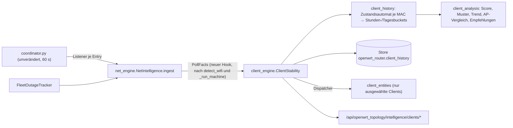

# Plan: Client Stability Intelligence (Erweiterung der Network Intelligence)

<!-- Ablage: docs/plans/2026-11-16-client-stability.md · Branch claude/client-stability-f9a22b
     (abgezweigt von feature/network-intelligence @ 4cef6a8). Keine IPs, MACs, Hostnamen echter
     Geräte, Passwörter oder Tokens. Rollen statt Namen. -->

Kennzeichnung wie im NI-Plan: **verifiziert** (mit `datei:zeile`, Stand `4cef6a8`), **Annahme**
(mit Prüfweg), **Vorschlag** (Planentscheidung, Freigabe durch den Master), **[CS-Entscheidung]**
(kleine Entscheidung von CS-1, markiert, vom Master überstimmbar).

## Status

- **Stand:** 2026-11-17 · **Phase:** B gebaut (B1–B6, B7, B8, B9), Release 1.42.0 als PR;
  **B7a offen** (wartet auf F10/F11). Anpassungen beim Bau: Abschnitt 14 (im Text mit
  **[Anpassung]** markiert).
- **Branch:** `claude/client-stability-f9a22b` · Basis ursprünglich
  `feature/network-intelligence@4cef6a8`, dann `origin/main` (1.40.0, 1.41.0) eingemergt.
- ~~Blocker für Phase B~~: erledigt, NI P5–P8 und RT sind in `main`.
- **Regeln:** 0 neue Router-Aufrufe, 0 neue SSH-Kommandos, keine Routeränderung.

---

## 1. Bestandsanalyse (Auftrag Abschnitt 1, Phase 1)

### 1.1 Was es schon gibt und wiederverwendet wird

| Baustein | Ort | Was er liefert | Nutzung durch CS |
|---|---|---|---|
| Client-Liste je Poll | `api.py:2741-2775` (`hostapd.<if> get_clients`) | MAC, `signal`, SSID, `radio` (ifname), rx/tx-Bytes, `rx_rate`/`tx_rate` (Momentwert, Einheit live ungeprüft, NI W12) | Präsenz, RSSI, Raten. **Kein** `connected_time` (live bestätigt, Master), `CLIENT_KEY_CONNECTED_SINCE` ist dort 0 |
| IP/Hostname | `api.py:2811` (`_enrich_clients_with_ip`, Leases) | IP und Hostname je MAC | Anzeige, Identität (Hinweis) |
| „Online seit“ im Coordinator | `coordinator.py:806-826` | `_client_first_seen` je Router, **nur im Speicher**, fällt bei jedem Fehlen in einem Poll weg | Wird **nicht** genutzt: kein Roaming-/Lückenschutz, je Router getrennt. CS ersetzt es nicht (bestehende Attribute bleiben) |
| Engine-Ingest | `net_engine.py:630-734` (`NetIntelligence.ingest`) | je Poll: `WifiContext` (`net_rules.py:3002-3068`), akzeptierte Logzeilen, gespeicherte Events, Findings, Uhr `_sync` | **Einziger Einstiegspunkt** für CS (Hook, Abschnitt 2.1). Kein zweiter Listener am Coordinator |
| Ort je MAC über die Flotte | `net_rules.py:3104-3151` (`_Loc`, `WifiState.loc`, `present`, `steer_loc`) | aktueller Router/Band/iface, „unentschieden“ bei zwei frischen Listen (W9), usteer-Knoten | Ort und Roaming-Entscheidung, keine eigene Ortslogik |
| Reconnect / Roam / Band-Wechsel | `net_rules.py:2893-2901` (`wifi.reconnect`, `wifi.roam`, `wifi.band_change`), Regeln R2/R3 im NI-Plan | Reconnect = Down→Up ≤ 30 s; Roam beobachtet (usteer+Logzeile) oder abgeleitet ≤ 0,6 | Zähler je Client-Stunde, keine eigene Erkennung |
| Auth-/Assoc-/Handshake-Fehler | `log_parser.py` + `net_rules.py:2903` (`WIFI_AUTH_KINDS`), `wifi.assoc_rejected`, `wifi.sae_failed` | MAC, Grund im Klartext (`LogEvent.reason`) | Zähler je Client-Stunde |
| DHCP-Probleme | `wifi.no_ip`, `wifi.dhcp_after_connect`, NAK-Regel R5 | MAC, abgeleitet | Zähler je Client-Stunde |
| Connect/Disconnect-Zeilen | `log_parser.py:109-117` (`COUNT_ONLY_KINDS`) | werden **nicht** im Ring gespeichert, nur gezählt | CS bekommt die Zeilen im Hook (Zeitpunkt, Grund) und speichert nur Aggregate → keine Doppelung |
| Disconnect-Gründe | `LogEvent.reason` (`inactivity`, `local_request`, `prune`, `timeout`, `invalid_mic`, `psk`, `max_sta`, `blocked`, `other`) | Klartext statt 802.11-Nummer | Gründe-Histogramm. Numerische Codes: nur, soweit der Parser sie liefert (NI: `reason=`-Codes nicht live gesehen) |
| Event-Ring, Stundenzähler | `net_events.py:536-669` (`EventRing`), `:669-770` (`EventCounters` Stunde 48 h / Tag 30 d) | Problem-Events mit `subject.mac`, Zähler je Router×Art | Detailansicht verlinkt NI-Events per Filter `mac` (keine Kopie). Muster `EventCounters` für Client-Buckets |
| Korrelation | `net_rules.py` `AlarmMachine`, P5-4..P5-7 (Wurzeln `router_unreachable`, `system_reboot`, `wifi_radio_change`, `wifi_mass_disconnect`, `lan_unreachable`) | Incidents mit Zeitfenster und Ursache (`confirmed`/`hypothesis`) | Disconnects im Fenster einer Wurzel werden markiert (`infra`), CS erzeugt **keine** eigenen Incidents oder Bus-Events |
| Ausfälle | `fleet.FleetOutageTracker` + Beobachter (P5-1) | Router im Ausfall | Zeit eines Clients an einem ausgefallenen Router = Messlücke, nicht offline |
| Store-Muster | `net_engine.py:425-601`, `const.py:582-590` | Laden mit Backup, `_save_pending`, Größenkappe mit `prepare_save_json`, Flush beim letzten Unload | Gleiches Muster, eigener Key (Abschnitt 4) |
| Settings-Muster | `net_rules.py:247-306` (`merge_settings`, Grenzen) | geprüfte Overlays aus dem Store | Gleiches Muster für CS-Settings |
| Ausschlüsse | NI `settings.exclusions.macs/ssids` (R4, P6-7) | ausgeschlossene MACs | gelten auch für CS (keine Historie für ausgeschlossene MACs) |
| Entities-Muster | `net_entities.py`, `sensor.py:96`, Dispatcher `openwrt_router_net_intel_updated`, Flotten-Anker P6-9 | lesen nur `engine.view` | CS-Entities lesen nur `cs.view`, am Flotten-Anker |
| Geräte je Client | `device_tracker.py:233-280` (ScannerEntity, Gerät über MAC-Verbindung) | bestehende Geräte-Registrierung | CS-Entities hängen sich per `connections={(mac, MAC)}` an dasselbe Gerät |
| Panel | `frontend/topology/src/components/Sidebar.tsx:15` (Tabs), `ClientsView.tsx`, `CompareView.tsx`, `SpeedChart.tsx` (eigenes SVG, keine Chart-Bibliothek) | Tab-Gerüst, Charts ohne Abhängigkeit | neuer Tab „Stabilität“, SVG-Charts ohne neue Bibliothek |
| Panel-Routen | `topology_panel.py:119-165` (Zugriffsprüfung), NI-P7-Routen | Auth/Admin/410 | gleiche Prüfung, Unterpfad `/api/openwrt_topology/intelligence/clients/...` |

### 1.3 Bestehendes Modul `client_stability.py` (seit v1.36.0) — Nachtrag nach Master-Hinweis

**Verifiziert** (`client_stability.py`, 220 Zeilen, rein, ohne HA-Import):

| Teil | Inhalt | Aufrufer |
|---|---|---|
| `parse_usteer_clients`, `NodeSignal`, `sticky_candidates`, `_comparable` | usteer-Flottenbild, „klebende“ Clients (≥ 8 dB besser, gleiches Band/SSID) | `coordinator.py` (Sticky-Timer), `api.py:1933` (Doku) |
| `HoldTimer` | Haltezeit 10 min für sticky/weak | `coordinator.py` |
| `iface_band` | Band eines AP-Interfaces | `fleet.py:45`, `net_rules.py:49` |
| `AssociationTracker` | je **Router**, **nur im Speicher**, 24-h-Fenster: Associations = Connect-Zeilen; Reconnect = Connect höchstens **300 s** nach `AP-STA-DISCONNECTED` desselben Routers am **selben Interface** | gefüttert in `coordinator.py:1466-1474` aus den Logzeilen (`WIFI_CONNECTED`/`WIFI_DISCONNECTED`); gelesen in `_client_stability_snapshot` (`coordinator.py:1639-1700`) |
| `unstable_top`, `UNSTABLE_RECONNECTS = 3`, `TOP_CLIENTS = 10` | Rangliste | `coordinator.py:1667-1698` |

Ergebnis im Coordinator: `data.client_stability = {usteer, sticky, weak, clients{mac:{associations_24h,
reconnects_24h}}, unstable, unstable_count}` (`coordinator.py:1009`). Leser:
- `sensor.py:483-494` `unstable_clients` (unique_id `{entry_id}_unstable_clients`, Zustand
  `unstable_count`, Attribut `top`);
- `binary_sensor.py:168-184` `sticky_clients` (`{entry_id}_sticky_clients`);
- `device_tracker.py:433-438` → `fleet.client_counts` (`fleet.py:470-488`): Tracker-Attribute
  `associations_24h`/`reconnects_24h`, Summe über alle Router;
- `diagnostics.py:102` (ohne `clients`), `net_engine.py:1930` (nur `usteer`-Status);
- Tests `tests/test_client_stability.py`.

**Drei Reconnect-Definitionen existieren heute nebeneinander:**

| Quelle | Fenster Down→Up | Bereich | Ping-Pong A→B→A | Down-Arten | Persistenz |
|---|---|---|---|---|---|
| v1.36 `AssociationTracker` | ≤ 300 s | je Router, gleiches Interface | zählt als Reconnect an A | nur `AP-STA-DISCONNECTED` | keine (Neustart = 0) |
| NI `wifi.reconnect` (R3, `net_rules.py` `_reconnects`) | ≤ 30 s (`max_gap`) | Flotte, gleiches Interface, Bandwechsel/`Prune` kein Reconnect | zählt **nicht** | `disconnected`, `deauth`, `disassoc`, `inactivity_timeout` (`_DOWN_KINDS`) | Event im Ring (NI-Store) |
| CS-Plan (Abschnitt 3, R) | übernahm NI | – | – | – | Buckets |

**Entscheidung [Vorschlag, vom Master zu bestätigen]: CS erweitert, löst nur den Zählteil ab.**
- **Eine Quelle für Reconnects:** das NI-Event `wifi.reconnect` (R3). CS zählt diese Events je
  Client und Stunde (aus `stored_events` des Hooks), sonst nichts. NI `wifi_reconnect_storm`
  (5 in 600 s) benutzt dieselben Events → Sturm-Alarm, CS-Zähler, Sensor und Tracker-Attribut
  sind deckungsgleich.
- **Associations:** CS zählt die Connect-Zeilen (`COUNT_ONLY_KINDS`, die der Hook ohnehin sieht)
  je Client und Stunde im Bucket-Feld `associations`.
- **`AssociationTracker` und `unstable_top` werden abgelöst** (Bauphase B7a): Der Coordinator
  füttert ihn nicht mehr; `data.client_stability["clients"]`, `["unstable"]`,
  `["unstable_count"]` kommen aus einer CS-Leseschnittstelle (`cs.counts_24h(router)`), die
  auf den Stundenbuckets plus laufender Stunde beruht. `client_stability.py` behält Sticky,
  usteer-Parser, `HoldTimer`, `iface_band` (unverändert, weiter von `fleet.py`/`net_rules.py`
  genutzt); `AssociationTracker` bleibt bis zum Ende der Deprecation nur für Tests im Modul,
  danach entfernt (F10).
- **Unveränderte Entities:** `{entry_id}_unstable_clients`, `{entry_id}_sticky_clients`,
  Tracker-Attributnamen `associations_24h`/`reconnects_24h` bleiben gleich (Test). Der Sensor
  zählt Clients mit ≥ `UNSTABLE_RECONNECTS` (3) Reconnects in 24 h **an diesem Router** (Router
  des `wifi.reconnect`-Events), `top` wie bisher (10, mit Hostname).
- **Bewusste Verhaltensänderung (CHANGELOG „Changed“):** Reconnect-Fenster 300 s → 30 s,
  Ping-Pong-Roaming zählt nicht mehr, Deauth/Disassoc/Inaktivität zählen als Down, Werte
  überstehen Neustarts. Die Zahlen sinken dadurch tendenziell (schlafende IoT-Clients, die nach
  1–5 min zurückkommen, sind kein Reconnect mehr; NI R3 begründet das).
- **„Unbekannt ohne Log“** bleibt: ohne lesbares Router-Log ist `unstable_clients` unbekannt,
  die CS-Abdeckung für R/A ist 0.
- **Schwaches Signal:** CS `weak_s` nutzt `WEAK_SIGNAL_DBM` (−75) aus `client_stability.py`
  (eine Konstante). Sticky/weak-Erkennung bleibt im Coordinator unverändert (keine Doppelung:
  CS speichert nur Zeitanteile, keine Sticky-Zustände).
- **Gesamtschalter `enabled` (F8):** schaltet nur Historie, Analyse, Panel und Store aus; die
  24-h-Zählung für die bestehenden Entities läuft immer (im Speicher, ohne Store), damit
  v1.36-Funktionen nie verschwinden.

**Namensprüfung (verifiziert):** Einziger Store-Key der Integration ist
`openwrt_router.intelligence` (`const.py:581-582`); `openwrt_router.client_stability` ist frei.
**[CS-Entscheidung]** Trotzdem Key `openwrt_router.client_history`, damit Datei und Modul
`client_stability.py` (v1.36, ohne Store) nicht verwechselt werden. Neue Module heißen
`client_history.py`, `client_analysis.py`, `client_engine.py`, `client_entities.py`,
`client_views.py` (kein Treffer im Repo). Neue Übersetzungsschlüssel `stability_score`,
`connection_quality`, `reconnects_24h`, `connection_uptime`, `last_disconnect`: kein Treffer
in `strings.json`. Die neuen unique_ids beginnen mit `openwrt_router_client_`; bestehende
Muster sind `{entry_id}_…` und die Tracker-Formen (`device_tracker.py:81-90`) → keine Kollision.

### 1.4 Live-Prüfung TX/RX-Rate (F7, nur lesend, 2026-11-16)

`ubus call hostapd.<if> get_clients` (`rate.rx/tx`) gegen `iwinfo <if> assoclist` und
`ubus call iwinfo assoclist` auf dem Gateway und einem Dumb-AP mit usteer (2,4 GHz):
- 5 200 000 ↔ 52,0 MBit/s (MCS 5, 20 MHz); 6 500 000 ↔ 65 000 kbit/s; 3 900 000 ↔ 39 000 kbit/s.
- **Ergebnis:** Einheit von hostapd `rate` ist **10 bit/s**; MBit/s = Wert / 100 000. Es ist die
  PHY-Rate des letzten Frames (Momentwert), keine Durchsatzmessung.
- Folge: Raten werden als Stundenmittel/Min in MBit/s angezeigt. **Nicht im Score**: bei wenig
  Verkehr meldet hostapd niedrige Basisraten (beobachtet 12 vs. 54 MBit/s beim selben Client
  rx/tx), das wäre ein Fehlurteil über ruhende IoT-Geräte.
- Nicht geprüft: 5/6 GHz (keine Clients auf diesen Interfaces zum Zeitpunkt), HE/EHT-Raten.

### 1.2 Fehlende Abhängigkeiten und Grenzen der Datenquelle (dokumentiert)

- **`connected_time` fehlt** in `get_clients` → Verbindungsdauer nur aus eigener Beobachtung.
  Nach HA-Neustart ist der Sessionbeginn unbekannt: Anzeige „≥ x“ (untere Schranke).
- **Kabelclients:** hostapd listet nur WLAN. ARP (`api.py:4741`, nur vollständige Einträge, ohne
  Alter/Zustand) und Leases sagen nichts Verlässliches über online/offline →
  **nicht machbar mit den Daten von OpenWrt** ohne neue Abfragen. Kabelclients bekommen keine
  Stabilitätshistorie (Tabelle zeigt sie nicht; Doku nennt den Grund).
- **Ende-zu-Ende-Erreichbarkeit:** HA pingt keine Clients; ein Ping wäre ein neuer Abfragepfad
  (Auftrag 1/11). **Nicht machbar ohne zusätzliche Abfragen.** Getrennt ausgewiesen wird nur
  „IP sichtbar“ (Lease und/oder ARP-Eintrag im selben Poll, abgeleitet).
- **Numerische 802.11-Reason-Codes:** nur der Klartext aus dem Parser; Codes nur, wenn der
  Parser sie aus der Zeile liest (Annahme, Prüfweg: Live-Zeilen in `tests/test_net_wifi.py`).
- **TX/RX-Raten:** Momentwerte alle 60 s, Einheit live geprüft (1.4: 10 bit/s) → nur Anzeige
  (Stundenmittel in MBit/s), **nicht im Score** (F7).
- **VLAN je Client:** nur indirekt über SSID → Netzwerk; ob `ap_interfaces` das Netzwerk trägt,
  ist offen (Annahme, Prüfweg in B6). Ohne verlässliche Zuordnung entfällt der VLAN-Filter.
- **APs ohne usteer und Zufalls-MACs:** Grenzen K5/K6 aus NI gelten weiter (Roaming-Untererkennung,
  neue Identität je Verbindung).
- **Log nicht lesbar:** Disconnect-Zeitpunkt nur auf Poll-Genauigkeit, Grund unbekannt,
  Reconnects (≤ 30 s) unsichtbar → Abdeckung der log-basierten Score-Teile sinkt (Abschnitt 5).

---

## 2. Datenmodell (Auftrag Abschnitt 2, Phase 2)

### 2.1 Datenfluss

Hook **[Vorschlag]**: `NetIntelligence.add_poll_observer(cb)`; nach jedem `ingest` ruft die Engine
die Beobachter mit einem unveränderlichen `PollFacts`:
`router, now (Engine-Uhr), interval, fresh_clients (bool), context (WifiContext), wifi_lines
(akzeptierte Logzeilen der Kategorie wifi/dhcp, nur frischer Abruf), log_ok, stored_events
(die in diesem Ingest gespeicherten NetEvents), loc (Lesezugriff auf WifiState.loc/steer_loc),
lease_macs, arp_macs`. Dazu `on_outage_changed`, `on_clock_shift(delta)`, `on_unregister/remove`.
Fehler im Beobachter werden geloggt und erreichen die Engine nicht (Muster P5-1).
Kosten: O(Clients + Zeilen) je Poll, 0 Netzwerkaufrufe.

### 2.2 Identität

- Schlüssel: MAC (groß). Lokal administrierte MAC (Bit 0x02) → `private_mac = true`.
- Hostname/IP: nur letzter Wert plus Zeitpunkt der letzten Änderung (Anzeige, Filter).
- Identitätswechsel: keine automatische Zusammenführung. Gleicher Hostname auf neuer privater MAC
  → Hinweis „mögliche frühere MAC“ (Hypothese) in der Detailansicht. **[CS-Entscheidung]**
- Ausgeschlossene MACs (NI `exclusions`) werden nicht erfasst; vorhandene Historie wird gelöscht.

### 2.3 Online-Erkennung mit Toleranz (Zustandsautomat je MAC)

Zustände: `online`, `grace` (fehlt, Entscheidung offen), `offline`, `unknown` (keine Aussage möglich).

Regeln je Poll von Router R (Zeit t, Poll-Intervall i, `roam_grace = max(2·i, 150 s)`):

1. MAC in der frischen Liste von R → `online` (Ort aus `WifiState.loc`; „unentschieden“ zählt
   als online beim bisherigen Ort). Lag eine Connect-Zeile vor, beginnt die Session zur
   Zeilenzeit (genauer als der Poll).
2. MAC war zuletzt an R und fehlt dort:
   - steht sie an einem anderen frischen Router (≤ 300 s, `_PRESENT_MAX_AGE`) oder kommt eine
     Connect-/usteer-Zeile eines anderen Routers innerhalb `roam_grace` → **Roam**, kein Abbruch;
   - Disconnect-Zeile von R seit dem letzten Lesen → `grace` mit Zeitstempel und Grund der Zeile;
   - sonst `grace` ab dem vorigen Poll von R.
3. `grace` → `offline` erst, wenn die MAC in **allen** frischen Listen der Flotte für
   `offline_after` (Standard: 2 Polls von R und ≥ 150 s) fehlt. Der Abbruch wird auf den Beginn
   von `grace` zurückdatiert. Taucht sie vorher wieder auf: kein Abbruch, nur `blip` (Diagnose).
4. **AP-Ausfall / Poll-Lücke:** Ist R nicht frisch (Daten > 1,25 Intervalle alt, Ausfall laut
   Tracker, Neustart erkannt) → alle MACs mit Ort R gehen auf `unknown` ab dem letzten frischen
   Poll. Diese Zeit ist **Messlücke**, nie offline. Kommt R zurück und die MAC fehlt: Abbruch mit
   unbekanntem Zeitpunkt (`dc_unknown_time`), bei einer offenen NI-Wurzel (`router_unreachable`,
   `system_reboot`, `wifi_radio_change`, `wifi_mass_disconnect`) als `infra` markiert.
5. **Veraltete Tabellen:** Zwei Router listen die MAC → Ort laut NI W9/R2; die Zeit zählt einmal.
6. **WLAN-Assoziation vs. IP:** `online` heißt assoziiert. Unabhängig davon je Poll
   `ip_visible` = Lease oder ARP-Eintrag (abgeleitet) → eigene Kennzahl, nie mit Verfügbarkeit
   vermischt.
7. **HA-Neustart:** Offene Sessions werden mit `unknown` ab dem letzten gespeicherten Zeitpunkt
   fortgesetzt; die Zeit bis zum ersten frischen Poll ist Messlücke.

Klassen eines Abbruchs (für Score und Muster): `error` (timeout, handshake, mic, psk, max_sta,
blocked, `other`), `inactivity`, `leave` (`local_request`, STA verlässt), `unknown` (nur Poll),
`infra` (im Fenster einer NI-Wurzel). `prune` ist Roaming, kein Abbruch.

### 2.4 Speicherstufen

| Stufe | Inhalt | Auflösung | Aufbewahrung | Ort |
|---|---|---|---|---|
| Live-Zustand | Zustand, Ort, Session-Beginn, letzter Abbruch (Zeit, Grund, Klasse), Hostname/IP | – | solange bekannt | Speicher + Store |
| Rohring kurz | je Poll `(t, ap, band, rssi, state)` | Poll | 1 h, ≤ 120 Einträge je MAC | **nur Speicher** (1-h-Ansicht; nach Neustart leer, Lücke sichtbar) |
| Übergänge | `(t, art, ap, grund, klasse, incident_id?)` | exakt | 24 h, ≤ 64 je MAC gespeichert | Speicher + Store |
| Stundenbuckets | je (MAC, Stunde, AP) | 1 h | 7 Tage (168 h) | Store, beim Schließen gepackt |
| Tagesbuckets | je (MAC, Tag, AP) + Disconnect-Stunden-Histogramm (dünn) | 1 d | `retention_days` (Std. 30, max. 90) | Store |

Felder eines Buckets: `observed_s, online_s, gap_s, sessions, associations, longest_stable_s,
dc_error, dc_inactivity, dc_leave, dc_unknown, dc_infra, reconnects, roams_in, roams_out,
roam_flaps, band_changes, auth_fail, assoc_fail, dhcp_fail, rssi_n, rssi_sum, rssi_min,
rssi_max, weak_s (≤ −75 dBm), ip_visible_n, rate_rx_sum, rate_tx_sum, rate_n`.
Gepackt wie NI P6-11 als String mit leeren Feldern für 0 (z. B.
`"490123,2,3600,3600,,1,,,,,,,,,,,60,-3300,-58,-52,,60,..."`). Tagesbuckets entstehen aus
geschlossenen Stunden (keine zweite Zählung). Score-Verlauf wird **nicht** gespeichert, sondern
aus Stundenbuckets bei Abruf berechnet.

### 2.5 Zeiträume (Auftrag Abschnitt 3)

| Fenster | Quelle |
|---|---|
| 1 h | Rohring + Übergänge (Live) |
| 24 h | Stundenbuckets + laufende Stunde + Übergänge |
| 7 d | Stundenbuckets |
| 30 d | Tagesbuckets |

Je Fenster: Beobachtungsdauer (`Σ observed_s`), **Abdeckung** = observed / Fensterlänge
(seit erstem Sehen), Verfügbarkeit = `online_s / observed_s` (bei `observed_s = 0`: `unknown`,
nie 100 %), Abbrüche je Klasse, Reconnects/24 h, mittlere und längste stabile Verbindung
(Sessions, zensiert am Fensterrand → „≥“), RSSI Mittel/Min/Max, Roams/24 h, auffällige
Ereignisse (Links auf NI-Events per `mac`), Messlücken als Liste von Intervallen (aus
Übergängen) bzw. Anteil (aus Buckets), `ip_visible`-Anteil getrennt.

---

## 3. Score (Auftrag Abschnitt 4)

Je Teilbereich k: Teilwert `s_k ∈ [0,100]`, Abdeckung `c_k ∈ [0,1]`, Gewicht `w_k`
(Standard, im CS-Store einstellbar):

| k | Gewicht | Kennzahl x (je 24 beobachtete Online-Stunden) | Teilwert | Abdeckung |
|---|---|---|---|---|
| D Abbrüche | 30 | `1,0·error + 0,75·unknown + 0,5·inactivity + 0,25·leave` (`infra` 0) | `100·e^(−x/4)` | `observed_s`-Anteil |
| R Reconnects | 15 | Reconnects (nur NI-Event `wifi.reconnect`, 1.3) | `100·e^(−x/3)` | Log-Abdeckung des Orts-Routers (ohne Log `unknown`) |
| U Verbindungsdauer | 15 | Median stabile Session h | `100·min(1, ln(1+x)/ln(1+6))` | ≥ 1 Session ≥ 1 h beobachtet oder laufende |
| S Signal | 20 | RSSI-Mittel m, Anteil schwach q | `100·clamp((m+85)/25)·(1−0,5·q)` | ≥ 10 RSSI-Werte |
| A Auth-Fehler | 10 | Fehlversuche (W3: Versuche, nicht Zeilen) | `100·e^(−x/2)` | Log-Abdeckung |
| M Roaming auffällig | 5 | Ping-Pong-Flaps (≥ 2 Wechsel A↔B in 600 s) | `100·e^(−x/3)` | wie R |
| W Wiederkehrend | 5 | aktive Muster n (Abschnitt 6) | `100 − 35·min(n,3)` (≥ 0) | ≥ 3 Tage Daten |

- `score = Σ w_k·c_k·s_k / Σ w_k·c_k` über Bereiche mit `c_k ≥ 0,3`;
  `coverage = Σ w_k·c_k / Σ w_k`; bei `coverage < 0,5` → **`unknown`** (Muster NI c6).
- **Normales Roaming kostet nichts** (nur Flaps in M). Garantie (Test): ein Flap senkt den Score
  weniger als ein `error`-Abbruch im selben Fenster.
- Klassen (Standard, einstellbar `[90, 75, 50, 25]`): 90–100 sehr stabil, 75–89 stabil,
  50–74 auffällig, 25–49 instabil, 0–24 kritisch, sonst `unknown`.
- Fenster: Entity-Score über 24 h, zusätzlich 7-d-Score als Attribut. **[CS-Entscheidung]**
- Option je Client `sleepy` (planmäßig schlafendes IoT-Gerät): `inactivity` zählt 0 (F4).
- Trend in der Tabelle: 24-h-Score minus Score der vorigen 24 h (≥ ±10 Punkte = Pfeil).

## 4. Persistenz und Speicherbudget (Auftrag Abschnitt 9)

### 4.1 Eigener Store-Key [Vorschlag]

`Store(hass, 1, "openwrt_router.client_history", minor_version=1)`, eigene Datei (Name siehe
1.3; vom Master bestätigt: eigener Key, Kappe 3 MB, Speichern höchstens alle 300 s). Gründe:
1. Der NI-Store ist mit 1,5 MB gedeckelt und in den Lasttests schon voll (P6-11: 1 499 794 B);
   Client-Historie würde NI-Events verdrängen.
2. Anderer Rhythmus: Buckets schließen stündlich; NI schreibt alle 300 s.
3. Fehlerisolation: Ein kaputter CS-Store löscht keine Incidents (eigenes `.bak`-Muster).
4. Eigene Aufbewahrung (30–90 Tage) und eigene Größenkappe.
Keine Doppelung: CS speichert keine NetEvents, nur Aggregate und Verweise (`incident_id`).

Inhalt: `{schema, settings, clients: {mac: {meta, live, transitions, hours[], days[]}}, saved_at}`.

### 4.2 Rechnung (150 Clients, 30 Tage, Worst Case: alle immer online, je 1 AP)

| Teil | Rechnung | Größe |
|---|---|---|
| Stundenbuckets | 150 × 168 × ~45 B (gepackt, Nullen leer) | ≈ 1,13 MB |
| Tagesbuckets | 150 × 30 × ~60 B | ≈ 0,27 MB |
| Übergänge | 150 × ≤ 64 × ~28 B (typisch ~10) | ≤ 0,27 MB (typ. 0,04 MB) |
| Meta + Live | 150 × ~200 B | ≈ 0,03 MB |
| **Summe** | | **≈ 1,5 MB Worst Case, ≈ 1,0 MB typisch** (Handys sind nicht 24/7 online) |

Roaming-Clients erzeugen mehr Zeilen (je AP eine). Messung mit `prepare_save_json` ist Teil von B8.

**[Anpassung] Messung B8** (2026-11-17, Entwickler-PC, Python 3.13, `tests/test_client_scale.py`
und Messskript; Clients je 1 AP, stündliche Polls über 30 Tage, alle immer online):

| Messung | 150 Clients | 1000 Clients |
|---|---|---|
| Store-Größe (Format wie HA `Store`) | **2,53 MB** (Schätzung oben 1,5 MB; Bucket-Strings sind länger als ~45 B, weil Sitzungs-Bins und Raten mitgespeichert werden) | 16,87 MB roh → gekürzt auf 7,75 MB bei 8 MB Grenze |
| `_data_to_save` | ≈ 22 ms | ≈ 94–107 ms; erstes Speichern mit Kürzen 528 ms |
| `on_poll` (Ingest eines Polls) | – | < 20 ms (Testbudget), bester Lauf 9,1 ms |
| Tabelle (erster Abruf je Stunde / danach) | 262 / 107 ms (vor B8: 1097 / 726 ms) | 1432 / 354 ms |
| AP-Vergleich 30 d / 24 h | 114 / 100 ms (vor B8: 739 ms bei 30 d) | 838 / 652 ms |
| Detail | ≤ 9 ms | – |

Ursache der B8-Beschleunigung: `observed_days` liest nur das erste Feld der gepackten Buckets,
`span()` nimmt für ganze UTC-Tage den Tagesbucket statt 24 Stundenbuckets, und Serien lesen nur
offene Stunden ungepackt (`open_only`). Budgets als Tests: Tabelle 150 Clients < 1000 / 400 ms,
AP-Vergleich 30 d < 400 ms, Poll 1000 Clients < 20 ms, 150 × 30 d < 3 MB ohne Kürzen.

- **Harte Grenze** (Vorschlag): 3 MB, einstellbar 1–8 MB. Kürzen in dieser Reihenfolge:
  Übergänge offline-Clients → Stundenbuckets älter 48 h von Clients mit `private_mac` →
  Stundenbuckets älter 48 h aller → ganze Clients nach `last_seen` (älteste zuerst).
  Tagesbuckets aktiver Clients zuletzt. Warnung im Log bei Kürzung.
- **Client-Grenze:** `max_clients` 1000. Gastclients (gesamt online < 1 h, seit 7 d weg) und
  private MACs ohne Wiederkehr nach 7 d fallen beim Bereinigen raus.
  **[Anpassung] nicht gebaut:** Die Erfassung endet nach 1 d `unknown` bzw. 7 d `offline`
  (`GAP_TRACK_S`, `OFFLINE_TRACK_S`); entfernt werden Clients erst nach `retention_days`
  Untätigkeit, beim Kürzen (Schritt 4, ältester zuerst) oder wenn `max_clients` erreicht ist.
  Offen in TODO.md.
- **Schreiben:** nur bei Änderung (`dirty`), `async_delay_save` 300 s mit `_save_pending`
  (NI-Muster). Buckets werden beim Schließen sofort gepackt → `_data_to_save` baut nur
  Listen aus fertigen Strings (kein JSON-Aufbau im Event-Loop über ms). Letzter Unload: sofort
  schreiben und warten (NI-Muster). Kein Schreiben, wenn sich nichts geändert hat (Test).
- **Bereinigung:** stündlich beim Schließen der Stunde (Aufbewahrung, Gäste, Größe).
- **Wiederherstellung:** Muster `async_load` mit `.bak` bei unlesbarem Store, leer starten,
  `load_failed` in der Diagnose. Schemafehler je Client verwerfen nur diesen Client.
- **Uhrsprung:** `on_clock_shift(delta)` verschiebt Live-Zeiten und Übergänge (NI-Uhrmodell);
  Bucket-Indizes bleiben (Wanduhr-Stunden).
- **RAM:** Rohring 150 × 120 Tupel ≈ 2 MB Python-Objekte; Buckets der laufenden Stunde ≈ 0,1 MB.

## 5. Erkennung wiederkehrender Muster (Auftrag Abschnitt 5)

| Muster | Bedingung (Standard, einstellbar) | Kennzeichnung |
|---|---|---|
| **Zeitmuster** | aus Tages-Histogramm (Abbrüche `error`/`unknown`/`inactivity` je Stunde, HA-Zeitzone): in Stunde h an ≥ 4 von ≥ 7 Tagen mit Abdeckung ≥ 0,8 in h, ≥ 50 % der abgedeckten Tage, Rate in h ≥ 3× Mittel der übrigen Stunden | Muster beobachtet; Ursache Hypothese (≤ 0,6) |
| **Signalverschlechterung** | Fenster A = älteste 7 d, B = jüngste 7 d (bei < 14 d: 3 d gegen 3 d); je Fenster ≥ 100 RSSI-Werte, Abdeckung ≥ 0,5, ≥ 70 % am selben AP und Band in beiden; Δ Mittel ≤ −6 dB | sonst „nicht vergleichbar“ mit Grund; Hypothese |
| **AP-spezifisch** | je (Client, AP) ≥ 24 Online-h; `error`-Abbrüche/24 h am schlechtesten AP ≥ 3× und ≥ 0,5 absolut über dem besten | beobachtet (Raten), Ursache Hypothese |
| **Gleichzeitige Abbrüche am AP** | Abbruch im Fenster einer NI-Wurzel (P5-4) → Klasse `infra` mit `incident_id` | Ursache übernimmt `cause_status` der Wurzel; **kein eigener Alarm** |

## 6. AP-Vergleich historisch (Auftrag Abschnitt 6)

Je AP (Router + Band; Filter SSID) und Fenster 24 h / 7 d / 30 d, alles aus den Buckets:
Clients (verschieden), Client-Stunden, mittlere Stabilität (Score gewichtet mit Client-Stunden),
Abbrüche/100 Client-h (ohne `infra`), Reconnects/100 Client-h, Auth-Fehler/100 Client-h,
Roams ein/aus/100 Client-h, gemeinsame Abbrüche (`infra`-Ereignisse und betroffene Clients),
RSSI-Mittel (gewichtet nach Werten), Anteil schwach, Entwicklung (Wert je Fenster).
Fairness: nur Raten je Client-Stunde; Wert erst ab 10 Client-h, sonst „zu wenig Daten“;
bei < 5 Ereignissen Hinweis „geringe Datenbasis“. Keine Rangfolge über absolute Zahlen.

## 7. Diagnoseempfehlungen (Auftrag Abschnitt 10)

Regeltabelle in `client_analysis.py`, Texte über Übersetzungsschlüssel mit Messwerten als
Parameter. Jede Empfehlung trägt `basis` (die Zahlen), `kind` = `observation`, `hypothesis`
(mit Konfidenz ≤ 0,6) oder `confirmed` (nur wenn eine NI-Wurzel mit `cause_status=confirmed`
die Abbrüche erklärt, z. B. AP-Neustart). Beispiele:
- ≥ 10 Abbrüche/24 h und weak ≥ 30 % → „Abdeckung prüfen“ (Hypothese).
- ≥ 8 Roams zwischen zwei APs in 30 min → „Kanalplanung/Roaming-Schwellen prüfen“ (Hypothese).
- ≥ 3 Clients eines AP mit erhöhten Reconnects im selben Zeitraum ohne NI-Wurzel →
  „Infrastrukturproblem wahrscheinlicher“ (Hypothese).
- Zeitmuster → „Zeitplan/Energiesparen des Geräts oder geplanter Job prüfen“ (Hypothese).
- AP-spezifisch → „an AP X instabil, an AP Y stabil: AP X/Kanal prüfen“ (Hypothese).

## 8. Entity-Strategie (Auftrag Abschnitt 8)

- **Keine Entities ohne Auswahl.** Settings `entity_macs` (höchstens 25, F2), gewählt im Panel
  (Admin-POST). Gastclients/private MACs bekommen nie automatisch Entities.
- Je ausgewählter MAC 5 Sensoren am Flotten-Anker (P6-9), Gerät über
  `connections={(CONNECTION_NETWORK_MAC, mac)}` (dasselbe Gerät wie der Tracker):
  `stability_score` (0–100/`unknown`, measurement, an), `connection_quality` (enum der Klassen, an),
  `reconnects_24h` (aus), `connection_uptime` (Sekunden, `duration`, aus),
  `last_disconnect` (`timestamp`, aus). **[CS-Entscheidung: zwei an, drei aus]**
- `unique_id`: `openwrt_router_client_<mac12>_<key>`; Test gegen `_LEGACY_DYNAMIC_PATTERNS`
  (`__init__.py:187-193`): kein `_rate`, `_ap_`, `_port_`, `_radio_`, `_iface_`.
- Abwahl entfernt die Entities aus der Registry. Attribute (7-d-Score, Abdeckung) in
  `_unrecorded_attributes`. Updates per Dispatcher `openwrt_router_client_stability_updated`,
  höchstens einmal je Poll-Runde gedrosselt; keine Netzwerkaufrufe.

## 9. API-Routen und Panel (Auftrag Abschnitt 7)

Gleiche Zugriffsprüfung wie die NI-P7-Routen (Auth, Admin außer Option „alle Benutzer“, 410 nach
Unload; POST nur Admin):

| Methode | Pfad | Inhalt | Grenzen |
|---|---|---|---|
| GET | `/api/openwrt_topology/intelligence/clients` | Tabelle: Name, MAC, IP, AP, SSID, Band, Zustand, Score, Klasse, Verf. 24 h/7 d, Reconnects 24 h, letztes Problem, Trend, Abdeckung; Filter `router`, `ap`, `ssid`, `class`, `vlan` (nur wenn verlässlich), Sortierung, Suche | `limit` ≤ 500, Cursor |
| GET | `.../clients/{mac}?window=1h\|24h\|7d\|30d` | Detail + Serien: Zeitleiste (Segmente online/offline/Lücke), RSSI (Poll bzw. Bucket min/mean/max), Abbrüche/Reconnects, AP-Wechsel, Score-Verlauf, Vorfälle (NI-Incident-IDs), Muster, Empfehlungen | Serie ≤ 720 Punkte |
| GET | `.../clients/aps?window=` | AP-Vergleich | – |
| GET/POST | `.../clients/settings` | Aufbewahrung, Klassen, Gewichte, `entity_macs`, `sleepy`, Größe | POST Admin, voluptuous-Prüfung |

**[Anpassung]** Tabellenfilter gebaut: `router`, `band`, `ssid`, `class`, `state`, Suche `q`;
ein AP wird über `router` + `band` gewählt (kein eigener Parameter `ap`), **kein
`vlan`-Filter** (Zuordnung nicht verlässlich, 1.2). Gewichte und Klassen nimmt der
Settings-POST an, das Panel bietet sie aber nicht zum Ändern an.

Panel: neuer Tab „Stabilität“ im NI-Diagnosebereich (P7-Gerüst). Tabelle sortierbar, schlechteste
zuerst; Detail mit Zeitraumwahl; SVG-Charts ohne neue Bibliothek (Muster `SpeedChart.tsx`).
Zeitleiste: Messlücken schraffiert, offline rot, online grün; Vorfälle als Marker mit Link.
Abruf nur beim Öffnen/Zeitraumwechsel und höchstens alle 60 s im offenen Tab. Keine Mock-Daten
im Produktivpfad (`mockData.ts` nur Dev-`App.tsx`). Handy-Layout: Tabelle → Karten.

## 10. Bauphasen und Commits (Phase B; Auftrag Phasen 3–10)

Allgemein: jeder Commit mit `ruff check`/`ruff format --check` (`uvx ruff@0.17.3`) und
`py -3.13 -m pytest` vollständig grün; Commits nach Konvention `feat(clients): …`.

| Bauphase | Auftrag-Phase | Dateien | Fertig, wenn |
|---|---|---|---|
| **B1** Modell und Statushistorie (rein) | 3 | neu `client_history.py`, neu `tests/test_client_history.py` | Automat (2.3) mit Tests: stabiler Client, Reconnects, normales Roaming, Roaming-Flapping, AP-Ausfall → Lücke, Poll-Lücke, veraltete Tabelle, Neustart-Fortsetzung; Buckets/Packen/Laden rund; kein HA-Import |
| **B2** Engine, Hook, Store | 3 + 8 | neu `client_engine.py`, `net_engine.py` (nur Hook, ≈ 40 Zeilen), `__init__.py` (Setup/Unload), `const.py`, `diagnostics.py`, neu `tests/test_client_engine.py` | Hook-Fehler isoliert; 0 neue Aufrufe (Aufrufzähler-Test); Store laden/speichern/`.bak`; nichts geschrieben ohne Änderung; Unload-Flush; Diagnose ohne MACs |
| **B3** Score und Langzeitanalyse | 4 | neu `client_analysis.py`, neu `tests/test_client_analysis.py` | Formel (3) mit Tests: Abdeckung → `unknown`, Roam < Abbruch, `sleepy`, Klassen konfigurierbar; Zeitmuster, Signaltrend (vergleichbar/nicht vergleichbar) |
| **B4** AP-Vergleich, Korrelation, Empfehlungen | 5 | `client_analysis.py`, `client_engine.py`, Tests in `test_client_analysis.py`/`test_client_engine.py` | Normierung je Client-Stunde getestet (großer vs. kleiner AP); `infra`-Markierung über NI-Wurzel, keine eigenen Incidents/Bus-Events; Empfehlungsarten getrennt |
| **B5** API-Routen | 6 (Backend) | `topology_panel.py` (Routen registrieren), neu `client_views.py` (View-Klassen), neu `tests/test_client_routes.py` | 401/403/410 wie P7; Filter, Limits, Fenster; Settings-POST validiert |
| **B6** Dashboard | 6 | `frontend/topology/src/components/StabilityView.tsx` (neu), `ClientStabilityDetail.tsx` (neu), `StabilityCharts.tsx` (neu), `Sidebar.tsx`, `api.ts`, `types.ts`, `topology.css`, `frontend/dist/*` | `--frontend`-Build grün; Bundle-Zuwachs ≤ 40 kB; Sichtprüfung Desktop/Handy (Screenshot an Master; Handy-Prüfung durch Nutzer offen) |
| **B7** Entitäten | 7 | neu `client_entities.py`, `sensor.py` (Setup-Aufruf), `strings.json`, `translations/en.json`, `translations/de.json`, neu `tests/test_client_entities.py` | 0 Entities ohne Auswahl; 5 je Auswahl, Standard an/aus wie 8; Abwahl entfernt; Musterprüfung `unique_id`; Übersetzungsschlüssel-Test |
| **B7a** Ablösung v1.36-Zählung | 7 | `coordinator.py` (`AssociationTracker` nicht mehr füttern, `_client_stability_snapshot` liest `cs.counts_24h`), `client_stability.py` (Deprecation-Hinweis), `fleet.py` (`client_counts` aus CS), `client_engine.py`, `tests/test_client_stability.py` (Erwartungen an 30-s-Definition), neu `tests/test_client_counts_migration.py` | unique_ids und Attributnamen unverändert (Test); `unstable_clients` unbekannt ohne Log; Ping-Pong und 60-s-Wiederkehr zählen nicht; Zählung übersteht Neustart; `enabled=false` lässt Zählung laufen; CHANGELOG-„Changed“-Text vorbereitet |
| **B8** Persistenz-Härtung und Performance | 8 + 9 | `client_engine.py`, `client_history.py`, neu `tests/test_client_scale.py` | Messung `prepare_save_json` 150 und 1000 Clients × 30 d im Plan nachgetragen; Kürzreihenfolge, Aufbewahrung, Gäste, Identitätswechsel, Uhrsprung, HA-Neustart getestet; Ingest 1000 Clients < 20 ms (Test mit Budget); alle bestehenden Tests grün |
| **B9** Doku | 10 | `README.md`, `CHANGELOG.md`, `TODO.md`, neu `docs/client-stability.md`, dieser Plan | Formel, Gewichte, Grenzen (1.2), Rückweg, Speicher; Abschlussbericht mit Testergebnis |

**[Anpassung] Stand der Bauphasen (2026-11-17):**

| Bauphase | Stand | Commit(s) |
|---|---|---|
| B1 | fertig | `012f592`, `3760f89` (Kürzen, `missing_acks` als `error`) |
| B2 | fertig | `17ab403` (Hook), `58b7d03` (Engine, Store) |
| B3 | fertig | `5bc32f8`, `c5faa89` |
| B4 | fertig | `0e5ef4b`, Anbindung in `58b7d03` |
| B5 | fertig | `7167df5` |
| B6 | fertig bis auf die Sichtprüfung Desktop/Handy (kein Browser in der Bau-Sitzung; offen in TODO.md). Statt `Sidebar.tsx` ein Unter-Tab „Stabilität“ in `DiagnoseView.tsx`; Bundle +28,9 kB | `0735657` |
| B7 | fertig; Sensoren ohne eigenes Gerät am Flotten-Anker | `e0aa5ba` |
| B7a | **offen**, wartet auf F10/F11 | – |
| B8 | fertig bis auf das Gäste-Bereinigen (4.2) | `5eee05b`, `4414a6f` (keine MAC im Debug-Log) |
| B9 | fertig | Doku-/Release-Commit 1.42.0 |

Tests gemäß Auftrag 12, Zuordnung: stabiler Client, Reconnects, Roaming, Flapping, Messlücken,
HA-Neustart → B1/B2; schwaches Signal, Score → B3; AP-Ausfall mehrere Clients, AP-Vergleich → B4;
Aggregation, Aufbewahrung, Identitätswechsel, hohe Client-Anzahl → B1/B8.

Rückweg: CS ist abschaltbar über Setting `enabled` (Standard an, F8); Entfernen der Datei
`.storage/openwrt_router.client_history` löscht die Historie; Revert der Commits B1–B9 lässt NI
unberührt (Hook ist ohne Beobachter wirkungslos).

## 11. Abhängigkeiten zu NI (P5-Fix, P7, P8)

| Nr | Abhängigkeit | betrifft | Art |
|---|---|---|---|
| D1 | `net_engine.py` nach P5-Fix stabil (Ingest-Reihenfolge, Uhr, `stored_events`) | B2 | Datei von NI-1 → B2 erst nach Rebase |
| D2 | P7-Zugriffsprüfung als wiederverwendbare Hilfsfunktion in `topology_panel.py` | B5 | Datei von NI-1 |
| D3 | P7-Diagnose-Tab, `api.ts`/`types.ts`/`Sidebar.tsx`-Gerüst, gebautes `dist` | B6 | Dateien von NI-1; `dist` erzeugt Merge-Konflikte → B6 nach P7 und neu bauen |
| D4 | NI-Settings `exclusions` und Settings-POST-Muster (P7) | B2, B5 | lesend |
| D5 | Flotten-Anker (P6-9), `sensor.py`-Setup | B7 | `sensor.py` ist P6, nicht P7; trotzdem nach P7 wegen Rebase |
| D6 | P8 ändert `README.md`, `CHANGELOG.md`, `TODO.md`, `coordinator.py` (`_record_events`) | B9 | B9 erst nach P8 |
| D8 | `coordinator.py` wird in NI P8 geändert (`_record_events`) | B7a | B7a erst nach P8 |
| D7 | NI-Incident-Schnittstelle (Fenster der Wurzeln, `cause_status`) | B4 | lesend über eine kleine Accessor-Methode in `net_engine.py` (Teil des Hooks in B2) |

B1 und B3 (reine Module, neue Dateien) berühren keine NI-Datei und könnten **vor** der Freigabe
gebaut werden, falls der Master das will (F9).

## 12. Zuordnung der Anforderungen (Auftrag Abschnitte 2–12)

| Abschnitt | Anforderung | Phase | Bemerkung |
|---|---|---|---|
| 1 | Keine doppelte Datenhaltung (v1.36-Zählung, NI-Reconnects) | B7a | eine Reconnect-Quelle (1.3) |
| 2 | Online/Offline, letzte Verbindung/Trennung, Dauer | B1, B2 | Dauer nur beobachtet (kein `connected_time`) |
| 2 | Disconnects/Reconnects, Reason-Codes | B1, B2 | Klartext-Gründe; numerische Codes teils **nicht machbar** (1.2) |
| 2 | Auth-, Assoc-, Handshake-, DHCP-Fehler | B2 | aus NI-Events/Zeilen |
| 2 | AP, SSID, Band, RSSI, TX/RX, Roaming | B1, B2 | Raten nur Anzeige (F7) |
| 2 | Toleranz Snapshot/Roaming/AP-Ausfall/Tabellen/Polls | B1 | Automat 2.3 |
| 2 | WLAN vs. IP-Erreichbarkeit | B1, B3 | `ip_visible` getrennt; Ende-zu-Ende **nicht machbar** ohne Ping (1.2) |
| 2 | Kabelclients | – | **nicht machbar mit den Daten von OpenWrt** (1.2) |
| 3 | Fenster 1 h/24 h/7 d/30 d mit allen Kennzahlen, Lücken, Abdeckung | B1, B3 | 2.5 |
| 4 | Score, Gewichte, Klassen, unknown, Roaming fair | B3 | 3 |
| 5 | Zeitmuster, Signaltrend, AP-spezifisch | B3, B4 | 5 |
| 5 | Gleichzeitige Abbrüche über Correlation Engine | B4 | `infra`, keine Doppel-Alarme |
| 6 | AP-Vergleich normiert | B4 | 6 |
| 7 | Dashboard, Detail, Zeitreihen, Tabelle, Filter | B5, B6 | VLAN-Filter nur falls verlässlich |
| 8 | Entities, gezielt aktivierbar, keine Gast-Entities | B7 | 8 |
| 9 | Persistenz, Aufbewahrung, Verdichtung, async, Bereinigung | B2, B8 | 4 |
| 10 | Empfehlungen, Hypothese vs. bestätigt | B4 | 7 |
| 11 | Performance, kein SSH, keine Routeränderung | B2, B8 | 0 neue Aufrufe (Test) |
| 12 | Tests | B1–B8 | 10 |

## 13. Offene Fragen (je mit Empfehlung)

| Nr | Frage | Empfehlung |
|---|---|---|
| F1 | Eigener Store-Key oder NI-Store? | **Eigener Key** `openwrt_router.client_history`, Kappe 3 MB (4.1) |
| F2 | Wie viele Clients dürfen Entities bekommen? | **25**, je 5 Sensoren, 2 an / 3 aus |
| F3 | Kabelclients ganz ausblenden oder als „keine Daten“ listen? | **Ausblenden** in der Stabilitätstabelle, Hinweis im Tab |
| F4 | `inactivity`-Abbrüche: Gewicht 0,5 und Schalter `sleepy` je Client? | **Ja** |
| F5 | Hook in `net_engine.py` statt eigener Coordinator-Listener? | **Hook** (keine doppelte Auswertung, eine Uhr, eine Ortslogik) |
| F6 | Aufbewahrung: Stunden 7 d fest, Tage Standard 30 d, max. 90 d? | **Ja** |
| F7 | TX/RX-Raten in den Score? | **Nein**, nur Anzeige, bis eine lesende Live-Prüfung (`get_clients` gegen `iwinfo assoclist` auf einem AP) die Einheit belegt; braucht Freigabe des Nutzers |
| F8 | Gesamtschalter `enabled` für CS? | **Ja**, Standard an (Rückweg ohne Revert) |
| F9 | B1 und B3 (reine neue Dateien) schon vor der Freigabe bauen? | **Ja**, spart Zeit, kein Konflikt mit NI-1 |
| F10 | `AssociationTracker` nach B7a sofort löschen oder ein Release als ungenutzt behalten? | **Sofort löschen** samt Tests (rein intern, keine öffentliche Schnittstelle) |
| F11 | Verhaltensänderung der Reconnect-Zahl (300 s → 30 s, Ping-Pong) annehmen? | **Ja**, eine Quelle; im CHANGELOG als „Changed“ |

Antworten des Masters (2026-11-16): F1–F9 ja; F1 mit Kappe 3 MB und Speichern höchstens alle
300 s; F7 Live-Prüfung erlaubt (nur lesend) → erledigt in 1.4. F10, F11 und die Entscheidung in
1.3 sind offen.

Stand 2026-11-17: F10, F11 und 1.3 weiter offen → B7a nicht gebaut; die v1.36-Zählung läuft
unverändert neben der neuen (im CHANGELOG 1.42.0 unter „Changed“ benannt).

## 14. Anpassungen beim Bau (Phase B)

Kleine Entscheidungen der Bau-Sitzung, vom Master überstimmbar:

| Nr | Plan | Gebaut | Grund |
|---|---|---|---|
| A1 | `infra` bei NI-Wurzeln `router_unreachable`, `system_reboot`, `wifi_radio_change`, `wifi_mass_disconnect` | alle Wurzel-Typen der NI (`ROOT_TIERS`) außer `wan_down`, also auch `lan_unreachable`, `lan_uplink_down` und `lan_port_flap`; Ereignis-Wurzeln (Neustart, Kanalwechsel, Port-Flap, Massen-Trennung) zählen nur bis 300 s nach ihrem letzten Zeitpunkt. **Korrektur nach Review PR #50:** Port-Wurzeln (`lan_uplink_down`, `lan_port_flap`) nennen in `routers` den Besitzer des Ports, nicht die Router dahinter; sie markieren deshalb **nur die Router ihrer verknüpften Kind-Incidents** (NI verknüpft nur Abbrüche hinter dem Port). Die Ausnahme „eigener Uplink-Port des Besitzers“ braucht keinen eigenen Code: NI zählt den Besitzer bei Flap seines eigenen Uplink-Ports zu `behind` (`net_rules._RootView.of`) und verknüpft seine Abbrüche als Kinder. Ein WAN-Port-Flap am Gateway markiert das Gateway nie (wie `wan_down`) | WAN-Ausfall trennt keine WLAN-Clients; Port-Flap erklärt seit 1.41.0 Abbrüche, aber nur hinter dem Port |
| A2 | Kind-Incident einer Wurzel | ein Abbruch in einem Kind-Incident meldet die Wurzel (`incident_id` der Wurzel) | ein Verweis je Ursache |
| A3 | Klassen `error` | zusätzlich `missing_acks` (Reason 34) als `error` | Funkabbruch, seit 1.41.0 als Grund im Log |
| A4 | Poll-Intervall der Regel `roam_grace`/offline | beobachtetes Intervall je Router, höchstens 2× das gemeldete | adaptiver Poll (120/300 s) ohne Fehl-Abbrüche |
| A5 | SSID im Store | SSID nur im Speicher (nach Neustart bis zum ersten Poll leer) | kleinerer Store |
| A6 | Filter `ap`, `vlan` | `router` + `band`, kein `vlan` | 9 |
| A7 | Zuordnung (Gerät oder Netz) | über die letzten 24 h | passt zum Score-Fenster |
| A8 | Muster in der Tabelle | Tabelle rechnet Muster, Ergebnis je Stunde gecacht | Spalte Muster/Score ohne zweiten Abruf; Kosten bei 1000 Clients siehe 4.2 (TODO) |
| A9 | Entities am Gerät des Trackers | Sensoren ohne Gerät am Flotten-Anker | die Integration legt keine Client-Geräte an und hängt nichts an Geräte anderer Einträge |
| A10 | Speicherrechnung 1,5 MB | gemessen 2,53 MB (150 × 30 d), Grenze 3 MB passt | 4.2 |
| A11 | Fenster aus Stunden- bzw. Tagesbuckets | `span()`: ganze UTC-Tage aus Tagesbuckets, Ränder aus Stunden | Laufzeit (4.2) |
| A12 | Gäste-Bereinigung | nicht gebaut | 4.2, TODO |
| A13 | Panel-Ort „Sidebar.tsx“ | Unter-Tab „Stabilität“ in `DiagnoseView.tsx`, AP-Vergleich standardmäßig 7 d | NI-Diagnose ist der Ort aller Analysen |
| A14 | Gewichte/Klassen im Panel einstellbar | nur über `POST clients/settings` | kleiner Tab; Standardwerte reichen für die Beta |
| A15 | B7a | offen; entschieden (Master, 2026-11-17): beide Zählungen bleiben vorerst, Ablösung in einem späteren PR | F10/F11 |
| A16 | Kanalwechsel als Wurzel | **bekannte Grenze:** `wifi_radio_change` markiert 300 s lang den ganzen Router, nicht nur das Radio. Das Radio steht zwar im `scope_key` (`<router>:radio:<phy>`), aber die Historie führt `infra` je Router (`PollInput.infra`, `c.infra`, an etwa sechs Stellen); eine Zuordnung je Radio wäre ein größerer Umbau (TODO.md) | Review PR #50 (L2) |
| A17 | Entities bei `enabled: false` | leere `entity_states`, die Sensoren werden unavailable statt den letzten Wert zu behalten | Review PR #50 (L3) |
| A18 | Incidents je Poll lesen | `machine.peek()` (nur lesen, keine Kopien) statt `machine.incidents()`; auch `incident_refs` | Review PR #50 (L1): Kopien kosteten 21 ms bei 500 Incidents je Poll |

## Prüfprotokoll

- 2026-11-16 CS-1: NI-Plan, `net_events.py`, `net_rules.py` (WLAN-Zustand), `net_engine.py`
  (Ingest, Store, Lebenszyklus), `api.py` (`get_clients`, ARP), `coordinator.py` (First-Seen),
  `log_parser.py` (Zählarten), `const.py`, `device_tracker.py`, Panel-Struktur gelesen.
  Nicht geprüft: Live-Daten (keine Router-Abfrage in Phase A), `ap_interfaces`-Feld `network`,
  Laufzeit des HA-Store-Schreibens bei 1,5 MB.
- 2026-11-16 CS-1 (Nachtrag nach Master-Hinweis): `client_stability.py` (v1.36) und alle
  Aufrufer analysiert (1.3), Reconnect-Definitionen verglichen, Store-Key/Modulnamen/
  Übersetzungsschlüssel auf Kollision geprüft, Live-Prüfung der Raten auf Gateway und einem AP
  (nur `ubus call … get_clients`, `iwinfo assoclist`; nichts geändert). Rückweg: entfällt
  (nur Lesen).
- 2026-11-17 Bau-Sitzung (B6–B9): nur Code und Tests im Worktree, keine Verbindung zu Router,
  HA, Host oder VM. Geprüft: volle Testsuite auf HA 2026.2.3 (Python 3.13) und HA 2026.11.2
  (Python 3.14), `ruff@0.17.3` check/format, Frontend-Build (`npm ci --legacy-peer-deps`,
  `npm run build`). Nicht geprüft: Sichtprüfung im Browser (Desktop/Handy), Verhalten auf
  echter Hardware. Rückweg: `enabled: false`, Store-Datei löschen, 1.41.0 installieren
  (`docs/client-stability.md`).
