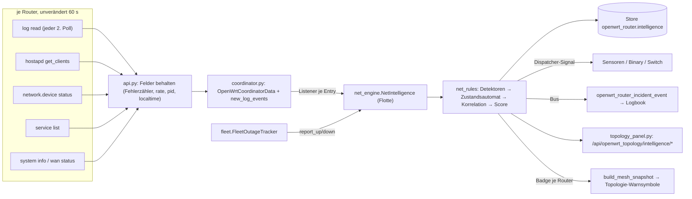

# Plan: OpenWrt Network Intelligence (Ereignisse, Incidents, Health-Score)

<!-- Ablage: docs/plans/2026-11-16-network-intelligence.md · wird im Feature-Branch mit dem PR committet.
     Keine IPs, MACs, Hostnamen echter Geräte, Passwörter oder Tokens. Rollen statt Namen. -->

Kennzeichnung jeder Aussage: **verifiziert** (im Code oder in einer Repo-Datei mit `datei:zeile`
belegt), **Annahme** (plausibel, aber noch nicht belegt; Prüfweg steht dabei), **Vorschlag**
(Planentscheidung, noch nicht freigegeben). Alle Codezeilen beziehen sich auf `main@f8a2ac7`
(v1.39.0 plus `[Unreleased]` in `CHANGELOG.md:5-23`).

## Status

- **Stand:** 2026-11-16 · **Phase:** freigegeben (Nutzer, 2026-11-16), in Umsetzung
- **Branch/PR:** `feature/network-intelligence` · Worktree `../ha-openwrt-router-net-intel` · PR #— · Basis: v1.39.0 (`main@f8a2ac7`)
- **Erledigt:** Live-Checks · **In Arbeit:** P1 · **Offen:** P2–P8
- **Blocker:** keine
- **Nächster Schritt:** P1 prüfen (Diff lesen, `checks.py`), dann P2.

### Entscheidungen (2026-11-16)

Der Nutzer hat den Plan freigegeben und die Produktentscheidungen dem Coordinator überlassen.
Entschieden nach der Empfehlung des Plans:

- F1 Flotten-Entities am Anker-Entry; Rückfall auf reine Router-Entities, falls A9 im Test nicht hält.
- F2 Schwellen und Einstellungen im Store, bearbeitet im Panel (keine Config-Entry-Migration).
- F3 Keine ACL v9. Conntrack nur als Sprung der Anzahl.
- F4 30 Tage, 3000 Events, 500 Incidents, höchstens 1,5 MB.
- F5 Kanalauslastung über `hostapd get_status` alle 5 Polls, Standard aus (L2 zeigt die Felder).
- F6 Keine zusätzlichen Benachrichtigungen; HA-Event und Entities genügen.

Weiter offen und nur mit eigener Freigabe des Nutzers: Änderungen an Routern, Deploy nach
Home Assistant, Merge nach `main`, Release.

### Live-Checks (2026-11-16, lesend, Gateway und ein Dumb-AP, beide OpenWrt 25.12.1 mediatek/filogic)

- A1 **bestätigt:** `network.device status` liefert `carrier`, `rx_errors`, `tx_errors`, `rx_dropped`, `tx_dropped`, `collisions`, zusätzlich `rx_crc_errors`.
- A2 **bestätigt:** `hostapd.<if> get_status` liefert `airtime` mit `time`, `time_busy`, `utilization`.
- A3 **bestätigt:** `get_clients` liefert pro Station `rate`, `airtime`, `signal`, `packets`, `bytes`.
- A4 **teilweise:** `service list` liefert pro Instanz `pid`, `running`, `respawn`. Ein `exit_code` war nicht zu sehen (kein abgestürzter Dienst im Moment der Abfrage). Neustart-Erkennung daher über PID-Wechsel.
- A5 **bestätigt:** `system info` liefert `localtime`.
- A6 **teilweise:** In 300 Logzeilen standen nur `hostapd`, `crond`, `dropbear`, `usteer`. Kernel-, netifd-, procd-, odhcpd- und ntpd-Zeilen waren im Fenster nicht zu sehen, ihre Form bleibt Annahme. hostapd schreibt beim Standard-Log-Level (L11: `log_level` nicht gesetzt) „deauthenticated due to local deauth request“, „deauthenticated due to inactivity“, „disassociated due to inactivity“, dazu `AP-STA-CONNECTED`/`-DISCONNECTED`. Fehlgeschlagene Assoziation und SAE-Fehler kamen im Fenster nicht vor.
- **Neuer Befund:** Auf dem Gateway waren 90 von 300 Zeilen `crond`. Das 200-Zeilen-Fenster des Log-Abrufs kann dadurch WLAN-Zeilen verlieren. In P4 prüfen (`LogCursor` meldet verpasste Zeilen), Abdeckung dann sichtbar senken.
- A7 **offen:** `wan6` existiert auf dem Gateway, ist aber nicht verbunden (`up: false`, `pending`). IPv6 ist in diesem Netz nicht in Betrieb; die Regel 3.26 lässt sich hier nicht live prüfen. Auf dem Dumb-AP gibt es `wan6` nicht (erwartet).
- A8 **bestätigt:** `network.interface.wan status` liefert `uptime` (Gateway).

## Problem und Zielverhalten

Die Integration erkennt heute viele Einzelsignale (WLAN-Logzeilen, DHCP-Probleme, DFS, RAM-Druck,
Kanalkonflikte, Router-Ausfälle), aber jedes für sich: als HA-Bus-Event, als Repairs-Issue, als
Eintrag in einer 30er-Liste im Speicher oder als Regel im Panel. Es gibt kein gemeinsames
Ereignismodell, keine Bündelung zu einer Hauptursache über Router hinweg, keinen Health-Score und
keinen Verlauf über einen HA-Neustart hinaus (verifiziert: `coordinator.py:459`, `TODO.md:101-102`,
`PROGRESS.md:210`).

Danach soll gelten: Jede Beobachtung wird ein `NetEvent` mit Zeit, Router, Betroffenem, Typ,
Häufigkeit, Signal, Schweregrad, Ursache und Konfidenz. Zusammengehörige Events werden zu einem
`Incident` mit Status, Belegen und optionaler Eltern-Ursache. Fällt ein AP aus, sieht der Nutzer
**einen** Haupt-Incident „AP nicht erreichbar“ statt zwanzig Client-Alarme. Fehlen Daten, zeigt der
Health-Score `unknown` statt „gesund“. Der Verlauf überlebt einen HA-Neustart (30 Tage).
Im Fehlerfall (Router weg, Log nicht lesbar, Store kaputt) bleibt die Integration funktionsfähig;
die Engine meldet dann `unknown` bzw. leere Listen, nie einen Absturz des Polls.

**Nicht-Ziele:**
- Keine externe KI, kein Cloud-Dienst; nur eine leere Schnittstelle für spätere lokale Analyse.
- Keine zweite Topologie, kein zweites Panel.
- Keine Entity pro WLAN-Client (die vorhandenen `device_tracker` bleiben, wie sie sind).
- Keine neuen SSH-Kommandos im Poll, kein `ubus listen`, kein Dauer-SSH.
- Keine ACL-Änderung in P1–P8 (eine optionale ACL v9 nur nach eigener Freigabe, F3).
- Keine Paketverlust-, DNS- oder Interferenzmessung auf dem Router (nicht belastbar messbar, siehe Abdeckung).
- Kein automatisches Eingreifen (kein Neustart, kein Reload) als Reaktion auf Incidents.

## Akzeptanzkriterien

- [ ] AK1 Fällt ein Dumb-AP aus (alle Polls scheitern), entsteht genau **ein** aktiver Incident `router_unreachable` (Scope Router). Disconnect-Events seiner Clients in den 120 s davor werden ihm als Kinder zugeordnet und lösen weder HA-Events noch eigene Incidents aus.
- [ ] AK2 Sind alle Router gleichzeitig weg, entsteht ein Incident `lan_unreachable` (Scope Flotte). Die Router-Incidents sind seine Kinder. Das Verhalten passt zum bestehenden `FleetOutageTracker`.
- [ ] AK3 Ein Client mit ≥ 5 Reconnects in 10 min erzeugt einen Incident `wifi_reconnect_storm` (Scope Client). Weitere Reconnects erhöhen nur `occurrences`. Nach 30 min Ruhe wird der Incident `resolved`. Ein erneuter Sturm innerhalb des Cooldowns öffnet denselben Incident wieder (`reopen_count` + 1).
- [ ] AK4 Ist der Health-Score-Sensor eines Routers aktiv, liegt sein Wert zwischen 0 und 100 oder ist `unknown`. Er ist `unknown`, solange die Abdeckung unter der Mindestabdeckung liegt, etwa direkt nach dem HA-Start oder bei Router offline. Er ist nie 100 bei fehlenden Daten.
- [ ] AK5 Nach einem HA-Neustart sind Incidents und Problem-Events der letzten 30 Tage im Panel wieder sichtbar. Die Store-Datei bleibt unter 1,5 MB.
- [ ] AK6 Jede Ursache trägt `cause_status`: `confirmed` nur bei Messdaten, sonst `hypothesis`. Ein Incident, der auf einer abgeleiteten Topologie-Kante beruht, hat höchstens Konfidenz 0,6 und `cause_status = hypothesis`.
- [ ] AK7 Die Diagnose-Datei enthält aus der Engine nur Zähler, Typen und Zeiten. MAC, IP, Hostname, SSID und Routername sind redigiert.
- [ ] AK8 Neue Abfragen pro Router und Poll: 0. Optional ab P4 höchstens 1 `hostapd.* get_status` je AP-Interface alle 5 Polls, und das nur nach L2. ACL bleibt v8.
- [ ] AK9 Wartungsmodus an: Events werden markiert gespeichert, es entstehen keine Incidents, HA-Events oder Score-Abzüge. Wartungsmodus aus: Normalbetrieb ohne Nachzügler-Alarme.
- [ ] AK10 Panel: Der Tab „Diagnose“ zeigt Übersicht, Timeline mit Filtern (Router, Kategorie, Schweregrad, Zeitraum), WLAN, Infrastruktur und Incident-Detail. Die Topologie trägt Warnsymbole an betroffenen Knoten. Bestätigen und Ignorieren gehen nur als Admin.
- [ ] AK11 Ein HA-Event `openwrt_router_incident_event` feuert genau einmal bei `opened`, `resolved` und `reopened`, ab Schweregrad `warning` (einstellbar). Für Kinder unter einer aktiven Eltern-Ursache feuert es nicht.

## Befunde im Code (verifiziert)

### a) Bestandsaufnahme

**Ereignisquellen und -senken**
- `custom_components/openwrt_router/log_parser.py:149-177` – `parse_entry` wertet nur Prozesse `hostapd` und `dnsmasq*` aus (`:173-176`). Zeilen von netifd, procd, odhcpd, Kernel, ntpd und dropbear werden verworfen. (verifiziert)
- `log_parser.py:87-102` – erkannte hostapd-Arten: `connected`, `disconnected`, `psk_mismatch`, `inactivity_timeout` (nur „deauthenticated due to inactivity“) und `handshake_failed` (inkl. „EAPOL-Key timeout“, „invalid MIC“). Allgemeines Deauth/Disassoc mit Reason-Code, Association-Reject und SAE/WPA3-Fehler fehlen. (verifiziert)
- `log_parser.py:104-112` – DHCP-Arten `ack`, `nak`, `decline`; `no_address` separat. `:39-51` DFS-Arten. `:55-61` `COUNT_ONLY_KINDS` (connect/disconnect/ack werden nur gezählt). (verifiziert)
- `log_parser.py:128-146` – `LogEvent` (frozen) hat Kategorie, Art, Log-ID, Zeit, MAC, Interface, IP, Text, Frequenz und Kanal. Es fehlen SSID/Band, Signal, Schweregrad, Ursache und Konfidenz. (verifiziert)
- `log_parser.py:269-313` `LogCursor` (ID-Dedup, Baseline, verpasste Zeilen, logd-Neustart), `:316-355` `EventLimiter`, `:358-377` `RollingCounter`. Diese Bausteine sind wiederverwendbar. (verifiziert)
- `coordinator.py:459` – `_event_history = deque(maxlen=30)`, nur im Speicher. `coordinator.py:1774-1858` `_record_events` schreibt WAN verbunden/getrennt, CPU ≥ 80 / < 65 % und RAM erhöht/normal mit fest deutschen Texten (`:1788`, `:1797`, `:1810`, `:1820`, `:1843`, `:1853`). (verifiziert)
- `coordinator.py:1443-1488` `_fire_log_event` feuert `EVENT_WIFI`/`EVENT_DHCP` (`const.py:526-527`) nur für Problem-Arten. `coordinator.py:1646` feuert `EVENT_DFS` (`const.py:531`). (verifiziert)
- `topology_diagnostic.py:374-375` – Der Router-Knoten im Snapshot trägt `events` und `cpu_history`. Das Panel liest höchstens 30 davon (`frontend/topology/src/api.ts:670`, `:797`) und zeigt 10 in der Router-Detailansicht (`components/DetailPanel.tsx:228-242`). (verifiziert)

**Bündelung, Entprellung, Repairs**
- `fleet.py:92-314` `FleetOutageTracker` ist ein hass.data-Singleton (`fleet.py:84`) mit 30 s Settle-Zeit (`fleet.py:60`). `_all_down` (`fleet.py:176`) bündelt ab 2 Routern ohne Auth-Fehler zu **einem** `lan_unreachable`, sonst einem Issue pro Router. Er feuert `EVENT_OUTAGE` (`const.py:194`) mit `scope`/`state`. Das ist bereits Root-Cause-Bündelung über Router hinweg. (verifiziert)
- `fleet.py:444-525` `ChannelPlanMonitor`: 2-Poll-Entprellung, Hysterese beim Aufheben. (verifiziert)
- `issues.py:32-50` – Issues sind nicht reparierbar und nicht persistent. IDs: `channel_plan_conflict`, `lan_unreachable`, `ram_high`, `router_unreachable`. (verifiziert)
- `coordinator.py:1703-1768` RAM-Druck mit Hold (`const.py:200-203`: 85 %/80 %, 15 min). Dazu gibt es zwei weitere Speicherformeln: `cpu_history` (`coordinator.py:925`) und `_record_events` (RAM ≥ 90/< 80). (verifiziert)

**WLAN-Client-Analyse**
- `client_stability.py:26-35` – Konstanten: Sticky-Delta 8 dB, Hold 600 s, schwaches Signal −75 dBm, Reconnect-Fenster 300 s, ≥ 3 Reconnects = instabil, Top 10. (verifiziert)
- `client_stability.py:163-209` `AssociationTracker`: Ein Reconnect zählt nur auf demselben Interface innerhalb von 300 s; ein Bandwechsel zählt **nicht**. `:146` `HoldTimer`, `:92` `sticky_candidates`, `:212` `unstable_top`. (verifiziert)
- `fleet.py:342` `collect_radios`, `:394` `usteer_node_info`, `:417` `client_counts` (Clients pro Router über die Flotte). (verifiziert)
- `dhcp_health.py:82` `pool_usage` (usage_pct), `:137` `client_dhcp_status` (`ok`/`pending`/`dhcp_missing`/`static_no_lease`, 180 s); `fleet.py:359` `dhcp_context` (None, wenn ein Pool-Server nicht erreichbar ist). (verifiziert)
- `api.py:2691-2715` – `hostapd.<if> get_clients` läuft pro Interface in jedem Poll. Behalten werden nur Signal, `connected_time` und Bytes. `rate`, `airtime`, `retries` und Ähnliches werden verworfen. (verifiziert für das Verwerfen; welche Felder hostapd liefert, ist **Annahme** → L3)

**Infrastruktur**
- `coordinator.py:687-700` – `ping_ms` ist eine **TCP-Verbindung vom HA-Host** zu einem öffentlichen DNS-Server auf Port 53. Sie läuft in jedem Router-Coordinator gleich und misst weder vom Router aus noch Paketverlust. (verifiziert)
- `coordinator.py:745` – `uptime` fällt bei fehlendem Wert auf 0. Eine Neustart-Erkennung muss 0 als „fehlt“ behandeln. (verifiziert)
- `api.py:4282-4307` `get_port_stats`: Aus `network.device status` werden `up`, Speed/Duplex, Bytes und Pakete übernommen. `statistics.*_errors`/`*_dropped` und `carrier` werden **verworfen**, obwohl die Antwort ohnehin geladen ist. (verifiziert für das Verwerfen; die Felder selbst sind **Annahme** → L1)
- `api.py:4908-4960` `get_services`: Pro Poll läuft procd `service list`. Behalten wird nur `running` pro Dienst, keine PID und keine Neustart-Zähler. `const.py:557` `DEFAULT_SERVICES` = dnsmasq, dropbear, firewall, network, uhttpd, wpad (ohne odhcpd). Die Liste speist die Dienst-Schalter und -Buttons (`switch.py:363`, `button.py:294`). (verifiziert)
- `coordinator.py:1006` `active_connections` (Conntrack-Anzahl). `acl_provisioning.py:92` erlaubt nur `nf_conntrack_count`, nicht `nf_conntrack_max`. Eine Prozent-Auslastung ist ohne ACL-Änderung nicht messbar. (verifiziert)
- `coordinator.py:831` LLDP läuft per SSH höchstens alle 600 s (`docs/plans/2026-10-28-ssh-polling-und-audit.md:28`, `:86`). (verifiziert)
- `topology_mesh.py:1533-1839` `build_mesh_snapshot`: Rollen sind eine Flottenentscheidung (`:1571-1593`). Offline-Router werden `stale` markiert (`:1626-1649`). `inferred` gibt es an Knoten und Kanten (`topology_diagnostic.py:345`, `topology_mesh.py:1817-1820`). (verifiziert)

**HA-Anbindung**
- `__init__.py:182-188` `_LEGACY_DYNAMIC_PATTERNS` = `_iface_`, `_rate`, `_radio_`, `_ap_`, `_port_` als **Teilstring**-Treffer. Eine neue `unique_id` mit einem dieser Teilstrings wird bei der Migration abgeschaltet (`__init__.py:202-206`). (verifiziert)
- Unique-ID-Muster `f"{entry.entry_id}_{key}"` (`sensor.py:696`, `binary_sensor.py:125`, `button.py:149`, `topology_entities.py:151`). `PARALLEL_UPDATES` ist in keiner Plattform gesetzt (Grep: 0 Treffer). (verifiziert)
- `config_flow.py:94-160` OptionsFlow (`step_id="init"`, Merge `:103`, Panel-Zielgruppe direkt ohne Update-Listener `:118-135`). `VERSION` 2/`MINOR_VERSION` 2 (`:179`, `:182`). `__init__.py:499` `async_reload_entry` ist nicht verdrahtet. (verifiziert)
- `diagnostics.py:162-175` `_redact`: HA-Redaktion nach Schlüssel plus Teilstring-Pass. Client-Listen werden zu Zählern (`:96-106`). (verifiziert)
- `topology_panel.py:63` `_PANEL_VERSION`, `:119-165` einzige View `GET /api/openwrt_topology/snapshot` (Auth, Admin-Pflicht außer Option, 410 nach Unload, 500 mit `meta.error`). (verifiziert)
- `frontend/topology/src/useAlerts.ts:15-21` – Panel-Regeln mit **eigenen** Schwellen (CPU 85 %, RAM 90 %, Ping 100 ms, 30 Clients/AP, Backhaul/Client −80 dBm). Sie weichen vom Backend ab (CPU 80 %, RAM 85 %, schwach −75 dBm). `TopologyView.tsx:525-532` Tab `alerts`. (verifiziert)
- `acl_provisioning.py:45` `ACL_VERSION = 8`. `:100-129` erlaubt bereits `hostapd.* get_status`, `network.device status`, `network.interface.* status`, `log read`, `usteer get_clients`, `service list`, `system info`. Ein `iwinfo survey` fehlt; `iwinfo scan` ist erlaubt, aber störend. (verifiziert)

**Frühere Entscheidungen, an die dieser Plan anknüpft**
- `docs/plans/2026-10-27-wlan-diagnose-features.md:38` – „persistenter Verlauf über HA-Neustarts“ war damals ein Nicht-Ziel. Dieser Plan macht ihn zum Ziel. (verifiziert)
- `docs/plans/2026-10-28-ssh-polling-und-audit.md:28` – kein SSH im normalen Poll; Daten, die es nur per SSH gibt, höchstens alle 600 s. (verifiziert)

### Annahmen (offen, mit Prüfweg)

- **Annahme A1:** `network.device status` liefert pro Port `statistics.rx_errors`, `tx_errors`, `rx_dropped`, `tx_dropped`, `collisions` und `carrier`. → L1
- **Annahme A2:** `hostapd.<if> get_status` liefert eine Kanalauslastung (`airtime`/`chan_util` o. ä.), wenn der Treiber es kann. → L2
- **Annahme A3:** `get_clients` liefert pro Station `rate.rx`/`rate.tx` (und eventuell `retries`). → L3
- **Annahme A4:** procd `service list` liefert pro Instanz `pid` und bei Abstürzen `exit_code`/`respawn`. → L4
- **Annahme A5:** `system info` liefert `localtime`, damit ist die NTP-Abweichung gegen die HA-Zeit messbar. → L5
- **Annahme A6:** Kernel-, netifd-, procd-, odhcpd- und ntpd-Zeilen stehen mit erkennbarem Prozess-Präfix im logd-Puffer. hostapd protokolliert beim Standard-Log-Level Deauth/Disassoc-Gründe und SAE-Fehler. → L6, L11
- **Annahme A7:** `network.interface.wan6 status` (bzw. `dump`) liefert IPv6-Präfix und RA-Zustand. → L7
- **Annahme A8:** `network.interface.wan status` liefert `uptime`, damit sind WAN-Reconnects auch ohne einen Poll im Ausfall erkennbar. → L8
- **Annahme A9:** Das HA-Entity-Registry übernimmt bei gleicher `unique_id` aus einem anderen Config-Entry dessen `config_entry_id`. Das betrifft Flotten-Entities (F1) und ist im Test mit Registry-Mock zu prüfen.

## b) Abdeckungstabelle

Status: **vorhanden** (gibt es schon, wird nur angeschlossen) · **erweitern** (Bausteine vorhanden,
Logik/Feld fehlt) · **neu** · **nicht belastbar messbar** (ohne neue Messquelle nur als Hypothese
oder gar nicht). Datenquelle ohne Zusatz = schon im Poll vorhanden, **0 neue Aufrufe**.

| # | Anforderung | Status | Begründung | Datenquelle |
|---|---|---|---|---|
| **1** | **Bestandsaufnahme** | | | |
| 1.1 | Bestand mit Belegen | vorhanden | Abschnitt a) oben, alle Belege mit `datei:zeile` | Code |
| **2** | **WLAN-Fehlererkennung** | | | |
| 2.1 | Reconnect-Stürme | erweitern | Der `AssociationTracker` zählt Reconnects nur pro Interface und 300 s (`client_stability.py:163-209`). Eine Sturm-Regel (≥ 5/10 min) mit Incident fehlt. | hostapd-Log `connected` (`log_parser.py:88`), `get_clients` je Poll |
| 2.2 | Verbindungsabbrüche | erweitern | `disconnected` wird nur gezählt (`log_parser.py:55-61`). Neu: stündliche Zähler pro Router/Band und ein Massen-Regel-Event. | hostapd-Log |
| 2.3 | WPA2/WPA3-Auth-Fehler | erweitern | WPA2: `psk_mismatch`, `handshake_failed` vorhanden (`log_parser.py:90-101`). SAE/WPA3-Fehlerzeilen fehlen (Annahme A6). | hostapd-Log |
| 2.4 | Fehlgeschlagene Assoziation | neu | Kein Muster vorhanden. Ob hostapd das beim Standard-Log-Level schreibt, ist Annahme A6. | hostapd-Log (L6, L11) |
| 2.5 | Handshake-Timeouts | erweitern | „EAPOL-Key timeout“ wird schon als `handshake_failed` erkannt (`log_parser.py:95-101`). Neu: eigene Art `handshake_timeout` und ein Incident. | hostapd-Log |
| 2.6 | Deauth/Disassoc | erweitern | Nur Inaktivitäts-Deauth wird erkannt (`log_parser.py:92-94`). Allgemeine Deauth/Disassoc-Zeilen mit Reason-Code sind neu (Annahme A6). | hostapd-Log |
| 2.7 | DHCP-Fehler nach Connect | erweitern | `nak`/`decline`/`no_address` sind vorhanden (`log_parser.py:104-112`). Neu: Zuordnung zu einem `connected` derselben MAC innerhalb von 60 s. | dnsmasq- + hostapd-Log |
| 2.8 | Verbunden ohne IP | erweitern | `client_dhcp_status` liefert `dhcp_missing` nach 180 s (`dhcp_health.py:137`). Bisher entsteht daraus kein Event und kein Incident. | Leases + Clients |
| 2.9 | Bandwechsel | neu | Der `AssociationTracker` blendet Bandwechsel bewusst aus (`client_stability.py:163-209`). Neu: Wechsel von Radio/Band pro MAC zwischen zwei Polls. | `get_clients` + `collect_radios` (`fleet.py:342`) |
| 2.10 | Roaming-Flapping | erweitern | Flottenweit fehlt eine AP-Wechsel-Zählung. Bausteine: `client_counts` (`fleet.py:417`), usteer (`fleet.py:394`). | Clients aller Router, usteer |
| 2.11 | Dauerhaft schwaches Signal | erweitern | −75 dBm und `HoldTimer` sind vorhanden (`client_stability.py:26-35`, `:146`). Neu: Incident pro AP („N Clients dauerhaft schwach“) statt pro Client. | `get_clients` Signal |
| 2.12 | Schwankende Datenrate | nicht belastbar messbar | Bei 60 s Abtastung gibt es nur Momentwerte. `rate` wird zudem verworfen (`api.py:2701-2715`). Möglich ist eine grobe Spannweite über 10 Polls als **Hypothese** (A3). | `get_clients` `rate` (L3) |
| 2.13 | Kanalauslastung / Interferenz | erweitern / nicht belastbar messbar | Auslastung: `hostapd get_status` ist im ACL (`acl_provisioning.py:102`), Feld ist Annahme A2. Gleichkanal zwischen eigenen APs: vorhanden (`fleet.py:444`). Fremd-Interferenz: nicht messbar (kein `survey` im ACL, `scan` stört den Betrieb). | `hostapd get_status` (optional, L2) |
| 2.14 | Event-Felder (Zeit, Router, SSID/Band, Client, Typ, Häufigkeit, Signal, Schwere, Ursache, Konfidenz) | neu | `LogEvent` hat diese Felder nicht (`log_parser.py:128-146`). Neues `NetEvent`-Modell (c). | Engine |
| 2.15 | Ursache nur mit Messdaten bestätigt | neu | Neues Feld `cause_status` = `confirmed` / `hypothesis` (c). | Engine |
| **3** | **Infrastruktur** | | | |
| 3.1 | Router-Neustart | neu | `uptime` ist vorhanden (`coordinator.py:745`). Neu: Erkennung, wenn die Uptime sinkt (0 = fehlt). | `system info` |
| 3.2 | Router nicht erreichbar | vorhanden | Über `FleetOutageTracker` (`fleet.py:92-314`); die Engine übernimmt dessen Zustand. | Poll-Ergebnis |
| 3.3 | CPU | erweitern | Schwellen 80/65 % gibt es nur als Timeline-Text (`coordinator.py:1774-1858`). Neu als Incident mit Hysterese. | `system info` |
| 3.4 | RAM | vorhanden | `ram_high` mit Hold (`coordinator.py:1703-1768`). Die Engine spiegelt das Issue; es bleibt eine einzige Formel (`calc_memory_pressure`, `coordinator.py:170`). | `system info` |
| 3.5 | Conntrack | erweitern | Anzahl ist vorhanden (`coordinator.py:1006`). Prozent ist ohne `nf_conntrack_max` nicht messbar (`acl_provisioning.py:92`). Ohne ACL: Trend bzw. Sprung der Anzahl. | `nf_conntrack_count`; Prozent nur mit ACL v9 (F3) |
| 3.6 | Abgestürzte Dienste (dnsmasq/hostapd/wpad/odhcpd) | erweitern | `service list` läuft bereits je Poll, behalten wird aber nur `running` (`api.py:4950-4957`). Neu: PID-Wechsel = Neustart (A4), eigene Dienstliste in der Engine. `DEFAULT_SERVICES` bleibt unverändert, sonst entstehen neue Schalter (`const.py:557`, `switch.py:363`). | procd `service list` (L4) |
| 3.7 | ubus/rpcd-Fehler | erweitern | `error_type` und `consecutive_failures` stehen in den Daten (`coordinator.py:241-349`, `:1297`). Neu als Events. | Poll-Ergebnis |
| 3.8 | Auth/ACL | erweitern | `ConfigEntryAuthFailed` nach 3 Fehlschlägen (`coordinator.py:1036-1110`), `log_status = not_permitted` (`const.py:550-554`). Neu als Events/Incident. | Poll-Ergebnis |
| 3.9 | NTP | neu | Abweichung `localtime` gegen HA-Zeit (A5). Ein Zeitsprung im Log ist ein zweiter Hinweis. | `system info` (L5) |
| 3.10 | Link-Flapping | erweitern | `up` pro Port und Poll ist vorhanden (`api.py:4300`). Flaps unter 60 s sind nur über Kernel-/netifd-Logzeilen sichtbar (A6). | `network.device status`, Log |
| 3.11 | Speed-Wechsel | erweitern | `speed_mbps` ist vorhanden (`api.py:4301`). Neu: Abfall unter das 24-h-Maximum. | `network.device status` |
| 3.12 | RX/TX-Fehler und Drops | erweitern | Die Zähler werden heute verworfen (`api.py:4296-4307`). Neu: Felder behalten (A1), Delta-Regel. | `network.device status` (L1) |
| 3.13 | Port-Last | erweitern | Raten sind vorhanden (`coordinator.py:965`, `sensor.py:1186`). Neu: Schwelle in % der Link-Speed. | `network.device status` |
| 3.14 | Uplink-Verlust | erweitern | Der Uplink-Port kommt aus Inter-Router-Kanten (`topology_mesh.py:1640-1650`). Das ist Heuristik: `inferred`, Konfidenz ≤ 0,6. | Ports + Topologie |
| 3.15 | LLDP-Änderungen | erweitern | Nachbarn sind vorhanden (`coordinator.py:831`, 600 s). Neu: Diff zwischen zwei LLDP-Ständen. | LLDP (SSH, 600 s, unverändert) |
| 3.16 | MAC-Änderungen | erweitern | Router-ID kommt aus der MAC (`topology_diagnostic.py:318`). FDB pro Port ist vorhanden (`port_fdb_map`). Neu: Router-MAC gewechselt; Client-MAC wandert zwischen Ports. | `system board`, FDB |
| 3.17 | Loops (nur belastbar) | nicht belastbar messbar | Ohne STP-Zustand und ohne Broadcast-Zähler je Port im ACL gibt es keinen belastbaren Indikator. Ein MAC-Wandern im FDB ergibt höchstens eine Hypothese (Konfidenz ≤ 0,4, nie `critical`). | FDB (Hypothese) |
| 3.18 | VLAN | erweitern | `port_vlan_map` und `vlans_stale` sind vorhanden (`coordinator.py:241-349`). Neu: Konfigurationsänderung als Event. | `uci get network` |
| 3.19 | WAN-Ausfall/-Reconnect | erweitern | Verbunden/getrennt gibt es als Timeline-Text (`coordinator.py:1784-1797`). Neu: Zähler, WAN-Uptime-Reset (A8), Incident. | `network.interface.wan status` (L8) |
| 3.20 | Paketverlust | nicht belastbar messbar | Kein Ping vom Router aus. `ping_ms` ist eine einzelne TCP-Verbindung vom HA-Host (`coordinator.py:687-700`). | – |
| 3.21 | Latenz | erweitern | Nur als „Latenz vom HA-Host“, klar so beschriftet, einmal je Flotte statt je Router (`coordinator.py:687-700`). Router-seitig nicht messbar. | HA-Host |
| 3.22 | DNS | nicht belastbar messbar | Es gibt keine Auflösungsprobe. dnsmasq-Fehlerzeilen ergeben höchstens eine Hypothese (A6). | dnsmasq-Log (Hypothese) |
| 3.23 | Lease-Probleme | vorhanden | `nak`/`decline`/`no_address` (`log_parser.py:104-112`), Events (`coordinator.py:1443-1488`). | dnsmasq-Log |
| 3.24 | Pool fast voll | vorhanden | `pool_usage` (`dhcp_health.py:82`), Pool-Sensor (`sensor.py:1486`). Neu: Incident ab 90 %. | `uci` + Leases |
| 3.25 | Konflikte | erweitern | `DHCPDECLINE` = Client meldet Konflikt (`log_parser.py:112`). Neu: eine IP mit mehreren MACs in `arp_table`. | Log, ARP |
| 3.26 | IPv6 RA/Präfix | neu | Bisher nicht ausgewertet. `network.interface.*` ist im ACL (`acl_provisioning.py:106`). Die Daten kommen aus `dump`/`wan6` (A7), nur auf dem Gateway. | `network.interface dump` (L7) |
| 3.27 | WAN-IP-Wechsel | erweitern | `wan_status.ipv4` ist vorhanden (`topology_diagnostic.py:349`). Neu: Wechsel = Info-Event. | `network.interface.wan status` |
| 3.28 | Unterscheidung lokal / DNS / WAN / einzelner Client | neu | Entscheidungstabelle in der Korrelation (c4). DNS bleibt eine Hypothese. | Engine |
| **4** | **Multi-AP / Mesh** | | | |
| 4.1 | AP-Ausfall | vorhanden | `FleetOutageTracker` (`fleet.py:92`), Panel-Regel (`useAlerts.ts:108-119`). | Poll-Ergebnis |
| 4.2 | Häufige AP-Wechsel | erweitern | Wie 2.10, aber pro AP aggregiert. | Clients aller Router |
| 4.3 | Hohe / ungleiche Clientzahl | erweitern | Zähler sind vorhanden (`fleet.py:417`), Panel-Schwelle 30 (`useAlerts.ts:18`). Neu: Ungleichverteilung (max/Median) als Info. | Clients |
| 4.4 | Schwacher Uplink | erweitern | Mesh: Backhaul-Signal aus `sta_interfaces`, Panel −80 dBm (`useAlerts.ts:19`). Kabel: Speed/Fehler am Uplink-Port (3.11/3.12). | `sta_interfaces`, Ports |
| 4.5 | Geänderte Verkabelung | erweitern | Diff von LLDP und Inter-Router-Kanten (`topology_mesh.py:1640`). Ohne LLDP ist das nur eine Hypothese. | LLDP, FDB |
| 4.6 | Backhaul-Unterbrechungen | erweitern | Mesh: `sta_interfaces` wechselt auf down. Kabel: Uplink-Port down. | `sta_interfaces`, Ports |
| 4.7 | Gleichzeitige Disconnects | neu | Regel: ≥ 5 Clients oder ≥ 50 % eines APs in 30 s. | hostapd-Log, Clients |
| 4.8 | Root-Cause, ein Haupt-Incident | erweitern | Das Muster gibt es in `_all_down` (`fleet.py:176`). Neu als allgemeine Eltern/Kind-Korrelation. | Engine |
| 4.9 | Heuristische Topologie ist kein Beweis | neu | `inferred` existiert (`topology_mesh.py:1817-1820`). Neu: Kappung der Konfidenz und `hypothesis`. | Engine |
| **5** | **Engine** | | | |
| 5.1 | Modular, deterministisch | neu | Reine Funktionen ohne HA-Import (Vorbild `log_parser.py`). | – |
| 5.2 | Keine externe KI | neu | Festgelegt; keine Netzwerkaufrufe aus der Engine. | – |
| 5.3 | Schnittstelle für spätere lokale Analyse | neu | Leeres `Protocol` plus Export-Funktion, standardmäßig aus (c1). | – |
| **6** | **Datenquellen** | | | |
| 6.1 | hostapd | vorhanden | Log und `get_clients` (`api.py:2691`). | – |
| 6.2 | iwinfo | vorhanden | `info`/`assoclist` (`acl_provisioning.py:113-119`). | – |
| 6.3 | iw | nicht belastbar messbar | Nur per SSH-exec erreichbar; das widerspricht „kein aggressives SSH“. Bewusst nicht genutzt. | – |
| 6.4 | logread | vorhanden | `log read`, `stream:false` (`api.py:1867-1889`). | – |
| 6.5 | procd | erweitern | `service list` (`api.py:4936`), PID neu (A4). | – |
| 6.6 | netifd | erweitern | `network.device status`, `network.interface.*` (`api.py:4240`); Logzeilen neu. | – |
| 6.7 | odhcpd | neu | Logzeilen (A6) und Dienststatus. | – |
| 6.8 | dnsmasq | vorhanden | Log (`log_parser.py:175`). | – |
| 6.9 | Kernel | neu | Logzeilen (Link up/down, OOM) (A6). | – |
| 6.10 | LLDP | vorhanden | SSH, 600 s (`coordinator.py:831`). | – |
| 6.11 | ubus-Events | nicht belastbar messbar | Über die HTTP-JSON-RPC-Abfrage gibt es kein `listen`. Dauer-SSH ist ausgeschlossen. Ob die SSE-Subscription von uhttpd-mod-ubus nutzbar wäre, ist eine Annahme und nicht Teil des Plans. | – |
| 6.12 | Kein aggressives SSH | vorhanden | Kein SSH im normalen Poll (`docs/plans/2026-10-28-ssh-polling-und-audit.md:28`). | – |
| 6.13 | Inkrementelle Logs | vorhanden | `LogCursor` (`log_parser.py:269-313`). | – |
| 6.14 | Ringpuffer | erweitern | `deque(30)` (`coordinator.py:459`) → Engine-Ring mit Kappung. | – |
| 6.15 | Dedup | vorhanden | `LogCursor`-ID-Dedup, `EventLimiter` (`log_parser.py:316`). Neu: Incident-Dedup. | – |
| 6.16 | Rotation/Neustart überstehen | erweitern | logd-Neustart: vorhanden (`LogCursor`). HA-Neustart: Store neu (c5). | – |
| 6.17 | Minimale ACL | vorhanden | v8 (`acl_provisioning.py:45`), in P1–P8 unverändert. | – |
| 6.18 | Beobachtet vs. abgeleitet | erweitern | `inferred` an der Topologie vorhanden. Neu: `origin` an jedem Event/Incident. | – |
| **7** | **Health-Score** | | | |
| 7.1 | 0–100 | neu | Formel in c6. | Engine |
| 7.2 | Teilbereiche | neu | WLAN, System, LAN, WAN, DHCP/DNS. | Engine |
| 7.3 | Konfigurierbar | neu | Gewichte und Abzüge in den Einstellungen (c8). | Store |
| 7.4 | Fehlende Daten = `unknown` | neu | Abdeckungsmaß; Vorbild ist `not_permitted` statt „ok“ (`const.py:550-554`). | Engine |
| **8** | **Dashboard** | | | |
| 8.1 | Im bestehenden Panel, keine zweite Topologie | erweitern | Tabs in `TopologyView.tsx:505-534`; `alerts` wird zu „Diagnose“. | API |
| 8.2 | Übersicht | erweitern | `AlertsView` (`components/AlertsView.tsx:30`) → Score, aktive Incidents. | `/intelligence/summary` |
| 8.3 | Timeline mit Filtern | erweitern | Bisher 10 Events pro Router ohne Filter (`DetailPanel.tsx:228-242`). | `/intelligence/events` |
| 8.4 | WLAN-Diagnose | neu | Ansicht nach SSID/Band/AP. | `/intelligence/events?category=wifi` |
| 8.5 | Infrastruktur | neu | Ansicht nach Router/Port/Dienst/WAN. | `/intelligence/summary` |
| 8.6 | Incident-Detail mit Status aktiv/behoben/bestätigt/ignoriert | neu | Belege, Kinder, Ursache, Konfidenz, Admin-Aktionen. | `/intelligence/incidents/{id}` |
| 8.7 | Warnsymbole in der Topologie | erweitern | Router-Knoten bekommen `incidents` im Snapshot. Der Gesundheitsmodus existiert (`TopologyView.tsx:491`, `:501`). | Snapshot |
| **9** | **HA-Entities und Events** | | | |
| 9.1 | Health-Score | neu | `sensor …_net_health` (c9). | Engine |
| 9.2 | Aktive / kritische Incidents | neu | `sensor …_incidents_active`, `binary_sensor …_incident_critical`. | Engine |
| 9.3 | Reconnect-Events | erweitern | `unstable_clients` vorhanden (`sensor.py:477`). Neu: Zähler pro Stunde. | Engine |
| 9.4 | Auth-Fehler | erweitern | Zähler in `log_stats` (`coordinator.py:1350-1405`). Neu als Sensor. | Engine |
| 9.5 | WAN-Stabilität | neu | Nur Gateway, standardmäßig aus auf Routern ohne WAN (wie in v1.38). | Engine |
| 9.6 | Router-/AP-Health | erweitern | `router_status` vorhanden (`sensor.py:1354`). Der Score kommt dazu. | Engine |
| 9.7 | Keine unbegrenzten Client-Entities | vorhanden | Regel bleibt. Neue Entities sind fest pro Router (7) plus Flotte (3). | – |
| 9.8 | Events neu/behoben | erweitern | Muster aus `EVENT_OUTAGE` (`fleet.py:295-314`). | Engine |
| 9.9 | Konfigurierbare Schwellen | neu | Einstellungen im Store (c8). | Store |
| 9.10 | Ausnahmen | neu | MAC, SSID, Router, Incident-Typ. | Store |
| 9.11 | Wartungsmodus | neu | Schalter pro Router plus Flotten-Zeitfenster. | Engine |
| **10** | **Persistenz** | | | |
| 10.1 | 30 Tage Standard | neu | Retention in den Einstellungen. | Store |
| 10.2 | `helpers.storage.Store` | neu | Offen laut `TODO.md:101-102`. | Store |
| 10.3 | Wiederherstellung nach HA-Neustart | neu | Laden in `async_setup_entry` vor dem ersten Ingest. | Store |
| 10.4 | Redigiert in der Diagnose | erweitern | `diagnostics.py:162-175` plus Engine-Zusammenfassung ohne Identitäten. | – |
| **11** | **Alarmqualität** | | | |
| 11.1 | Debounce | erweitern | Gibt es punktuell (`fleet.py:60`, `:444`); neu als generischer Zustandsautomat. | Engine |
| 11.2 | Hysterese | erweitern | CPU 80/65, RAM 85/80 (`coordinator.py:1774-1858`, `const.py:200-201`). | Engine |
| 11.3 | Cooldown | neu | – | Engine |
| 11.4 | Dedup | erweitern | `EventLimiter` (`log_parser.py:316-355`). | Engine |
| 11.5 | Gruppierung | erweitern | `lan_unreachable` (`fleet.py:176`). | Engine |
| 11.6 | Auto-Resolve | erweitern | Issues werden bei Erholung gelöscht (`issues.py`). | Engine |
| 11.7 | Reopen | neu | – | Engine |
| 11.8 | Unterdrückung unter Eltern-Ursache | erweitern | `lan_unreachable` ersetzt Router-Issues (`fleet.py:176`). | Engine |
| **12** | **Tests** | | | |
| 12.1 | Hardwarefrei | vorhanden | MagicMock-`hass`, 51 Testdateien (`tests/`). | – |
| 12.2 | Alle Szenarien | neu | Liste im Validierungsplan. | – |
| **13** | **Rollout** | | | |
| 13.1 | 8 Phasen | neu | P1–P8 (d). | – |
| 13.2 | README, CHANGELOG, Doku | neu | Pro Release ein CHANGELOG-Abschnitt; der Release-Text kommt aus dem CHANGELOG. | – |

Selbstprüfung: Gruppen 1–13 stehen alle in der Tabelle (1: 1 Zeile, 2: 15, 3: 28, 4: 9, 5: 3,
6: 18, 7: 4, 8: 7, 9: 11, 10: 4, 11: 8, 12: 2, 13: 2).

## Komponenten und Datenfluss

### c1) Module (Vorschlag)

Drei neue Python-Module, keine neue Plattform:

| Modul | Inhalt | HA-Import |
|---|---|---|
| `net_events.py` | `NetEvent`, `Incident`, Enums, Ringpuffer `EventRing`, Stundenzähler, (De-)Serialisierung, Redaktions-Helfer | nein |
| `net_rules.py` | Detektoren (reine Funktionen auf vorherigem/aktuellem Zustand), Alarm-Zustandsautomat, Korrelation, Health-Score, Schwellen-Defaults | nein |
| `net_engine.py` | Flotten-Singleton `NetIntelligence` in `hass.data` (Muster `fleet.py:84`), Store, Bus-Events, Dispatcher-Signal, Einstellungen, Wartungsmodus | ja |

Dazu kommen Änderungen in bestehenden Dateien:
- `log_parser.py`: neue Arten.
- `api.py`: Felder behalten statt verwerfen.
- `coordinator.py`: Übergabe-Feld.
- `sensor.py`, `binary_sensor.py`, `switch.py`: Entities.
- `topology_panel.py`: Routen.
- `topology_diagnostic.py`: Badge-Feld.
- `diagnostics.py`, `logbook.py`, `const.py`.
- `strings.json`, `translations/en.json`, `translations/de.json`.
- Frontend.

Schnittstelle für spätere lokale Analyse (Vorschlag): `class IncidentAnalyzer(Protocol): def
analyze(self, incident: dict, events: list[dict]) -> dict | None`. Die Registrierung erfolgt nur im
Code, Standard ist keine. Die Eingabe ist die schon redigierte Form wie in der Diagnose. Es gibt
keinen Netzwerkaufruf in der Engine.

### c2) Ereignis- und Incident-Modell (Vorschlag)

`NetEvent` (frozen dataclass):

| Feld | Typ | Bedeutung |
|---|---|---|
| `id` | str | `"<router_key>:<seq>"`, eindeutig pro Flotte |
| `ts` | float | Empfangszeit in HA (UTC). Die Router-Logzeit steht in `src_ts`. Weicht sie mehr als 300 s ab, gilt `ts` und `clock_skew=True`. |
| `router` | str | `entry_id` (der Anzeigename wird erst beim Rendern aufgelöst) |
| `category` | enum | `wifi`, `dhcp`, `system`, `lan`, `wan`, `dns`, `mesh` |
| `kind` | str | z. B. `wifi.reconnect`, `wifi.auth_failed`, `lan.port_flap`, `system.reboot` |
| `origin` | enum | `observed` (direkt gemessen/gelesen) · `inferred` (abgeleitet) |
| `source` | enum | `log`, `hostapd`, `poll`, `procd`, `netifd`, `fleet`, `usteer`, `lldp`, `topology` |
| `subject` | dict | optional `mac`, `ssid`, `band`, `iface`, `port`, `service` |
| `signal` | int \| None | dBm zum Zeitpunkt, wenn bekannt |
| `count` | int | Häufigkeit (bei Dedup im Fenster zusammengefasst) |
| `severity` | enum | `info`, `warning`, `critical` |
| `cause` | str \| None | Ursachen-Schlüssel (`psk_wrong`, `ap_reboot`, `wan_down` …) |
| `cause_status` | enum \| None | `confirmed` (Messdaten belegen sie) · `hypothesis` |
| `confidence` | float | 0,0–1,0 |
| `msg_key`, `params` | str, dict | Übersetzungsschlüssel statt fester Texte |
| `maintenance` | bool | während Wartungsmodus aufgenommen |

`Incident`:

| Feld | Bedeutung |
|---|---|
| `id`, `type`, `scope` (`client`/`radio`/`port`/`router`/`segment`/`fleet`), `scope_key` | Dedup-Schlüssel = (`type`, `scope_key`) |
| `status` | `active` · `resolved` · `acknowledged` (bestätigt, bleibt bis Behebung sichtbar, ohne erneute HA-Events) · `ignored` (bis zum Ablauf von `ignore_until` unterdrückt) |
| `severity`, `confidence`, `origin`, `cause`, `cause_status` | wie beim Event; Konfidenz = Maximum der Belege, gekappt bei `inferred` |
| `evidence` | bis zu 20 Event-IDs mit Kurzform; älteste fallen heraus, `occurrences` zählt weiter |
| `parent_id`, `children` | Eltern-Ursache bzw. Anzahl der Kinder |
| `routers`, `affected` | betroffene `entry_id`s, Anzahl der Clients |
| `first_seen`, `last_seen`, `resolved_at`, `reopen_count`, `occurrences` | Verlauf |

Regel „bestätigt nur mit Messdaten“ (Vorschlag):
- `cause_status = confirmed` nur, wenn die Ursache selbst ein `observed`-Event aus derselben Messquelle ist, z. B. `system.reboot` aus gesunkener Uptime als Ursache von Client-Disconnects auf diesem Router.
- Alles über Topologie, Zeitnähe oder Mehrheit ist `hypothesis`.

### c3) Datenfluss



Ablauf pro Poll (Vorschlag):
1. Der Coordinator legt neu geparste `LogEvent`s in `data.new_log_events` (Tuple). Das Feld ist nicht in `as_dict`, damit es nicht in die Diagnose gerät, und wird jeden Poll neu gesetzt.
2. `NetIntelligence.ingest(entry_id, data, now)` läuft über `coordinator.async_add_listener`. Detektoren vergleichen mit dem gespeicherten Vorzustand pro Router (nur im Speicher) und erzeugen `NetEvent`s.
3. Der Zustandsautomat pro (`type`, `scope_key`) arbeitet Debounce, Hysterese, Cooldown, Reopen und Auto-Resolve ab.
4. Die Korrelation läuft flottenweit höchstens alle 30 s nach einem Ingest (Settle wie in `fleet.py:60`).
5. Ergebnis: Dispatcher-Signal, Bus-Events (nur Wurzeln), `Store.async_delay_save(…, 300)`.

`_record_events` (`coordinator.py:1774`) schreibt in P2 parallel weiter. Erst P7 stellt die Panel-Timeline
auf die Engine um. Danach wird `_record_events` entfernt (P8, Vorschlag).

**Poll-Kosten:**
- P1–P8: **0 zusätzliche ubus-Aufrufe** und 0 SSH-Kommandos pro Router. Es werden nur Felder vorhandener Antworten behalten (verifiziert für die Quellen in Abschnitt a). Mehr Speicher pro Router: Vorzustand etwa 5–20 KB.
- Optional ab P4, nur wenn L2 die Felder zeigt: `hostapd.<if> get_status` je AP-Interface alle 5 Polls. Bei 2–4 Interfaces sind das etwa 0,4–0,8 Aufrufe pro Minute und Router, Antwort etwa 1–2 KB (Annahme). `get_status` läuft schon heute beim SSID-Aufbau (`api.py:2654`). Ein rpcd-Leck ist nicht bekannt, weil `hostapd.*` vom hostapd-Prozess bedient wird (Annahme, wie `service list` bei procd, `api.py:4913-4914`).
- HA-Seite: pro Ingest O(Clients + neue Logzeilen). Die Korrelation läuft höchstens 2× pro Minute.

**ACL-Änderung:** nein (bleibt v8). Optional ACL v9 (`/proc/sys/net/netfilter/nf_conntrack_max`
read) nur nach F3 und ausdrücklicher Freigabe, weil jede Verteilung rpcd auf jedem Router neu startet.

### c4) Korrelation und Root-Cause (Vorschlag, deterministisch, feste Reihenfolge)

| Prio | Wurzel | Kinder (unterdrückt) | Zeitfenster | `cause_status` |
|---|---|---|---|---|
| 1 | `lan_unreachable` (alle Router weg, aus `FleetOutageTracker`) | alle `router_unreachable`, alle Client-Events | −120 s … Ende | confirmed |
| 2 | `router_unreachable` / `system.reboot` eines Routers | Disconnects/Reconnects seiner Clients, LLDP-Verlust beim Nachbarn, Port-down am Uplink-Port des Gateways | −120 s … +180 s | confirmed (eigener Router) / hypothesis (Nachbarport über abgeleitete Kante) |
| 3 | `wan_down` am Gateway | `wan.latency_ha`, `dns.*` | Dauer + 120 s | confirmed (netifd) |
| 4 | Radio down, Kanalwechsel, DFS-Radar | Disconnects auf diesem Radio | ±60 s | confirmed |
| 5 | `lan.uplink_down` (Uplink-Port oder Backhaul eines APs) | Disconnects und Erreichbarkeit dieses APs | ±60 s | hypothesis, wenn die Kante `inferred` ist |
| 6 | `wifi.mass_disconnect` ohne Wurzel 1–5 | Client-Disconnects im Fenster | 30 s | hypothesis („AP/Radio-Problem“) |
| 7 | Einzel-Client | – | – | je nach Regel |

Entscheidung lokal / DNS / WAN / einzelner Client (Vorschlag):

| Beobachtung | Einordnung |
|---|---|
| Kein Router erreichbar | lokal: HA-Host oder LAN (`lan_unreachable`) |
| Ein Router nicht erreichbar, andere schon | lokal: dieser Router oder sein Uplink |
| Gateway erreichbar, `wan_connected = false` | WAN (observed) |
| WAN up, TCP-Test vom HA-Host scheitert | Internet vom HA-Host nicht erreichbar (hypothesis, „vom HA-Host gemessen“) |
| WAN up, dnsmasq-Fehlerzeilen (A6) | DNS (hypothesis) |
| Nur eine MAC betroffen, andere Clients am selben AP unauffällig | einzelner Client |

### c5) Persistenz (Vorschlag)

- `Store(hass, version=1, key="openwrt_router.intelligence", minor_version=1)`, eine Datei für die Flotte.
- Inhalt: `{settings, incidents[], events[], counters{router:{kind:{hour|day: n}}}, log_marks{router:{last_id, last_time_ms}}}`.
- Grenzen:
  - Problem-Events: höchstens 3000 und höchstens `retention_days` (Standard 30).
  - Zähl-Arten (connect/disconnect/ack): nur Zähler, stündlich für 48 h, danach täglich bis 30 Tage.
  - Incidents: höchstens 500. Gelöscht werden zuerst `resolved`/`ignored`, die älter als die Retention sind; `active` wird nie gekappt.
  - `msg` höchstens 120 Zeichen.
- Größenschätzung (Annahme): Event etwa 350 B JSON → 3000 ≈ 1,05 MB; Incidents 500 × 600 B ≈ 0,3 MB; Zähler < 0,1 MB.
- Harte Grenze 1,5 MB: Vor dem Speichern wird die Länge geprüft, älteste Events fallen zuerst.
- Speichern mit `async_delay_save` (300 s); der Store sichert beim Beenden selbst (Annahme: HA-Final-Write für verzögerte Saves).
- Laden in der ersten `async_setup_entry` vor dem ersten Ingest. Bei einem kaputten oder fremden Schema wird leer gestartet, mit einer Warnung im Log. Die Integration läuft weiter.
- Nach einem HA-Neustart: `log_marks` erlaubt, Zeilen aus der Lücke einzulesen, wenn logd sie noch hat (Zeit > `last_time_ms`, ID-Dedup). Ist der logd-Puffer rotiert, wird die Lücke als `system.log_gap` (info) vermerkt.
- Entfernen eines Config-Entries (`async_remove_entry`): Events und Zähler dieses Routers werden gelöscht. Bei Unload bleiben sie.
- Diagnose: Pro Entry kommt nur `intelligence: {active_by_type, counts_by_category_24h, score, coverage}` dazu. Keine Subjekte, keine Texte.

### c6) Health-Score (Vorschlag)

Teilbereiche `i` mit Gewicht `w_i` (Standard):

| Bereich | `w_i` | Indikatoren (Abdeckung `c_i`) | gilt für |
|---|---|---|---|
| WLAN | 30 | Clients gelesen, Log lesbar (`log_status`), usteer optional | Router mit AP-Interfaces |
| System | 25 | Erreichbarkeit, CPU, RAM, Dienste, Zeit | alle |
| LAN | 15 | Port-Status, Fehlerzähler (A1), LLDP optional | alle mit Ports |
| WAN | 20 | `wan_status`, WAN-Uptime | nur Gateway (sonst nicht anwendbar) |
| DHCP/DNS | 10 | Pools, Leases, dnsmasq-Log | nur DHCP-Server (sonst nicht anwendbar) |

- `c_i` = Anteil der Indikatoren des Bereichs mit frischen Daten (Alter ≤ 3 Poll-Intervalle). „Nicht anwendbar“ zählt weder im Zähler noch im Nenner.
- `s_i = max(0, 100 − Σ p(sev) · conf)` über aktive, nicht unterdrückte, nicht ignorierte Incidents des Bereichs. Standard: `p(critical)=40`, `p(warning)=15`, `p(info)=3`. Bestätigte Incidents zählen mit `0,5 · p`.
- Ist `c_i < 0,3`, wird der Bereich `unknown` und fällt aus der Summe.
- Gesamtwert pro Router: `score = Σ w_i·c_i·s_i / Σ w_i·c_i` über bekannte Bereiche.
- Abdeckung pro Router: `coverage = Σ w_i·c_i / Σ w_i` über anwendbare Bereiche.
- Ist `coverage < min_coverage` (Standard 0,5), ist `score = unknown`.
- Flotte: Mittel der Router-Scores, gewichtet mit der Router-Abdeckung. Ein offline-Router zählt als System-Bereich mit `s=0, c=1`, denn die Erreichbarkeit ist gemessen.
- Wartungsmodus: Der Router wird aus dem Flotten-Score genommen und mit Attribut `maintenance: true` gemeldet.
- Attribute des Sensors: `areas` (s_i, c_i), `coverage`. Sie stehen in `_unrecorded_attributes` (Test `tests/test_unrecorded_attributes.py`).

### c7) Standard-Schwellen (Vorschlag; Zeiten in Sekunden)

| Regel | Auslösen | Aufheben (Hysterese) | Debounce | Cooldown | Schwere |
|---|---|---|---|---|---|
| `wifi_reconnect_storm` (Client) | ≥ 5 Reconnects / 600 | 0 in 1800 | – | 3600 | warning |
| `wifi_auth_failures` (Client) | ≥ 3 PSK/Handshake/SAE / 600 | 0 in 1800 | – | 3600 | warning |
| `wifi_auth_wave` (Flotte) | ≥ 10 Fehler von ≥ 3 MACs / 600 | < 2 in 1800 | – | 3600 | warning (Hypothese „PSK geändert/Angriff“) |
| `wifi_mass_disconnect` (AP) | ≥ 5 Clients oder ≥ 50 % in 30 | – (Ereignis) | – | 600 | warning |
| `wifi_no_ip` (Client) | `dhcp_missing` (180, `dhcp_health.py:137`) | Lease da | 2 Polls | 3600 | info, ab 3 Clients/AP warning |
| `wifi_dhcp_after_connect` | NAK/NoAddr ≤ 60 nach Connect | 0 in 1800 | – | 3600 | warning |
| `wifi_band_flapping` (Client) | ≥ 4 Bandwechsel / 600 | 0 in 1800 | – | 3600 | info |
| `wifi_roam_flapping` (Client) | ≥ 4 AP-Wechsel / 600 | 0 in 1800 | – | 3600 | info |
| `wifi_weak_clients` (AP) | ≥ 3 Clients ≤ −75 dBm für 600 (HoldTimer) | > −70 dBm | Hold 600 | 3600 | info |
| `wifi_channel_busy` (Radio, optional) | Auslastung ≥ 70 % in 3 von 5 Messungen | < 55 % | 3 Messungen | 3600 | info |
| `system_cpu_high` | Last/Kern ≥ 80 % | < 65 % | 3 Polls | 900 | warning |
| `system_ram_high` | wie `ram_high` (85 %/80 %, 900 Hold) | – | – | – | warning (gespiegelt) |
| `system_reboot` | Uptime gesunken (beide Werte > 0) | – (Ereignis) | – | – | warning (info im Wartungsmodus) |
| `system_service_restart` | PID-Wechsel / `running` false | läuft 600 stabil | – | 900 | warning; ≥ 3/3600 critical |
| `system_clock_skew` | \|localtime − HA\| > 120 | < 30 | 3 Polls | 3600 | warning |
| `system_conntrack_jump` | Anzahl > 3× Median 1 h und > 5000 | < 1,5× | 3 Polls | 3600 | info (ohne Prozent) |
| `lan_port_flap` | ≥ 3 up/down / 600 (Poll + Log) | 0 in 1800 | – | 3600 | warning |
| `lan_port_speed_drop` | Speed < 24-h-Max | = Max | 2 Polls | 3600 | warning |
| `lan_port_errors` | ΔFehler/ΔPakete > 0,1 % bei ΔPakete ≥ 1000 über 300 | < 0,01 % | – | 3600 | warning; Zähler-Reset (Δ < 0) = Neustart, kein Event |
| `lan_port_load` | > 90 % Link-Speed | < 70 % | 5 Polls | 1800 | info |
| `lan_uplink_down` | Uplink-Port oder Backhaul down | up | 1 Poll | 600 | critical (inferred: warning, Konfidenz ≤ 0,6) |
| `lan_lldp_change` | Nachbar an Port weg/anders in 2 LLDP-Ständen | – (Ereignis) | 2 Stände | – | info |
| `wan_down` | `wan_connected = false` | true | 1 Poll | 300 | critical |
| `wan_unstable` | ≥ 3 Reconnects / 3600 | 0 in 7200 | – | 3600 | warning |
| `wan_ip_changed` | IPv4/Präfix geändert | – (Ereignis) | – | – | info |
| `dhcp_pool_full` | ≥ 90 % | < 85 % | 2 Polls | 3600 | warning; ≥ 98 % critical |
| `dhcp_conflict` | DECLINE oder eine IP mit 2 MACs in ARP | 0 in 3600 | – | 3600 | warning |
| Incident-Auto-Resolve allgemein | – | keine Belege seit `auto_resolve` (1800) | – | – | – |
| `ignored` | – | gilt bis `ignore_until` (Standard 7 Tage) | – | – | – |

### c8) Einstellungen (Vorschlag)

Flottenweit im Store (nicht in den Config-Entry-Optionen). Daher gibt es keine Änderung an `VERSION`/`MINOR_VERSION` und
keine Options-Migration. Bearbeitet werden sie im Panel per Admin-POST mit voluptuous-Prüfung.

```json
{
  "schema": 1,
  "retention_days": 30,
  "max_events": 3000,
  "notify_min_severity": "warning",
  "score": {"weights": {"wifi": 30, "system": 25, "lan": 15, "wan": 20, "dhcp_dns": 10},
            "penalty": {"critical": 40, "warning": 15, "info": 3},
            "min_coverage": 0.5, "min_area_coverage": 0.3},
  "thresholds": {"wifi_reconnect_storm": {"count": 5, "window": 600, "clear": 1800, "cooldown": 3600}, "...": {}},
  "exclusions": {"macs": [], "ssids": [], "routers": [], "incident_types": []},
  "maintenance": {"fleet_until": null},
  "optional_sources": {"hostapd_status": false}
}
```

Wartungsmodus pro Router: `switch` mit `RestoreEntity`, Kategorie `config`. Das ist für Automationen nutzbar
und braucht keinen Options-Reload.

### c9) Neue Entities (Vorschlag)

Prüfung gegen `_LEGACY_DYNAMIC_PATTERNS` (`__init__.py:182-188`): Keine `unique_id` enthält `_rate`, `_ap_`,
`_port_`, `_radio_` oder `_iface_`. Ein Test prüft das für alle neuen Schlüssel (P6).

| Plattform | `unique_id` | `translation_key` | Hinweis |
|---|---|---|---|
| sensor | `{entry_id}_net_health` | `net_health` | 0–100 oder `unknown`; `state_class: measurement` |
| sensor | `{entry_id}_incidents_active` | `incidents_active` | Anzahl der Wurzeln, ohne Kinder/ignorierte |
| sensor | `{entry_id}_wifi_reconnects_1h` | `wifi_reconnects_1h` | nur bei AP-Interfaces |
| sensor | `{entry_id}_wifi_auth_errors_1h` | `wifi_auth_errors_1h` | nur bei AP-Interfaces |
| sensor | `{entry_id}_wan_stability` | `wan_stability` | Reconnects in 24 h; standardmäßig aus ohne WAN |
| binary_sensor | `{entry_id}_incident_critical` | `incident_critical` | `device_class: problem` |
| switch | `{entry_id}_maintenance_mode` | `maintenance_mode` | `RestoreEntity`, `entity_category: config` |
| sensor (Flotte) | `openwrt_router_fleet_net_health` | `fleet_net_health` | Anker siehe F1 |
| sensor (Flotte) | `openwrt_router_fleet_incidents_active` | `fleet_incidents_active` | Anker siehe F1 |
| binary_sensor (Flotte) | `openwrt_router_fleet_incident_critical` | `fleet_incident_critical` | Anker siehe F1 |

Mengengerüst: 7 pro Router + 3 Flotte, fest und nicht von Clients abhängig. Alle Entities
lesen nur aus der Engine (keine Netzwerkaufrufe). `PARALLEL_UPDATES = 0` kommt in die berührten
Plattformen (heute 0 Treffer).

HA-Event `openwrt_router_incident_event` (Muster `const.py:194`) mit den Feldern:
- `state` (`opened`/`resolved`/`reopened`)
- `incident_id`, `type`, `severity`, `confidence`, `cause`, `cause_status`
- `scope`, `routers` (Namen), `entry_ids`, `device_id`
- `mac` nur bei Scope `client` (wie `EVENT_WIFI`, `coordinator.py:1443-1488`).

Dazu kommt eine Logbook-Beschreibung in `logbook.py`. Es gibt keine persistent_notification und kein zusätzliches
Repairs-Issue; die vorhandenen vier Issues bleiben (F6).

### c10) Neue API-Routen (Vorschlag, in `topology_panel.py`)

Gleiche Zugriffsprüfung wie `OpenWrtMeshSnapshotView` (`topology_panel.py:119-165`): Auth, Admin außer
Option „alle Benutzer“, 410 nach Unload. **Schreibende** Routen sind immer nur für Admins.

| Methode | Pfad | Zweck | Grenzen |
|---|---|---|---|
| GET | `/api/openwrt_topology/intelligence/summary` | Score/Abdeckung je Router und Flotte, aktive Incidents nach Schwere, Zähler 24 h | – |
| GET | `/api/openwrt_topology/intelligence/events` | Timeline; Filter `router`, `category`, `severity`, `kind`, `since`, `until`, `mac` | `limit` ≤ 500, Cursor `before` |
| GET | `/api/openwrt_topology/intelligence/incidents` | Liste; Filter `status`, `router`, `severity` | `limit` ≤ 200 |
| GET | `/api/openwrt_topology/intelligence/incidents/{id}` | Detail mit Belegen und Kindern | – |
| POST | `/api/openwrt_topology/intelligence/incidents/{id}` | `{"status": "acknowledged" \| "ignored" \| "active", "ignore_days"?}` | nur Admin |
| GET / POST | `/api/openwrt_topology/intelligence/settings` | Einstellungen lesen / ändern (Schema-Prüfung) | POST nur Admin |

Der Snapshot bekommt pro Router-Knoten `attributes.incidents = {critical, warning, info}` und
`meta.intelligence = {fleet_score, coverage}`. So braucht die Topologie für Warnsymbole keinen
zweiten Abruf.

## Alternativen

| Option | Vorteile | Nachteile |
|---|---|---|
| A: Logik je Coordinator (ein Router) erweitern | klein, kein Singleton | keine Korrelation über Router; AP-Ausfall erzeugt weiter viele Alarme; Duplikate je Router |
| **B: Flotten-Engine als hass.data-Singleton (Muster `FleetOutageTracker`) + reine Regelmodule** | eine Korrelation, ein Store, testbar ohne HA, folgt vorhandenem Muster | Lebenszyklus über mehrere Entries; Flotten-Entities brauchen einen Anker (F1) |
| C: Agent auf dem Router (Skript schreibt Events) | Ereignisse in Echtzeit, auch ubus-Events | Installation auf jedem Router, neue ACL/Rechte, mehr Last; widerspricht „kein aggressives SSH“ |
| D: Auswertung außerhalb (Node-RED, externe KI) | schnell zusammengesteckt | widerspricht Anforderung 5, nicht testbar im Repo |

**Empfehlung:** B. Es baut direkt auf `fleet.py` und `log_parser.py` auf und braucht keine neuen
Router-Aufrufe. Die Regeln bleiben reine Funktionen und sind damit hardwarefrei testbar.

## Risiken und Kompatibilität

- HA-Floor (`hacs.json`): 2026.2.0; Python-3.13-Syntax. `Store` mit `minor_version` und `HomeAssistantView` sind lange verfügbar. Es gibt kein neues Options-Flow-Muster und damit kein `OptionsFlowWithReload` + Update-Listener-Konflikt (Vorschlag: Einstellungen im Store).
- OpenWrt 24.x/25.x:
  - Logformate und hostapd-Log-Level weichen ab (A6). Alle neuen Muster sind deshalb optional: Kein Treffer bedeutet „keine Daten“, nicht „gesund“.
  - Die Abdeckung sinkt dann sichtbar.
  - DSA- und swconfig-Ports liefern unterschiedliche Zähler (A1).
  - Ein Gateway ohne usteer oder lldpd führt zu Bereichen mit geringerer Abdeckung.
- Rollen:
  - Dumb-APs haben keinen WAN- und keinen DHCP-Bereich (nicht anwendbar).
  - Ein Router mit Gateway-Wechsel bekommt seine Rolle wie bisher aus `_resolve_router_roles` (`topology_mesh.py:1593`).
- Mehrere Router / Config-Entries:
  - Der Singleton entsteht beim ersten Setup und wird erst beim letzten Unload gespeichert und entfernt.
  - Reload eines Entries: Der Vorzustand dieses Routers wird verworfen, kein Fehlalarm (Debounce).
  - Gestaffelte Polls (`__init__.py:346`) verlangen Korrelation mit Settle-Zeit statt im selben Poll.
- `unique_id`/Registry:
  - Fallen der Altmuster sind ausgeschlossen (c9, Test).
  - Flotten-Entities ohne `entry_id`-Präfix hängen am Anker-Entry. Ein Ankerwechsel ist Annahme A9 → F1.
- Last:
  - Router: keine neuen Aufrufe.
  - HA: Store-Schreiben alle 300 s, Datei ≤ 1,5 MB.
  - Recorder: Score-Attribute nicht aufgezeichnet.
- Datenschutz:
  - Der Store enthält MACs und SSIDs lokal unter `.storage` (wie die Registry).
  - Die Diagnose zeigt nur Zähler (AK7).
  - Das HA-Event enthält eine MAC nur bei Scope `client`.
- Migration und Rückweg:
  - Kein Wechsel der Config-Entry-Version.
  - Downgrade: Ältere Versionen ignorieren die Store-Datei; die neuen Entities werden `unavailable`/verwaist und lassen sich in HA entfernen.
  - Zurück: Die Datei `.storage/openwrt_router.intelligence` löschen, während HA gestoppt ist. Das ist nur ein Hinweis in der Doku; ohne Freigabe wird nichts automatisch gelöscht.
- Frontend: Das Bundle wird größer. `_PANEL_VERSION` (`topology_panel.py:63`) wird bei jeder Panel-Änderung neu gesetzt (Cache-Buster).

## Arbeitspakete

| ID | Rolle | Inhalt | Dateien | Hängt ab von | Aufwand | Definition of Done |
|---|---|---|---|---|---|---|
| P1 | HA (rein) | Modell, Ringpuffer, Zähler, Zustandsautomat, Serialisierung | `net_events.py`, `net_rules.py` (Automat), `tests/test_net_events.py`, `tests/test_net_rules_state.py` | – | M | Alle Automaten-Übergänge getestet; nicht importiert von `__init__` |
| P2 | HA | Engine-Singleton, Store, Coordinator-Übergabe, Diagnose | `net_engine.py`, `coordinator.py`, `__init__.py`, `diagnostics.py`, `const.py`, Tests | P1 | M | Neustart-Wiederherstellung und Redaktion getestet; 0 neue Aufrufe (Test zählt `_call`) |
| P3 | OpenWrt + HA | Infrastruktur-Detektoren, behaltene Felder | `api.py`, `net_rules.py`, `log_parser.py` (Kernel/netifd/procd/odhcpd), Tests | P2, L1/L4/L5/L6/L8 | L | Detektor-Tests je Regel inkl. kaputter/fehlender Felder grün |
| P4 | OpenWrt + HA | WLAN-Detektoren | `log_parser.py`, `api.py` (`rate`), `net_rules.py`, Tests | P2, L3/L6/L11 (L2 optional) | L | Szenario-Tests WLAN grün; Abdeckung sinkt ohne Logdaten |
| P5 | HA | Korrelation und Unterdrückung über die Flotte | `net_rules.py`, `net_engine.py`, `fleet.py` (nur Beobachter-Hook), Tests | P3, P4 | M | AK1, AK2, AK6 als Tests grün |
| P6 | HA | Score, Entities, Bus-Event, Logbook, Übersetzungen, Wartungsmodus | `net_rules.py`, `sensor.py`, `binary_sensor.py`, `switch.py`, `logbook.py`, `strings.json`, `translations/*.json`, Tests | P5 | M | AK4, AK9, AK11 grün; `unique_id`-Musterprüfung grün; hassfest grün |
| P7 | Frontend + HA | API-Routen, Diagnose-Tab, Badges, Einstellungen | `topology_panel.py`, `topology_mesh.py`/`topology_diagnostic.py` (Badge), `frontend/topology/src/*`, `frontend/dist/*`, `tests/test_topology_panel_access.py` | P6 | L | AK10; Routen-Zugriff (403/410) getestet; `--frontend`-Build grün; Sichtprüfung Handy offen |
| P8 | Doku | README, CHANGELOG, TODO, Doku-Seite, Aufräumen `_record_events`/`useAlerts` | `README.md`, `CHANGELOG.md`, `TODO.md`, `docs/network-intelligence.md`, `coordinator.py`, `useAlerts.ts` | P7 | S | Doku beschreibt Grenzen (nicht messbar), Rückweg, Schwellen |

### d) Paketdetails

**P1 – Fundament** (Aufwand M)
- Ziel: Datentypen und Alarmlogik ohne HA.
- Dateien: `net_events.py`, `net_rules.py` (nur Automat und Defaults).
- Abhängigkeiten: keine.
- Abnahme:
  - `NetEvent`/`Incident` lassen sich verlustfrei (de)serialisieren.
  - Der Ring kappt nach Anzahl und Alter.
  - Der Automat kann Debounce, Hysterese, Cooldown, Dedup, Reopen und Auto-Resolve.
- Tests:
  - Jeder Übergang, Uhr-Sprünge, Kappung, unbekannte Felder beim Laden.
- Risiko-Auslöser: keine (nicht verdrahtet).

**P2 – Engine und Store** (M)
- Ziel: Ereignisse einsammeln und speichern.
- Dateien: `net_engine.py`, `coordinator.py` (Feld `new_log_events`), `__init__.py` (Listener, Laden/Speichern, Unload, `async_remove_entry`), `diagnostics.py`, `const.py`.
- Abnahme:
  - AK5 und AK7.
  - Kaputter Store → leerer Start ohne Exception.
  - Die bestehende Timeline läuft unverändert.
- Tests:
  - Laden/Speichern mit `Store`-Mock, Kappung 1,5 MB.
  - Diagnose ohne MAC/IP/SSID (Muster aus `tests/test_diagnostics.py`).
  - Unload/Reload mehrerer Entries.
  - Zählung der Router-Aufrufe unverändert (`tests/test_poll_no_ssh.py` als Vorbild).
- Risiko-Auslöser:
  - **Diagnose** (neue Daten).
  - **Logik über mehrere Router** (Singleton-Lebenszyklus).

**P3 – Infrastruktur** (L)
- Ziel: Erkennungen für System, LAN, WAN und DHCP.
- Dateien: `api.py` (`get_port_stats` behält Fehlerzähler/`carrier`, `get_services` behält PID, `get_router_status` behält `localtime`), `log_parser.py` (neue Prozesse), `net_rules.py`.
- Abnahme:
  - Regeln aus c7 für System/LAN/WAN/DHCP.
  - Zähler-Reset erzeugt kein Event.
  - `uptime = 0` erzeugt keinen Neustart.
- Tests:
  - Parser mit echten, anonymisierten Antwortformen aus L1/L4/L5/L6.
  - Fehlende Felder → `unknown`.
- Risiko-Auslöser:
  - **Neue Felder im Poll-Pfad**: nur Parsing, kein neuer Aufruf.
  - **`unique_id`**: keine Entity in P3.
  - `DEFAULT_SERVICES` bleibt unverändert, sonst entstehen neue Dienst-Schalter.

**P4 – WLAN** (L)
- Ziel: WLAN-Erkennungen aus Gruppe 2.
- Dateien: `log_parser.py` (Deauth/Disassoc mit Reason, Assoc-Reject, SAE, Handshake-Timeout), `api.py` (`rate`), `net_rules.py`.
- Abnahme: c7-Regeln für WLAN; Ereignisfelder vollständig (2.14).
- Tests: Sturm, PSK-Serie, SAE, Bandwechsel, Roaming-Flapping, schwaches Signal, ohne IP, DHCP nach Connect, Massen-Disconnect.
- Risiko-Auslöser:
  - **Neuer Aufruf im Poll-Pfad**, nur falls `hostapd get_status` freigeschaltet wird (L2, alle 5 Polls, Option `optional_sources.hostapd_status`, Standard aus).
  - **Logik über mehrere Router** (Roaming).

**P5 – Korrelation** (M)
- Ziel: ein Haupt-Incident statt vieler.
- Dateien: `net_rules.py`, `net_engine.py`, `fleet.py` (Beobachter-Hook für `report_up`/`report_down`, keine Verhaltensänderung).
- Abnahme: AK1, AK2, AK6, Entscheidungstabelle c4.
- Tests:
  - AP-Ausfall mit 20 Clients.
  - Alle Router weg.
  - WAN weg + DNS-Hypothese.
  - Abgeleitete Kante → Konfidenz ≤ 0,6.
  - Gestaffelte Polls (Settle).
- Risiko-Auslöser: **Logik über mehrere Router**.

**P6 – Score und HA-Oberfläche** (M)
- Ziel: Entities, Event, Logbook, Wartungsmodus.
- Dateien: `sensor.py`, `binary_sensor.py`, `switch.py`, `logbook.py`, `strings.json`, `translations/en.json`, `translations/de.json`.
- Abnahme: AK4, AK9, AK11; Entities `has_entity_name` + `translation_key`.
- Tests:
  - Score-Formel inkl. „nicht anwendbar“ und `unknown`.
  - `unique_id` ohne Altmuster.
  - Event-Payload.
  - Wartungsmodus und Ausnahmen.
  - Flotten-Anker (A9).
- Risiko-Auslöser:
  - **`unique_id`-Falle** (Musterprüfung).
  - **Notifications** (bewusst keine neuen).
  - **Logik über mehrere Router** (Flotten-Entities).

**P7 – Panel** (L)
- Ziel: Diagnose-Tab und Warnsymbole.
- Dateien: `topology_panel.py` (Routen), Snapshot-Badge, `TopologyView.tsx`, `AlertsView.tsx` → Diagnose-Ansichten, `api.ts`, `types.ts`, `dist`.
- Abnahme: AK10; Nicht-Admin erhält 403 bei POST.
- Tests:
  - Zugriff wie `tests/test_topology_panel_access.py`.
  - Filter und Limits.
  - Frontend nur Build, keine Frontend-Tests (laut Projekt-Skill).
- Risiko-Auslöser: Zugriffsrechte der neuen Routen; Größe des Bundles.

**P8 – Doku und Aufräumen** (S)
- Ziel: Nutzerdoku und Abbau der Doppelungen.
- Inhalt:
  - Die Panel-Regeln aus `useAlerts.ts` entfallen, bis auf die Regel „möglicher Router/Repeater“, die bleibt (`useAlerts.ts:160-194`).
  - `_record_events` wird entfernt, wenn das Panel umgestellt ist.
  - TODO „Persistente Event-History“ wird geschlossen.
- Abnahme: CHANGELOG-Abschnitt je Release; die Grenzen aus der Abdeckungstabelle stehen in der Doku.
- Risiko-Auslöser: keine.

### Aufteilung in PRs und Releases (Vorschlag)

Jeder Merge nach `main` mit neuer Manifest-Version erzeugt automatisch ein öffentliches Release.
Darum gilt:

| PR | Pakete | Manifest | Release |
|---|---|---|---|
| PR-1 | P1 | unverändert (1.39.0) | keins, toter Code, nur Tests |
| PR-2 | P2 + P3 + P5 (Infrastruktur-Teil) + P6 | 1.40.0 | „Network Intelligence (Beta): Infrastruktur-Incidents, Health-Score, Verlauf über Neustart“ |
| PR-3 | P4 + P5 (WLAN-Teil) | 1.41.0 | „WLAN-Diagnose: Stürme, Auth-Fehler, Massen-Disconnects“ |
| PR-4 | P7 | 1.42.0 | „Diagnose-Tab im Panel“ |
| PR-5 | P8 | 1.42.1 oder ohne Version | Doku/Aufräumen |

Vor jedem Versionssprung muss im CHANGELOG der passende Abschnitt stehen (Release-Text = Abschnitt).
Die laufenden `[Unreleased]`-Einträge (`CHANGELOG.md:5-23`) gehen mit dem ersten Release mit.

## e) Offene Fragen (höchstens 6, je mit Empfehlung)

- **F1 Flotten-Entities: Wo hängen sie?**
  - Optionen: (a) am Anker-Entry (kleinste `entry_id`) mit `unique_id` ohne Entry-Präfix · (b) nur Router-Entities, Flottenwert nur im Panel · (c) eigener Config-Entry „Netzwerk“.
  - Empfehlung: **(a)**, mit Test für den Ankerwechsel (A9). Wenn A9 nicht hält: (b).
- **F2 Wo stehen Schwellen, Gewichte und Ausnahmen?**
  - Optionen: (a) im Store, bearbeitet im Panel (Admin) · (b) im Options-Flow jedes Routers.
  - Empfehlung: **(a)**. Das ist eine Stelle für die ganze Flotte, ohne Config-Entry-Migration und ohne Reload.
- **F3 ACL v9 für Conntrack-Prozent (`nf_conntrack_max`)?**
  - Optionen: (a) nein, nur Anzahl/Trend · (b) ja, mit rpcd-Neustart auf jedem Router.
  - Empfehlung: **(a)** bis zu einem echten Bedarf.
- **F4 Retention und Grenzen?**
  - Optionen: (a) 30 Tage, 3000 Problem-Events, 500 Incidents, ≤ 1,5 MB · (b) 30 Tage ohne Event-Grenze.
  - Empfehlung: **(a)**.
- **F5 Optionale Kanalauslastung über `hostapd get_status` alle 5 Polls?**
  - Optionen: (a) nur wenn L2 die Felder zeigt, Standard aus · (b) nie.
  - Empfehlung: **(a)**.
- **F6 Zusätzliche Benachrichtigungen bei `critical`?**
  - Optionen: (a) nein, nur HA-Event + Entity; Nutzer baut Automation/Blueprint · (b) persistent_notification.
  - Empfehlung: **(a)**. Es gibt schon Repairs für Ausfall/RAM/Kanal; das vermeidet Doppelmeldungen und offene i18n-Schulden (`TODO.md:78-81`).

### Live-Checks (nur lesend, vom Nutzer auf Gateway und einem Dumb-AP auszuführen)

Platzhalter `<ap-if>` = ein AP-Interface aus `ubus list 'hostapd.*'`, `<port>` = ein LAN-Port. Ergebnisse bitte
ohne MAC/IP/Hostname hier eintragen.

| ID | Befehl | Klärt |
|---|---|---|
| L0 | `ubus list 'hostapd.*'` und `ubus -v list hostapd.<ap-if>` | Interfaces und Methoden |
| L1 | `ubus call network.device status '{"name":"<port>"}'` | A1: `statistics.rx_errors/tx_errors/rx_dropped/tx_dropped/collisions`, `carrier`, `speed` |
| L2 | `ubus call hostapd.<ap-if> get_status` | A2: Kanalauslastung/airtime-Felder |
| L3 | `ubus call hostapd.<ap-if> get_clients` | A3: `rate`, `retries`, `airtime` pro Station |
| L4 | `ubus call service list '{"name":"wpad"}'`, dasselbe für `dnsmasq` und `odhcpd` | A4: `pid`, `exit_code`, `respawn` |
| L5 | `ubus call system info` | A5: `localtime` |
| L6 | `ubus call log read '{"lines":300,"stream":false}'` | A6: Prozess-Präfixe von Kernel, netifd, procd, odhcpd und ntpd; Felder `source`/`priority` |
| L7 | `ubus call network.interface.wan6 status` (Gateway) | A7: `ipv6-prefix`, `ipv6-prefix-assignment` |
| L8 | `ubus call network.interface.wan status` (Gateway) | A8: `uptime`, `up` |
| L9 | `ubus call network.interface dump` (Gateway) | Größe der Antwort; ob `wan6` darin steht (dann kein Extra-Aufruf) |
| L10 | `ubus call iwinfo info '{"device":"<ap-if>"}'` | `noise`, `quality` für Link-Qualität |
| L11 | `ubus call uci get '{"config":"wireless"}'` | `log_level` von hostapd (bestimmt, ob Deauth-Gründe und SAE-Fehler geloggt werden) |
| L12 | `ubus call system board` | `release.version`, um Logformate der OpenWrt-Version zuzuordnen |

## f) Validierungslücken, die nur echte Hardware schließt

- Echte Logzeilen bei Deauth/Disassoc/SAE/Assoc-Reject unter dem eingestellten hostapd-Log-Level, sowohl OpenWrt 24.10 als auch 25.12 (A6).
- Wann und wie schnell Fehlerzähler und `carrier` steigen, bei DSA und bei swconfig, sowie das Zurücksetzen der Zähler nach einem Neustart (A1).
- Zeitlicher Ablauf eines echten AP-Neustarts: Kommen die Client-Disconnect-Zeilen im Gateway-Log vor oder nach dem ersten gescheiterten Poll? Das legt das Fenster in c4 fest.
- Eine echte Kabelumsteckung bzw. Uplink-Unterbrechung mit LLDP-Abstand von 600 s.
- Ein WAN-Reconnect beim echten Provider (Zwangstrennung), IPv6-Präfixwechsel.
- NTP-Abweichung nach einem Router-Neustart ohne Internet.
- Store-Größe und Schreibhäufigkeit nach 30 Tagen echtem Betrieb.
- HA-CPU-Zeit der Engine bei sechs Routern und vielen Clients.
- Panel-Darstellung auf dem Handy (Diagnose-Tab), Rechte als Nicht-Admin.
- Eventuelle Last durch `hostapd get_status`, falls F5 = (a) und L2 positiv: rpcd-/hostapd-RSS über 24 h, analog `scripts/_prod_24h_sample.sh`.
- Mesh-Backhaul (WLAN-Uplink) nur, wenn ein Router in der Flotte per WLAN angebunden ist (Annahme: überwiegend Kabel-Uplinks).

## Validierungsplan

- **Lokal:** `python ~/.claude/skills/project/scripts/checks.py --repo <repo> --ruff-ci` (ab P7 mit `--frontend`), ruff 0.17.3.
- **Neue Tests (hardwarefrei, MagicMock-`hass`)** – jedes Szenario aus Gruppe 12:
  - **WLAN:**
    - Reconnect-Sturm mit Reopen im Cooldown
    - PSK-Serie
    - SAE-Fehler
    - Handshake-Timeout
    - Deauth mit Reason
    - Massen-Disconnect bei AP-Neustart (Kind von `system_reboot`)
    - Bandwechsel und Roaming-Flapping
    - schwaches Signal mit Hold
    - ohne IP
    - DHCP-NAK nach Connect
  - **Infrastruktur:**
    - Uptime-Rücksprung (und `uptime=0` ohne Event)
    - CPU-Hysterese
    - Dienst-PID-Wechsel und Crash-Serie
    - Port-Flap
    - Speed-Abfall
    - Fehlerzähler mit Zähler-Reset
    - WAN-Reconnect-Serie
    - WAN-IP-Wechsel
    - Pool 90/98 %
    - IP-Konflikt aus ARP
    - Zeitabweichung
  - **Flotte:**
    - AP offline mit Kindern
    - alle offline → `lan_unreachable`
    - WAN down → DNS-Hypothese unterdrückt
    - abgeleitete Kante → Konfidenz ≤ 0,6
    - gestaffelte Polls
    - Reload eines Entries ohne Fehlalarm
  - **Persistenz:**
    - Laden/Speichern
    - Kappung
    - kaputter Store
    - Log-Lücke nach HA-Neustart
    - logd-Neustart/Rotation
    - doppelte Logzeilen
    - Retention
  - **Score:**
    - fehlende Daten → `unknown`
    - AP ohne WAN-Bereich
    - Wartungsmodus
    - Ausnahmen
    - Ignorieren mit Ablauf
  - **Oberfläche:**
    - Diagnose-Redaktion
    - API-Zugriff (403/410, POST nur Admin)
    - Filter-Limits
    - `unique_id`-Musterprüfung
    - Event-Payload
- **CI:** tests (Py 3.13/3.14), hassfest, hacs nach PR-Erstellung.
- **Hardware (lesend):** L0–L12 vor P3/P4. Nach jedem Release: Store-Größe, Score plausibel, AP-Neustart erzeugt einen Incident. Nur mit Freigabe des Nutzers; AP-Neustart nur von ihm selbst ausgelöst.
- **Review:** unabhängig durch den Reviewer-Agenten pro PR, mit Fokus auf Korrelation und Zugriffsrechte.

## Entscheidungen

- 2026-11-16 – Flotten-Engine als hass.data-Singleton (Option B) – baut auf `fleet.py` auf, ermöglicht Root-Cause über Router – Vorschlag, Planer
- 2026-11-16 – Keine ACL-Änderung und 0 neue Aufrufe in P1–P8; nur Felder vorhandener Antworten behalten – Router-Last, rpcd-Neustart braucht Freigabe – Vorschlag, Planer
- 2026-11-16 – Ein Bus-Event `openwrt_router_incident_event` mit `state` statt mehrerer Event-Typen – gleiches Muster wie `EVENT_OUTAGE` (`fleet.py:295-314`) – Vorschlag, Planer
- 2026-11-16 – Modulnamen `net_events.py`, `net_rules.py`, `net_engine.py` – kurze, eindeutige Namen, Regeln ohne HA-Import – Vorschlag, Planer
- 2026-11-16 – `DEFAULT_SERVICES` bleibt unverändert; die Engine wertet `service list` selbst aus – sonst neue Dienst-Schalter/Buttons (`switch.py:363`) – Vorschlag, Planer
- 2026-11-16 – Latenz nur als „vom HA-Host gemessen“, einmal pro Flotte – `coordinator.py:687-700` misst nicht vom Router – Vorschlag, Planer

## Prüfprotokoll

- 2026-11-16 `main@f8a2ac7` – nur gelesen, kein Code geändert · lokal: – · CI: – · Hardware: nicht geprüft (L0–L12 offen) · Review: –
