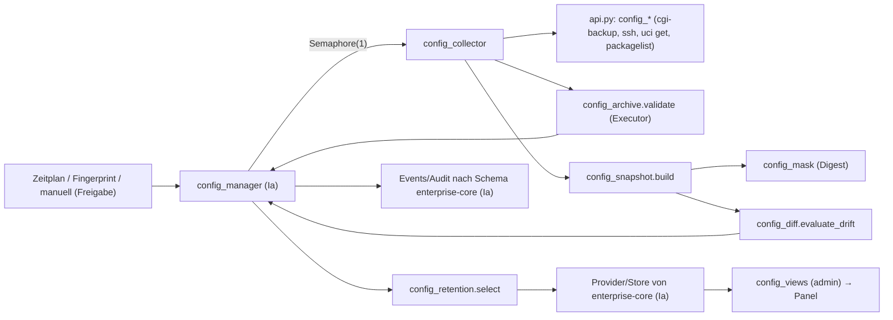

# Plan: Configuration Manager (Enterprise, Phase 1)

<!-- Ablage: docs/plans/2026-11-17-config-manager.md. Keine IPs, MACs, Hostnamen echter Geräte,
     Passwörter oder Tokens. Reiner Architektur-Plan: kein Produktivcode in diesem Commit. -->

## Status

- **Stand:** 2026-11-17 · **Phase:** Entwurf (zur Freigabe)
- **Branch/PR:** `claude/config-manager-d9fdac` · PR — · Basis: v1.42.0 (`0dc20cd`)
- **Ziel-Release:** voraussichtlich 1.44.0. Reihenfolge: 1.43.0 → Enterprise Core → Configuration Manager.
- **Erledigt:** Analyse und Plan · **Offen:** G1–G9 (Arbeitspakete, Abschnitt 17)
- **Blocker:** Gruppe Ia wartet auf den Vertrag `configuration_api_version = 1` von enterprise-core
  (`docs/dev/configuration-api-v1.md`, noch nicht veröffentlicht). Gruppe II wartet zusätzlich auf den
  Merge von 1.43.0 und Enterprise Core.
- **Nächster Schritt:** Nutzer beantwortet die QUESTION-Punkte (Abschnitt 20), danach Gruppe I (G1–G5).

Kennzeichnung in diesem Dokument:
- **[Repo]**: im Quelltext dieses Repos belegt, mit `datei:zeile` (Stand `0dc20cd`).
- **[Quelle]**: in einer öffentlichen OpenWrt- oder HA-Quelle belegt, mit URL.
- **[Annahme]**: nicht belegt. Wird vor dem Code, der darauf baut, geprüft (Abschnitt 21).
- **DECIDED**: kleine Entscheidung dieser Planungs-Sitzung. Master oder Nutzer kann sie kippen.
- **QUESTION**: nur der Nutzer (oder der Master) kann das entscheiden. Mit Optionen und Empfehlung.

Bei dieser Planung gab es keinen Kontakt zu Routern, Home Assistant, Host, VM oder Drucker.
Alle Aussagen über Router stammen aus dem Quelltext von OpenWrt, nicht aus Messungen.

---

## Problem und Zielverhalten

Heute weiß die Integration nicht, wie ein Router konfiguriert ist und ob sich das ändert. Ein falscher
Klick in LuCI (VLAN, Firewall, Management-IP) fällt erst auf, wenn etwas ausfällt. Ein Backup gibt es nur,
wenn der Nutzer es selbst in LuCI zieht.

Nach Phase 1 gilt:
- Pro Router liegen in HA wiederherstellbare Archive (`sysupgrade -b`), normalisierte UCI-Snapshots und
  ein Paket- und System-Inventar, versioniert und nach Regeln aufbewahrt.
- Änderungen an der Konfiguration werden erkannt (Drift), nach Bereich und Risiko eingestuft und
  maskiert angezeigt. Der Nutzer kann sie bestätigen oder als bekannt markieren. Nichts wird automatisch
  zurückgedreht.
- Ein Restore wird geprüft (Dry Run, Kompatibilität, Vorschau) und als geprüfter Export mit Anleitung
  angeboten. Den Restore selbst führt der Nutzer aus.
- Im Fehlerfall (Router weg, Rechte fehlen, Archiv kaputt) steht eine klare Fehlerklasse am Router, die
  normale Überwachung läuft unverändert weiter.

**Nicht-Ziele (Phase 1):**
- Automatischer Restore (siehe QUESTION Q4).
- Firmware-Update aus HA heraus (die Integration hat keinen solchen Pfad, Abschnitt 1).
- Eigenes Datenmodell, eigene Router-ID, eigenes Event-Schema, eigene Freigabe-Logik: das liefert
  enterprise-core (Abschnitt 12).
- Konfiguration auf dem Router ändern.

## Abgrenzung zu enterprise-core

| Thema | Besitzer | Wie wir es nutzen |
|---|---|---|
| Stabile Router-ID, Router-Registry | enterprise-core | kommt als Parameter `router_id: str` in jede Funktion |
| Capability-Erkennung | enterprise-core | wir melden unseren Bedarf (Abschnitt 12.6) |
| Vertrag `configuration_api_version = 1` (Operationen, Fehlerklassen, Rückgabeobjekte) | enterprise-core | wir liefern schlanke eigene Ergebnisobjekte, ein Adapter bildet sie ab |
| Backup-/Versions-Datenmodell, Metadatenformat, Speicherreferenz | enterprise-core | Anforderungsliste in Abschnitt 12 |
| Freigabe-Mechanismus für schreibende Aktionen | enterprise-core | Backup auslösen, Schutz setzen, Export, später Restore laufen nur darüber |
| Event- und Audit-Schema | enterprise-core | Anforderungsliste in Abschnitt 12.4 |
| Migrationen | enterprise-core | keine eigenen |
| Provider-Schnittstelle | enterprise-core | unsere Engine registriert sich dort |
| Collector, Archivprüfung, UCI-Snapshot und Normalisierung, Maskierung, Drift, Diff, Aufbewahrungslogik, Panel, Restore-Dry-Run, Doku | **wir** | dieser Plan |

---

## Akzeptanzkriterien

- [ ] AK1 Tägliches Backup eines erreichbaren Routers erzeugt Archiv, UCI-Snapshot und Inventar. Archiv
  und Snapshot sind geprüft, eine identische Konfiguration erzeugt keine neue Version.
- [ ] AK2 Router nicht erreichbar oder Rechte fehlen: genau eine Fehlerklasse pro Router
  (`unreachable`, `timeout`, `auth`, `permission`, `not_available`, `too_large`, `incomplete`,
  `invalid`). Kein Retry-Sturm, keine Auswirkung auf den Poll.
- [ ] AK3 Eine WLAN-, VLAN- oder Firewall-Änderung auf dem Router erscheint spätestens nach dem
  nächsten Fingerprint-Treffer plus Entprellzeit als Drift mit Bereich und Risiko. Management-IP, VLAN,
  Firewall, SSH-Zugang und Uplinks sind `critical`.
- [ ] AK4 Kein Secret im Klartext in Frontend-Antworten, Logs, Diagnostics oder Events. Test über alle
  Schlüssel aus Abschnitt 14.
- [ ] AK5 Aufbewahrung 7/4/6 (konfigurierbar), geschützte Versionen werden nie automatisch gelöscht,
  Größenlimit greift.
- [ ] AK6 Restore-Dry-Run zeigt Diff, Kompatibilität und Anleitung, ohne den Router anzufassen.
  Inkompatibles Archiv (anderes Board, swconfig gegen DSA) wird als `block` gemeldet.
- [ ] AK7 Manipulierte Archive (Pfad-Traversal, absolute Pfade, Links nach außen, Gerätedateien,
  Gzip-Bombe) werden abgewiesen, ohne dass HA etwas auf die Platte entpackt.
- [ ] AK8 Mehrere Router: höchstens ein Backup gleichzeitig in der ganzen Flotte. HA-Neustart mitten im
  Backup hinterlässt keine halbe Version.
- [ ] AK9 Bestehende Erkennung unverändert: alle bisherigen Tests grün, kein neuer Incident-Typ in
  `net_rules`, kein fremder Alarm unterdrückt (Regressionstest, Abschnitt 16).

---

## 1. Was es heute gibt (Frage 1)

**Backup, Snapshot, Drift:** nichts. Kein Modul liest oder speichert Router-Konfiguration als Ganzes.

**Bausteine, auf die wir aufsetzen:**
- ACL: `acl_provisioning.py:32` `ACL_FILE_PATH`, `:45` `ACL_VERSION = 8`, `:61` `RPCD_ACL_CONTENT`.
  - Gruppe heißt `"root"` (`acl_provisioning.py:62`).
  - Read-Teil: einzelne lesbare Pfade unter `file`, ubus `file: read/stat/list/exec`, `uci: ["get"]`,
    `system: ["board","info"]`, `service`, `log`, `luci-rpc`, `iwinfo`, `hostapd.*`, `usteer`
    (`acl_provisioning.py:100-128`) **[Repo]**.
  - Write-Teil: nur `/etc/init.d/rpcd` exec, `network.wireless up/down`, `network reload`
    (`acl_provisioning.py:130-143`) **[Repo]**.
  - **Fehlt:** `cgi-io`, `rpc-sys`, ein `uci`-Read-Scope mit Config-Namen, jedes `sysupgrade`-Recht.
    Ein Nicht-Root-Nutzer kann heute also weder ein Archiv holen noch per ubus UCI lesen; ubus `uci get`
    funktioniert nur für root über dessen `read '*'` (Docstring `api.py:3944-3953`) **[Repo]**.
- UCI lesen: `api.py:3944` `get_dhcp_config`, `api.py:3958` `get_uci_wireless` (ubus `uci get`),
  SSH-Parser `api.py:550` `_parse_uci_show(text, config)`, der die ubus-Form mit `@type[n]`-Schlüsseln
  nachbaut **[Repo]**.
- Board und Release: `api.py:1681` `get_router_info` (ubus `system board`) **[Repo]**.
- Pakete: `api.py:213` `_UPDATE_CHECK_SCRIPT` (apk/opkg nur über SSH, Kommentar dort: ubus `file exec`
  ist nur für rpcd freigegeben), Parser `api.py:426` `parse_apk_upgradable`, `api.py:4894`
  `check_package_updates` (SSH, 180 s) **[Repo]**.
- SSH: `api.py:3016` `_asyncssh_get_connection` mit `known_hosts=None` (`api.py:3036`, keine
  Host-Key-Prüfung), `api.py:3106` `_asyncssh_run` puffert die ganze Ausgabe ohne Obergrenze,
  `api.py:3184` `_run_ssh_binary` erhält NUL-Bytes **[Repo]**.
- ubus-Kern: `api.py:5170` `_call` (Re-Login, ACL-Block-Cache), `api.py:5272` `_acl_cache_key`,
  `api.py:5324` `_raw_call` (Status 6 → AuthError, 3/4 → MethodNotFound) **[Repo]**.
- Streaming-Muster für große Antworten: `api.py:5913` (`self._session.get` mit `ssl=self._ssl_context`,
  `resp.content.iter_any()`), Basis-URL `api.py:1166` `self._ubus_url` **[Repo]**.
- Kein Firmware-Pfad: `button.py` kennt nur reload_wifi, check_updates, reboot; `const.py:243`
  `SUFFIX_FIRMWARE` ist nur ein Entity-Suffix. **„Backup vor Firmware-Update" hat heute keinen Haken.**
- Ereignisse: `net_engine.py:1885` `_fire` feuert `EVENT_INCIDENT` (`const.py:598`);
  `net_events.py:342` Incidents dedupliziert über (`type`, `scope_key`); `net_events.py:27-28`
  30 Tage / 3000 Events **[Repo]**.
- Alarm-Korrelation: `net_rules.py:834` `AlarmMachine.correlate`, `net_rules.py:4727` `ROOT_TIERS`
  (`system_reboot`, `router_unreachable` usw.). Jeder Nicht-Root-Incident im Fenster eines Roots wird
  Kind und feuert kein eigenes Bus-Event **[Repo]**. Konsequenz in Abschnitt 9.
- Poll-Beobachter: `net_engine.py:268` `PollFacts`, `net_engine.py:308` `PollObserver`,
  `net_engine.py:881` `add_poll_observer`. `PollFacts` enthält keine Konfigurationsdaten
  (nur Clients, Log, Findings) **[Repo]**.
- Wartung: `net_engine.py:1369` `in_maintenance(router)` **[Repo]**.
- Speicher-Muster: `net_engine.py:723` `async_delay_save`, `net_engine.py:2525` `_backup_file` im
  Executor (`net_engine.py:556`) **[Repo]**.
- Panel: `topology_panel.py:202` `_IntelView` (Auth, Admin für Schreiben, 503 ohne Engine),
  `topology_panel.py:454` `_api_views()` sammelt alle Views inkl. `client_api_views()`
  (`topology_panel.py:457,466`) – das ist der Einhängepunkt für unsere Views **[Repo]**.
- Options-Flow: `config_flow.py:97` `async_step_init`, Entry `VERSION = 2`, `MINOR_VERSION = 2`
  (`config_flow.py:179,182`) **[Repo]**.
- Coordinator liefert ohne Zusatzkosten: `router_info` (alle `BOARD_REFRESH_CYCLES` Polls,
  `coordinator.py:697-702`), Radios, AP-Interfaces, Netzwerk-Interfaces, Port-VLAN-Map, WAN-Status,
  Dienste, DHCP-Config (`coordinator.py:1699` `_fetch_dhcp_config`) **[Repo]**. Poll alle 60 s
  (`const.py:61`).
- Setup: `__init__.py:69` `PLATFORMS`, `__init__.py:232` `_stagger_offset`, `__init__.py:352`
  `poll_offset`, `__init__.py:483` `async_unload_entry`, `__init__.py:566` `async_remove_entry` **[Repo]**.
- Diagnostics-Redaktion: `const.py:254` `DIAGNOSTICS_REDACT_KEYS`, `const.py:265`
  `DIAGNOSTICS_TO_REDACT` **[Repo]**.
- Frontend: `frontend/topology/src/components/Sidebar.tsx:16` `SidebarTab`; `DiagnoseView.tsx` mit
  Untertabs als Vorbild; `api.ts` `intelRequest`/`createIntelApi` **[Repo]**.
- ACL-Kopie zum manuellen Einspielen: `scripts/ha-openwrt-router.json` (muss bei jeder ACL-Änderung
  mitgezogen werden) **[Repo]**.

---

## 2. Archiv vom Router holen (Frage 2)

### 2.1 Wege im Vergleich

| | (b) `cgi-backup` (uhttpd + cgi-io) | (c) SSH `sysupgrade -b -` | (a) ubus `file exec` + `file read` |
|---|---|---|---|
| Ablauf | POST `…/cgi-bin/cgi-backup`, Formfeld `sessionid=<ubus-Session>`, Antwort `application/x-targz` als Stream | `sysupgrade --create-backup -` schreibt das Archiv nach stdout | `sysupgrade -b /tmp/x.tar.gz` per exec, dann `file read` mit `base64:true`, dann aufräumen |
| Größenlimit Router-seitig | keins, kein Content-Length | keins | **256 KiB** (`RPC_FILE_MAX_SIZE`) |
| Temp-Datei auf dem Router | nein | nein | ja, vermutlich 0644 in `/tmp` **[Annahme]** |
| Benötigt | Paket `cgi-io` (kommt mit LuCI), Session-Recht `cgi-io: backup` (read) | SSH-Zugang **als root** (liest `/etc/shadow`, Host-Keys) | Recht exec auf genau diesen Befehl, read auf die Datei, `remove` zum Aufräumen |
| Root nötig? | nein (nur das ACL-Recht) | ja | nein, aber exec läuft als root im rpcd-Prozess |
| Beleg | [cgi-io main.c](https://github.com/openwrt/luci/blob/master/libs/cgi-io/main.c) `main_backup`: prüft `session_access(sid,"cgi-io","backup","read")`, startet `/sbin/sysupgrade --create-backup -`; [luci-mod-system.json](https://github.com/openwrt/luci/blob/master/modules/luci-mod-system/root/usr/share/rpcd/acl.d/luci-mod-system.json) Gruppe `luci-mod-system-flash`: `"cgi-io": ["backup","download"]`; [flash.js](https://github.com/openwrt/luci/blob/master/modules/luci-mod-system/htdocs/luci-static/resources/view/system/flash.js) nutzt genau diesen Weg | [sysupgrade](https://github.com/openwrt/openwrt/blob/main/package/base-files/files/sbin/sysupgrade): `-b`/`--create-backup <file\|->`, `-` = stdout | [rpcd file.c](https://github.com/openwrt/rpcd/blob/master/file.c): `RPC_FILE_MAX_SIZE`, `base64`; exec prüft erst den Pfad, dann den String „cmd arg1 arg2"; [exec.h](https://github.com/openwrt/rpcd/blob/master/include/rpcd/exec.h) `RPC_EXEC_DEFAULT_TIMEOUT 120*1000`, `RPC_EXEC_MAX_SIZE 4096*64` |

Weitere Belege:
- `luci-base` hängt von `+cgi-io +rpcd-mod-file +rpcd-mod-luci` ab
  ([luci-base Makefile](https://github.com/openwrt/luci/blob/master/modules/luci-base/Makefile)).
  Ohne LuCI gibt es also kein `cgi-backup` **[Quelle]**.
- Der Pfad `/www/cgi-bin/cgi-backup` als Link auf `cgi-io` (belegt am 2026-11-18 auf vier Geräten mit OpenWrt 25.12, siehe Abschnitt 21): `main.c` wählt den Modus über
  `argv[0]`, LuCI ruft `cgi_base + '/cgi-backup'` auf. Der Collector behandelt HTTP 404 als
  `not_available` und geht zum nächsten Weg.
- Die Antwort bei fehlendem Recht **[Annahme]**: HTTP 403 oder ein Fehlertext statt
  `application/x-targz`. Der Collector prüft deshalb Content-Type **und** Gzip-Magic `1f 8b`, statt sich
  auf den Statuscode zu verlassen.
- Das Archiv enthält **alle Secrets** des Routers (`/etc/shadow`, Dropbear-Host-Keys, WLAN-Schlüssel,
  WireGuard-Keys). Wer das Recht `cgi-io: backup` hat, kann sie lesen. Das ist der Kern von QUESTION Q1.

### 2.2 ACL-Schnipsel

Für einen Nicht-Root-Nutzer, Weg (b), in `RPCD_ACL_CONTENT["root"]["read"]` (ACL-Version 9):

```json
"cgi-io": ["backup"]
```

Für den UCI-Snapshot per ubus braucht ein Nicht-Root-Nutzer zusätzlich einen `uci`-Scope mit den
Config-Namen (rpcd prüft `access("uci", config, "read")`,
[rpcd uci.c](https://github.com/openwrt/rpcd/blob/master/uci.c)):

```json
"uci": ["network", "wireless", "firewall", "dhcp", "system", "dropbear",
        "uhttpd", "rpcd", "ddns", "sqm", "usteer", "mwan3", "upnpd", "openvpn"]
```

Für das Inventar per ubus (nur wenn `rpcd-mod-rpcsys` installiert ist):

```json
"ubus": { "rpc-sys": ["packagelist"] }
```

Zum Vergleich, Weg (a), **nicht empfohlen**:

```json
"read":  { "file": { "/sbin/sysupgrade -b /tmp/ha-openwrt-router-cfg.tar.gz": ["exec"],
                     "/tmp/ha-openwrt-router-cfg.tar.gz": ["read"] } },
"write": { "file": { "/tmp/ha-openwrt-router-cfg.tar.gz": ["write"] },
           "ubus": { "file": ["remove"] } }
```

Dass `file remove` das Recht `write` auf dem Pfad prüft, ist **[Annahme]**.

### 2.3 Fallback-Kette

**DECIDED (D1):** Kette `cgi-backup` → SSH `sysupgrade -b -` (nur wenn der SSH-Nutzer `root` ist) → Abbruch
mit Fehlerklasse. Weg (a) wird in Phase 1 nicht gebaut — er braucht mehr Rechte als (b) (root-exec
eines Befehls, Schreibrecht, Aufräumen), hat eine Temp-Datei mit Secrets in `/tmp` und scheitert ab
256 KiB.

Regeln der Kette:
- Ein Weg, der `not_available` (404, kein LuCI) oder `permission` liefert, wird pro Router für 24 h
  gemerkt und übersprungen. Das ist gleiche Idee wie der ACL-Block-Cache in `api.py:5170`. Ein
  manuelles Backup setzt den Merker zurück.
- `unreachable`/`timeout` brechen die Kette sofort ab. Der nächste Weg würde denselben toten Router
  fragen.
- Nicht-root ohne ACL v9: nur SSH bleibt, und das scheitert ohne root. Ergebnis `permission` mit Hinweis
  im Panel auf die ACL-Erweiterung bzw. Q1.
- Kein Router ohne LuCI und ohne root-SSH bekommt ein Archiv. Er bekommt aber UCI-Snapshot und Inventar,
  falls die gehen (Teilerfolg, Status `partial`).

### 2.4 Neue Methoden in `api.py` (Gruppe I, additiv)

Am Ende der Klasse `OpenWrtAPI` (vor dem RT2-Block `api.py:6032`) in einem eigenen, markierten Block
`# --- Configuration Manager (config_*) ---`; Exceptions am Dateiende in einem zweiten markierten Block.
Nichts Bestehendes wird umgebaut.

```python
async def config_fetch_backup_cgi(self, *, max_bytes: int, timeout: float) -> bytes: ...
async def config_fetch_backup_ssh(self, *, max_bytes: int, timeout: float) -> bytes: ...
async def config_uci_get(self, config: str) -> dict[str, Any]: ...          # ubus, sonst SSH `uci show`
async def config_packagelist(self) -> dict[str, str] | None: ...            # rpc-sys, sonst SSH apk/opkg
```

- `config_fetch_backup_cgi`: URL aus `self._ubus_url` (`api.py:1166`) mit `/cgi-bin/cgi-backup` statt
  `/ubus`; POST `multipart/form-data` oder `x-www-form-urlencoded` mit `sessionid`; `ssl=self._ssl_context`;
  `iter_chunked(65536)` mit harter Obergrenze `max_bytes`; Token-Erneuerung bei abgelaufener Session
  über den vorhandenen Login. Das Token steht nur im Body, nie in der URL oder im Log.
- `config_fetch_backup_ssh`: neue Lesefunktion mit Obergrenze auf Basis von asyncssh
  `create_process` statt `conn.run`, weil `_asyncssh_run` (`api.py:3106`) unbegrenzt puffert. Exit-Code
  ≠ 0 → `incomplete`; stderr höchstens 4 KiB, nur für die Fehlerklasse, nie im Log.
- Exceptions: `OpenWrtConfigFetchError(OpenWrtResponseError)` mit Unterklassen
  `…PermissionError`, `…NotAvailableError`, `…TooLargeError`, `…IncompleteError`. Verbindung und Timeout
  nutzen die vorhandenen `OpenWrtConnectionError`/`OpenWrtTimeoutError`.

---

## 3. UCI-Snapshot (Frage 3)

### 3.1 Quelle

| | ubus `uci get {config}` | SSH `uci show <config>` | SSH `uci export` | `etc/config/*` aus dem Archiv |
|---|---|---|---|---|
| Form | JSON, Sektionen mit `.type`, `.name`, `.anonymous`, Listen als Arrays | Textzeilen, Parser `_parse_uci_show` (`api.py:550`) liefert ubus-Form mit `@type[n]` | UCI-Dateiformat | UCI-Dateiformat |
| Rechte | `uci`-Read-Scope je Config (root hat ihn) | SSH-Login | SSH-Login | Archiv |
| Kosten | 1 Aufruf je Config | 1 SSH-Kommando je Config (oder eins für alle) | 1 Kommando | 0 zusätzliche Aufrufe |

Belege: rpcd `uci get` prüft `access("uci", config, "read")`, liefert Meta-Schlüssel `.anonymous`,
`.type`, `.name` und bei Paket-Dumps `.index`; `configs` ist nicht ACL-gefiltert
([rpcd uci.c](https://github.com/openwrt/rpcd/blob/master/uci.c)) **[Quelle]**.

**DECIDED (D6):** Snapshot aus ubus `uci get` je Config aus einer festen Liste (Abschnitt 2.2), bei
`MethodNotFound`/ACL-Block SSH `uci show` über den vorhandenen Parser. Kein `uci configs`, weil das ein
weiteres ubus-Recht bräuchte; unbekannte Configs fehlen dann im Drift, sind aber im Archiv. Liegt ein
frisches Archiv vor, wird der Snapshot **zusätzlich** aus `etc/config/*` des Archivs gebaut. Beide
müssen denselben Inhalts-Hash ergeben (Kreuzprobe gegen unvollständige Archive, Abschnitt 7).

### 3.2 Normalisierung (`config_snapshot.normalize_uci`)

Eingang: eine der drei Formen (ubus-JSON, `_parse_uci_show`-Ausgabe, eigener UCI-Datei-Parser).
Ausgang: kanonisches Dict, aus dem ein SHA-256 über kanonisches JSON (`sort_keys`, `separators=(",",":")`,
UTF-8) gebildet wird.

1. **Meta-Schlüssel:** `.name`, `.anonymous`, `.index` fliegen raus; `.type` bleibt als `type`.
2. **Anonyme Sektionen (D7):** Schlüssel `@<type>[n]`, n = Position unter Sektionen gleichen Typs
   (dieselbe Konvention wie `_parse_uci_show`). Zufällige Namen `cfgXXXXXX` tauchen nie auf.
   Zusätzlich ein **Identitätsschlüssel** für bekannte Typen, damit ein Umsortieren nicht als
   „alles geändert" erscheint: `firewall.rule/redirect/zone` → `name`; `dhcp.host` → `mac` bzw. `name`;
   `wireless.wifi-iface` → `device` + `mode` + `ssid`; `network.bridge-vlan` → `device` + `vlan`;
   `network.device` → `name`. Diff paart erst über Identität, dann über Position.
3. **Benannte Sektionen:** Schlüssel ist der Name.
4. **Werte (D8):** keine Umwandlung. `"1"` und `"on"` bleiben verschieden. Was der Router speichert,
   ist die Wahrheit; eine Umstellung von `1` auf `on` ist eine echte Änderung (Risiko `low`).
5. **Listen:** Reihenfolge bleibt (bei `list network`, `list server`, `list ports` ist sie
   bedeutungstragend oder zumindest sichtbar). Reine Umordnung wird im Diff als `reordered` mit
   Risiko `low` markiert.
6. **Secrets (D5):** Werte von Secret-Optionen (Abschnitt 14) werden **vor** dem Speichern ersetzt durch
   `{"secret": "<hmac16>"}`, `hmac16` = die ersten 16 Hex-Zeichen von HMAC-SHA256(Installations-Schlüssel,
   `config/section/option/wert`). So erkennt der Drift „Schlüssel geändert", ohne dass der Klartext im
   Snapshot liegt. Den Installations-Schlüssel hält enterprise-core (Abschnitt 12.3).
7. **Laufzeitwerte:** `uci get` liefert die gespeicherte Konfiguration, nicht den Laufzeitstand
   (`uci state` wäre das andere). Nichts herausfiltern.

### 3.3 Kosten und billiger Fingerprint

- Voller Snapshot: 1 Aufruf je Config, also 10–14 ubus-Aufrufe mit zusammen geschätzt 20–80 KB JSON
  **[Annahme]** (wireless und firewall am größten).
- **Fingerprint ohne Zusatzaufruf (D3):** `fingerprint_from_coordinator(data)` bildet SHA-256 über
  ausgewählte, konfigurationsnahe Felder aus `coordinator.data`, die der Poll ohnehin holt:
  SSIDs, Verschlüsselungsart und Radio-Zuordnung der AP-Interfaces; Radio an/aus; Interface-Namen,
  Protokoll und statische Adressen; Port-VLAN-Map; DHCP-Pools (alle 10 Polls); Liste der
  aktivierten Dienste; `release.version`/`revision` aus `router_info`. **Ausgeschlossen** sind
  Laufzeitwerte (aktueller Kanal bei Auto, Uptime, DHCP-WAN-Adresse, Zähler, Clients).
- Der Fingerprint ist nur ein **Auslöser**: Ändert er sich, folgt nach 300 s Ruhe ein voller
  UCI-Snapshot, höchstens einmal pro Stunde und Router. Falsch-Positive kosten einen Snapshot, mehr nicht.
  Was der Fingerprint nicht sieht (z. B. eine Firewall-Regel), fängt der tägliche Snapshot.
- Einhängen über `coordinator.async_add_listener` (wie die NI im Setup), **nicht** über
  `PollObserver`, weil `PollFacts` keine Konfigurationsdaten enthält (`net_engine.py:268-305`).

---

## 4. Inventar (Frage 4)

| Quelle | Inhalt | Recht | Beleg |
|---|---|---|---|
| `system board` (schon im Coordinator, `api.py:1681`) | `model`, `board_name`, `release.version/revision/target/distribution`, `kernel` | vorhanden | [Repo] |
| ubus `rpc-sys packagelist` | `{packages: {name: version}}` | `rpc-sys: ["packagelist"]`, Paket `rpcd-mod-rpcsys` (README nennt es, `README.md:435`) | [rpcd sys.c](https://github.com/openwrt/rpcd/blob/master/sys.c): liest seit Commit cc9a471 (2024-12-02, „rework packagelist call for apk") `/lib/apk/db/installed` und `/etc/apk/world`, vorher den opkg-Status |
| SSH `apk list --installed` / `opkg list-installed` | Name und Version | SSH | Muster `_UPDATE_CHECK_SCRIPT` (`api.py:213`) |
| `etc/backup/installed_packages.txt` im Archiv | Name + rom/overlay | nur mit `sysupgrade -k` | [sysupgrade](https://github.com/openwrt/openwrt/blob/main/package/base-files/files/sbin/sysupgrade); `cgi-backup` ruft `--create-backup -` **ohne** `-k` auf → nicht verfügbar über Weg (b) |
| Mitgliederliste des Archivs | geänderte Conffiles | Archiv | Abschnitt 7 |

**DECIDED (D17):** `rpc-sys packagelist`, bei `MethodNotFound` SSH-Paketliste, sonst nur Board und
Release mit Status `inventory: partial`. Welche rpcd-Version 24.10 ausliefert (opkg- oder apk-Lesart),
ist **[Annahme]**; der Parser verträgt beide, weil die Antwortform gleich bleibt.

Ergebnisobjekt `Inventory(board_name, model, release_version, release_revision, target, kernel,
packages: Mapping[str, str] | None, package_source: "rpc-sys"|"ssh-apk"|"ssh-opkg"|None,
archive_members: tuple[str, ...])`.

---

## 5. Ablage in HA (Frage 5) → Anforderung an enterprise-core

Das Datenmodell gehört enterprise-core. Diese Befunde gehen als Anforderungen in Abschnitt 12 ein.

- **Ort:** `hass.config.path("openwrt_router", "config_backups", <router_id>)`, **nicht** unter `www`
  und nicht unter `.storage` (Binärdateien gehören nicht in den Store).
- **Rechte:** Ordner 0700, Dateien 0600. `write_utf8_file_atomic(filename, data, private=True,
  mode="wb")` aus `homeassistant/util/file.py` schreibt atomar über eine Temp-Datei (0600 durch
  `tempfile`) und erlaubt Binärmodus ([HA util/file.py](https://github.com/home-assistant/core/blob/dev/homeassistant/util/file.py))
  **[Quelle]**. Ordner mit `os.makedirs(mode=0o700)` plus `os.chmod`, weil `makedirs` die umask beachtet.
- **Alle Datei-Operationen im Executor** (`hass.async_add_executor_job`), wie `net_engine.py:556`.
- **Reihenfolge bei einer neuen Version:** Archiv → `<id>.tar.gz.partial` schreiben, prüfen, `fsync`,
  umbenennen; Snapshot und Inventar ebenso; **zuletzt** den Index-Eintrag schreiben. Ohne Index-Eintrag
  existiert die Version nicht.
- **HA-Neustart mitten im Backup:** beim Start `*.partial` löschen; Dateien ohne Index-Eintrag, älter als
  1 h, in `orphaned/` verschieben (nicht löschen, Prüfung durch den Nutzer); Index-Einträge ohne Datei
  als `missing` markieren. Der abgebrochene Lauf zählt als `incomplete`, der nächste Zeitplan läuft normal.
- **In HA-Backups enthalten:** ja. `EXCLUDE_FROM_BACKUP` in
  [backup/const.py](https://github.com/home-assistant/core/blob/dev/homeassistant/components/backup/const.py)
  schließt nur `__pycache__`, `*.log*`, `backups/*.tar`, `tmp_backups/*.tar`, `tts/*`, `.cache/*` u. a.
  aus **[Quelle]**. Die Router-Secrets landen also in jedem HA-Backup. Das ist gewollt (ein HA-Restore
  bringt die Router-Backups zurück) und wird in der Doku genannt. Dass automatische HA-Backups seit
  2025.1 standardmäßig verschlüsselt sind, ist **[Annahme]**.
- **Größe:** Limit je Router (Vorschlag 50 MB) und gesamt (Vorschlag 250 MB). Überschreitung steuert
  die Aufbewahrungslogik (Abschnitt 11.6).
- **Entfernen eines Routers** (`async_remove_entry`, `__init__.py:566`): Backups **nicht** automatisch
  löschen, sondern in `removed/<router_id>/` verschieben; Löschen nur über eine Freigabe. Das ist eine
  Anforderung an den Lebenszyklus in enterprise-core.

---

## 6. Verschlüsselung (Frage 6)

| Option | Schutz gegen | Kosten | Bewertung |
|---|---|---|---|
| A Keine eigene; 0700/0600; HA-Backup-Verschlüsselung | Fremde Nutzer auf dem Host, Lesen über HTTP (`www`) | 0 | Gleiches Schutzniveau wie die Router-Passwörter, die heute im Klartext in `.storage/core.config_entries` liegen (`entry.data`) |
| B Fernet (`cryptography`), Schlüssel in `.storage` | Kopie nur des Backup-Ordners | gering; `cryptography` ist HA-Kern-Abhängigkeit (2026.2.0: `cryptography==46.0.2`) | Schlüssel liegt auf derselben Platte, schützt also nicht gegen einen Dieb des ganzen Config-Ordners |
| C Passphrase des Nutzers (scrypt + AES-GCM) | Dieb des ganzen Config-Ordners | mittel | Unbeaufsichtigtes tägliches Backup braucht den Schlüssel → er müsste doch gespeichert werden; Restore ohne Passphrase unmöglich |
| D `securetar` (HA-eigenes AES-Format) | wie B | gering; HA-Kern-Abhängigkeit (2026.2.0: `securetar==2025.2.1`) | Format ist an HA-Versionen gebunden, Export für Router-Restore muss erst entschlüsselt werden |

Belege für die Versionen: HA-Core `pyproject.toml` am Tag 2026.2.0
([home-assistant/core](https://github.com/home-assistant/core/blob/2026.2.0/pyproject.toml)) **[Quelle]**.
Keine Option braucht eine neue Abhängigkeit in `manifest.json`.

Empfehlung: A in Phase 1 → **QUESTION Q3**.

---

## 7. Archivprüfung (Frage 7)

`config_archive.validate_archive(data: bytes, limits: ArchiveLimits) -> ArchiveReport`, rein,
synchron, läuft im Executor. **Es wird nie auf die Platte entpackt (D9).**

Prüfungen in dieser Reihenfolge:
1. Größe komprimiert ≤ `max_compressed` (16 MiB). Gzip-Magic `1f 8b`. Sonst `invalid`.
2. Öffnen mit `tarfile.open(fileobj=BytesIO(data), mode="r:gz")`. Gzip-CRC und Trailer werden beim
   vollständigen Lesen geprüft; Abbruch mitten im Strom (`EOFError`, `tarfile.ReadError`,
   `zlib.error`) → `incomplete`.
3. Je Mitglied:
   - Anzahl ≤ 5000, Summe entpackt ≤ 64 MiB, einzelnes Mitglied ≤ 16 MiB, Verhältnis entpackt zu
     gepackt ≤ 200 → sonst `invalid` (Gzip-Bombe).
   - Name: kein führendes `/`, kein `..`-Segment, kein NUL, kein `\`, Länge ≤ 255 → sonst `invalid`.
   - Typ: nur reguläre Datei, Verzeichnis, Symlink. Hardlink, Gerätedatei, FIFO → `invalid`.
   - Symlink-Ziel: relativ und nach Auflösung innerhalb des Archivwurzel-Baums, oder absolut unter
     `/etc/`, `/usr/`, `/lib/` (OpenWrt legt z. B. Zeitzonen-Links an) → sonst `invalid`.
   - Dieselbe Logik wie `tarfile.data_filter` aus Python 3.12+, aber ohne zu entpacken.
4. Inhalt:
   - `etc/config/` vorhanden, darin mindestens `network` und `system`, sonst `incomplete`.
   - Mitglieder außerhalb von `etc/` (Nutzer-Einträge in `/etc/sysupgrade.conf`, z. B. `root/`)
     sind erlaubt, werden aber im Report als `extra_paths` gelistet.
   - Kreuzprobe: Menge der Configs im Archiv gegen den gleichzeitigen UCI-Snapshot. Fehlt eine Config,
     die per ubus existiert, → Warnung `config_missing_in_archive` (kein Abbruch, Conffiles ohne
     Änderung gegenüber `/rom` fehlen bei `-u`; `cgi-backup` nutzt `-u` nicht).
5. Hashes:
   - `archive_sha256`: über die gepackten Bytes, Integrität der gespeicherten Datei. Vor jedem Export
     und jedem Dry Run neu gerechnet; Abweichung → `checksum_mismatch`.
   - `content_hash` (D2): SHA-256 über die sortierte Liste `(name, typ, mode, sha256(inhalt) bzw.
     linkziel)`. **Ohne** mtime, uid/gid, uname/gname und Gzip-Header. Grund: `sysupgrade` packt mit
     `tar c -C / -T conffiles | gzip` ohne `-n` und ohne mtime-Normalisierung
     ([sysupgrade](https://github.com/openwrt/openwrt/blob/main/package/base-files/files/sbin/sysupgrade))
     **[Quelle]**, der Archiv-Hash ändert sich also bei jedem Lauf. Dedup läuft über `content_hash`.

`ArchiveReport(ok, error: str | None, members: tuple[MemberInfo, ...], configs: frozenset[str],
extra_paths: tuple[str, ...], archive_sha256, content_hash, uncompressed_size, warnings)`.
`MemberInfo` enthält Name, Typ, Größe und Inhalts-Hash, **nie den Inhalt**.

Zusätzlich `extract_uci_texts(data, limits) -> dict[str, str]`: nur `etc/config/*`, nur im Speicher,
für den Snapshot aus dem Archiv und den Dry Run.

---

## 8. Restore je OpenWrt-Version (Frage 8)

### 8.1 Was OpenWrt anbietet

- `sysupgrade -r`/`--restore-backup <file>` entpackt mit `tar -C / -xzf` (oder
  `platform_restore_backup`), **ohne** Neustart und ohne Rückweg
  ([sysupgrade](https://github.com/openwrt/openwrt/blob/main/package/base-files/files/sbin/sysupgrade))
  **[Quelle]**.
- LuCI (`flash.js`): Upload nach `/tmp/backup.tar.gz` → `tar -tzf` → Dateiliste bestätigen →
  `sysupgrade --restore-backup` → `/sbin/reboot` → auf Wiederkehr warten. **Kein Rollback.**
  ([flash.js](https://github.com/openwrt/luci/blob/master/modules/luci-mod-system/htdocs/luci-static/resources/view/system/flash.js))
  **[Quelle]**.
- UCI-Ebene mit Rückweg: rpcd `uci apply {rollback: true, timeout}` sichert die Configs, committet und
  rollt nach Ablauf zurück, wenn kein `confirm` aus **derselben Session** kommt
  ([rpcd uci.c](https://github.com/openwrt/rpcd/blob/master/uci.c),
  [LuCI uci.js](https://github.com/openwrt/luci/blob/master/modules/luci-base/htdocs/luci-static/resources/uci.js):
  `confirm` alle 250 ms bis zur Frist, Standard 10 s) **[Quelle]**. Der Rollback-Zustand liegt im RAM
  und geht bei einem Neustart verloren **[Annahme]**. Er deckt nur UCI-Configs ab, keine Dateien wie
  Host-Keys oder `/etc/shadow`.

### 8.2 Versionsmatrix

| Version | Paketverwaltung | Firewall | Switch-Modell | Restore-Weg | Hinweis im Dry Run |
|---|---|---|---|---|---|
| 22.03 | opkg | fw4 (nftables) | DSA auf vielen Targets, swconfig auf älteren | LuCI oder `sysupgrade -r` **[Annahme: Option vorhanden]** | EOL; Archiv aus 21.02 (fw3, swconfig) → `warn` |
| 23.05 | opkg | fw4 | wie 22.03 | wie 22.03 | EOL-Hinweis |
| 24.10 | opkg | fw4 | DSA | wie 22.03 | rpcd-packagelist liest opkg **[Annahme]** |
| 25.12 | apk | fw4 | DSA | wie 22.03 | Archiv aus 24.10: Paketnamen-Hinweis, Conffile-Erkennung über apk |

### 8.3 Kompatibilitätsprüfung (`config_restore.check_compatibility`)

- `block`:
  - `board_name` verschieden.
  - Archiv nutzt `switch`/`switch_vlan`, Ziel nutzt DSA (`device`/`bridge-vlan`), oder umgekehrt.
  - Archivprüfung nicht `ok`.
  - Prüfsumme weicht ab.
- `warn`:
  - Ziel-Release älter als Archiv-Release (Downgrade).
  - Major-Wechsel (22.03 → 24.10 usw.).
  - Configs für nicht installierte Pakete (Inventar).
  - Änderungen an Management-IP, VLAN, Firewall, Dropbear oder uhttpd/rpcd (Gefahr der Aussperrung).
- `ok`: sonst.

### 8.4 Phase 1: kein automatischer Restore

**DECIDED (D15):** Dry Run + Kompatibilität + Vorschau (Diff Archiv-UCI gegen aktuellen Snapshot,
maskiert) + geprüfter Export + Anleitung. Der Dry Run ruft den Router nicht auf, sondern nutzt den
letzten Snapshot. Ist der älter als 24 h, steht das als Hinweis da.

Anleitung (Textbausteine je Version, übersetzbar):
1. Konsole oder Failsafe bereithalten, falls Management-IP, VLAN oder Firewall sich ändern.
2. LuCI → System → Sichern/Firmware → „Sicherung wiederherstellen", Datei auswählen, Dateiliste prüfen.
3. Oder per CLI: Datei nach `/tmp/` kopieren, `sysupgrade -r /tmp/<datei>` und danach `reboot`.
4. Nach dem Neustart in HA prüfen: Router erreichbar, Drift gegen die wiederhergestellte Version = leer.
5. Hinweis: Das Archiv stellt auch Passwörter und SSH-Host-Keys wieder her. Ein Archiv von einem
   anderen Gerät übernimmt dessen Identität.

Automatischer Restore → **QUESTION Q4**.

---

## 9. Events, Incidents, Sensoren, Zeitplan, Options-Flow (Frage 9)

### 9.1 Events

- **DECIDED (D4):** Config-Ereignisse laufen **nicht** durch `net_rules`/`AlarmMachine` und werden
  **nicht** in die NI-Stores geschrieben. Begründung: `AlarmMachine.correlate` (`net_rules.py:834`) macht
  jeden Nicht-Root-Incident im Fenster eines Roots zum Kind ohne eigenes Bus-Event. Ein Drift nach
  `system_reboot` (Tier 2, `net_rules.py:4727`) wäre so verschluckt. Umgekehrt dürfen wir keine
  fremden Alarme unterdrücken. Ein neuer Typ in `DEFAULT_SETTINGS["thresholds"]` (`net_rules.py:130`)
  würde die Regeln ändern. Zwei Reviews haben genau diese Fehlerklasse bereits gefunden.
- Anbindung an die NI ist **nur lesend**:
  - `engine.in_maintenance(router)` (`net_engine.py:1369`) markiert einen Drift als
    „während Wartung" (Risiko unverändert, nur Hinweis).
  - Phase 2 (optional): RCA liest „Konfiguration geändert um T" als Kontext über eine lesende
    Abfrage, ohne Einfluss auf die Korrelation.
- Event-Typen (Namen und Schema legt enterprise-core fest, Abschnitt 12.4):
  `config_backup_succeeded`, `config_backup_failed`, `config_backup_recovered`,
  `config_drift_detected`, `config_drift_acknowledged`, `config_restore_checked`.
- **Dedup:**
  - Drift über (`router_id`, `drift_id`); `drift_id` = SHA-256 über die sortierten Change-Schlüssel
    plus den neuen `content_hash`. Derselbe Drift feuert einmal. Ändert er sich, ist es ein neuer.
  - Fehler über (`router_id`, `error_class`): einmal beim Übergang auf Fehler, dann frühestens nach
    24 h erneut, einmal `recovered` beim ersten Erfolg.
  - Erfolge feuern nur bei neuer Version, nicht bei Dedup-Treffern.
- Payload ohne Secrets: Router-ID, Typ, Bereichs- und Risikozähler, `drift_id`, Fehlerklasse. Nie Werte.

### 9.2 Sensoren (pro Router, Gruppe Ia/II, weil die `unique_id` die Router-ID braucht)

| Entity | Art | Wert |
|---|---|---|
| `sensor.<router>_config_last_backup` | timestamp | Zeit der letzten erfolgreichen Version |
| `sensor.<router>_config_backup_status` | enum | `ok`, `partial`, `failed`, `running`, `disabled` (+ Attribut `error_class`) |
| `binary_sensor.<router>_config_drift` | problem | an, solange ein unbestätigter Drift mit Risiko ≥ `medium` offen ist (Attribute: Anzahl je Risiko) |
| `sensor.<router>_config_versions` | measurement, diagnostic | Anzahl gespeicherter Versionen |

Einbindung nach dem vorhandenen Muster: `config_entities.async_setup_sensors(...)` wird aus
`sensor.py` bzw. `binary_sensor.py` aufgerufen, wie `client_entities`/`net_entities` es heute tun.

### 9.3 Zeitplan

- `async_track_time_change(hass, cb, hour=H, minute=M, second=0)` täglich zur eingestellten Zeit
  (Standard 03:30) plus Versatz je Router: `_stagger_offset`-Prinzip (`__init__.py:232`) über
  60 Minuten, damit nicht alle Router gleichzeitig starten.
- **DECIDED (D10):** Ein `asyncio.Semaphore(1)` für die ganze Integration (in `hass.data`) begrenzt
  auf ein laufendes Backup in der ganzen Flotte. Zeitlimits: `cgi-backup` 60 s, SSH 120 s,
  Gesamtjob 180 s. Bei `unreachable`/`timeout` ein Nachversuch nach 15 min, dann Fehler-Event.
- Wöchentlich/monatlich sind **Aufbewahrungsklassen**, keine eigenen Jobs.
- Drift-Snapshot: Fingerprint-Auslöser (Abschnitt 3.3), 300 s Entprellung, max. 1/h je Router.
- Release-Wechsel in `router_info` (Firmware-Update von außen erkannt): sofortiger Snapshot und
  Vergleich gegen die letzte Version davor. Das ist der Ersatz für „Backup vor Firmware-Update"
  (siehe **QUESTION Q5**).
- Nach einem Router-Ausfall (`router_unreachable` → wieder da) nicht sofort sichern, sondern den
  normalen Zeitplan abwarten (schont den Router nach dem Start).

### 9.4 Options-Flow-Felder (Gruppe II, `config_flow.py:97` `async_step_init`)

| Feld | Typ | Standard |
|---|---|---|
| `config_backup_enabled` | bool | **aus** (D11) |
| `config_backup_interval` | select `daily`/`weekly`/`off` | `daily` |
| `config_backup_time` | time | `03:30` |
| `config_retention_daily` / `_weekly` / `_monthly` | int 0–60 | 7 / 4 / 6 |
| `config_storage_limit_mb` | int 5–1000 | 50 |
| `config_drift_enabled` | bool | an, wenn Backup an |
| `config_fetch_method` | select `auto`/`cgi`/`ssh` | `auto` |

**DECIDED (D11):** opt-in. Die Funktion kopiert alle Router-Secrets nach HA und braucht für Nicht-Root
eine ACL-Erweiterung. Das soll niemand durch ein Update automatisch bekommen. Der Options-Flow hat
keinen Update-Listener (Konflikt mit Reauth); die Manager-Einstellungen werden beim Laden des Entry
gelesen wie die übrigen Optionen.

---

## 10. Panel und HTTP-Routen (Frage 10)

### 10.1 Routen (`config_views.py`, Gruppe Ia/II)

Basis: eigene Klasse `_ConfigView(HomeAssistantView)` mit `requires_auth = True`, gleichem
Admin-Check wie `topology_panel.py:233` `_is_admin`, aber **(D12) immer nur für Admins**, auch wenn
`topology_panel_all_users` gesetzt ist. Fehlerantworten nennen nur die Fehlerklasse (wie `_failed`
in `_IntelView`). Eingehängt über `topology_panel.py:454` `_api_views()` (eine Zeile, Gruppe II).

| Methode | Pfad | Zweck | Freigabe nötig |
|---|---|---|---|
| GET | `/api/openwrt_topology/config/overview` | Status je Router | nein |
| GET | `/api/openwrt_topology/config/{router_id}/versions` | Versionsliste mit Metadaten | nein |
| GET | `/api/openwrt_topology/config/{router_id}/versions/{version_id}` | Metadaten, maskierter Snapshot, Inventar, Archivreport (ohne Inhalt) | nein |
| GET | `/api/openwrt_topology/config/{router_id}/diff?from=&to=` | strukturierter, maskierter Diff | nein |
| GET | `/api/openwrt_topology/config/{router_id}/drift` | offene und bestätigte Drifts | nein |
| POST | `/api/openwrt_topology/config/{router_id}/drift/{drift_id}` | `{state: "acknowledged"\|"known", note}` | ja |
| POST | `/api/openwrt_topology/config/{router_id}/backup` | manuelles Backup | ja |
| POST | `/api/openwrt_topology/config/{router_id}/versions/{version_id}/protect` | `{protected: bool}` | ja |
| POST | `/api/openwrt_topology/config/{router_id}/versions/{version_id}/restore-check` | Dry Run | nein (nur lesend), wird aber auditiert |
| GET | `/api/openwrt_topology/config/{router_id}/versions/{version_id}/export` | Archiv-Download (Klartext-Secrets) | ja, siehe **QUESTION Q9** |

- `router_id` und `version_id` werden gegen das Register geprüft, nie als Pfad benutzt
  (kein Pfad-Traversal über die URL).
- „Freigabe nötig" heißt: Aufruf geht durch den Freigabe-Mechanismus von enterprise-core. Wir bauen
  keine eigene Prüfung zusätzlich. Auth und Admin auf der Route bleiben.
- Export: `Content-Type: application/gzip`, `Content-Disposition: attachment`,
  `Cache-Control: no-store`. Prüfsumme vor dem Senden neu gerechnet.

### 10.2 Panel-Struktur (Gruppe II)

- Sidebar: Eintrag „Enterprise" → Untertab „Configuration Manager". Wer den Container „Enterprise"
  anlegt, klärt **QUESTION Q10**.
- Komponenten (neu):
  - `ConfigManagerView.tsx`: Router-Liste mit Status, letzter Version, offenen Drifts.
  - `ConfigVersionList.tsx`: Versionen, Schutz-Schalter, Klasse daily/weekly/monthly/manual.
  - `ConfigDiffView.tsx`: gruppiert nach Bereich, Farbe nach Risiko, Secrets als „geändert" ohne Wert.
  - `ConfigDriftList.tsx`: Bestätigen / als bekannt markieren.
  - `ConfigRestoreCheck.tsx`: Kompatibilität, Diff, Anleitung, Export-Knopf.
- **DECIDED (D14):** eigene Typen in `configTypes.ts` und eigener Client `createConfigApi(getHass)` in
  `configApi.ts` nach dem Muster `createIntelApi` (Bearer, 401-Refresh). `types.ts` und `api.ts` werden
  nicht angefasst, bis auf den Import in `main.tsx`/Sidebar (Gruppe II).

---

## 11. Moduldesign Gruppe I (jetzt baubar)

Regeln für alle Gruppe-I-Module:
- `from __future__ import annotations`, `_LOGGER = logging.getLogger(__name__)`, Type Hints.
- Keine HA-Imports außer im Collector. Keine Annahme über Router-Schlüssel oder Metadatenformat.
  `router_id: str` und Metadaten kommen als Parameter.
- Eigene schlanke Ergebnisobjekte (`@dataclass(frozen=True, slots=True)`). Ein Adapter in Gruppe Ia
  bildet sie auf den Vertrag ab.
- Konstanten in `config_const.py`, nicht in `const.py`.

### 11.1 `config_const.py`

`ArchiveLimits` (16 MiB / 64 MiB / 16 MiB / 5000 / Verhältnis 200), `UCI_CONFIGS` (Abschnitt 2.2),
`SECRET_OPTIONS`, `SECRET_OPTION_PATTERNS`, `SECRET_ARCHIVE_PATHS` (Abschnitt 14),
`AREA_RULES`, `RISK_RULES`, `FETCH_TIMEOUTS`, `DRIFT_DEBOUNCE_S = 300`, `DRIFT_MIN_INTERVAL_S = 3600`,
`FAILURE_EVENT_COOLDOWN_S = 86400`, `ERROR_CLASSES`.

### 11.2 `config_collector.py`

```python
@dataclass(frozen=True, slots=True)
class FetchAttempt:
    method: Literal["cgi", "ssh"]
    error_class: str | None          # None = Erfolg
    duration_s: float

@dataclass(frozen=True, slots=True)
class ArchiveFetch:
    data: bytes | None               # nie geloggt, nie in repr (field(repr=False))
    method: Literal["cgi", "ssh"] | None
    error_class: str | None
    attempts: tuple[FetchAttempt, ...]

async def collect_archive(api: OpenWrtAPI, *, order: Sequence[str], is_root: bool,
                          skip: Collection[str], limits: ArchiveLimits) -> ArchiveFetch
async def collect_uci(api: OpenWrtAPI, configs: Sequence[str]) -> UciFetch
async def collect_inventory(api: OpenWrtAPI, router_info: Mapping[str, Any]) -> Inventory
def classify_error(err: BaseException) -> str
```

Ruft nur die neuen `api.py`-Methoden auf (Architekturregel: HTTP nur in `api.py`). Kein Retry
innerhalb, das entscheidet der Manager (Ia).

### 11.3 `config_archive.py`

```python
def validate_archive(data: bytes, limits: ArchiveLimits) -> ArchiveReport
def content_hash(members: Iterable[MemberInfo]) -> str
def verify_checksum(data: bytes, expected_sha256: str) -> bool
def extract_uci_texts(data: bytes, limits: ArchiveLimits) -> dict[str, str]
```

### 11.4 `config_snapshot.py`

```python
def parse_uci_file(text: str) -> dict[str, dict[str, Any]]     # UCI-Dateiformat → ubus-Form
def normalize_uci(config: str, raw: Mapping[str, Any],
                  secret_digest: Callable[[str], str]) -> dict[str, Any]
def build_snapshot(raw_configs: Mapping[str, Mapping[str, Any]],
                   secret_digest: Callable[[str], str]) -> UciSnapshot
def fingerprint_from_coordinator(data: Mapping[str, Any]) -> str

@dataclass(frozen=True, slots=True)
class UciSnapshot:
    configs: Mapping[str, Mapping[str, Any]]   # normalisiert, Secrets schon als Digest
    content_hash: str
    missing: frozenset[str]                    # Configs ohne Leserecht
```

`parse_uci_file` versteht `config`, `option`, `list`, einfache und doppelte Anführungszeichen,
Backslash-Fortsetzung und Kommentare. Es dient nur zum Lesen.

### 11.5 `config_mask.py`

```python
def is_secret_option(config: str, section_type: str, option: str) -> bool
def is_secret_path(path: str) -> bool
def secret_digest_factory(key: bytes) -> Callable[[str], str]
def mask_for_output(obj: Any) -> Any            # letzte Schranke vor JSON-Antwort/Log/Event
def redact_text(text: str) -> str               # für Fehlermeldungen und stderr
```

`mask_for_output` ersetzt jeden `{"secret": …}`-Wert durch `"***"` und läuft zusätzlich über
Schlüsselnamen (Abschnitt 14). Doppelt hält besser: Digest im Speicher, Maske am Ausgang.

### 11.6 `config_diff.py` (Diff und Drift)

```python
class Area(StrEnum): VLAN, INTERFACE, MGMT_IP, FIREWALL, DHCP, DNS, WLAN, ROUTING, SERVICES, SSH, SYSTEM, OTHER
class Risk(StrEnum): CRITICAL, HIGH, MEDIUM, LOW

@dataclass(frozen=True, slots=True)
class Change:
    kind: Literal["added", "removed", "changed", "reordered"]
    config: str; section: str; option: str | None
    area: Area; risk: Risk
    old: Any; new: Any            # schon maskiert (Digest), Klartext nie

def diff_snapshots(old: UciSnapshot, new: UciSnapshot, *, mgmt_host: str | None) -> tuple[Change, ...]
def classify(config: str, section_type: str, option: str | None, *, mgmt_host: str | None) -> tuple[Area, Risk]
def evaluate_drift(baseline: UciSnapshot, current: UciSnapshot, acks: Iterable[DriftAck],
                   *, mgmt_host: str | None) -> DriftReport
def drift_id(changes: Sequence[Change], content_hash: str) -> str
```

Einstufung (Auszug, vollständige Tabelle in `config_const.RISK_RULES`):

| Bereich | Erkennung | Risiko |
|---|---|---|
| MGMT_IP | `network.interface` mit `ipaddr`/`netmask`/`proto`/`device`, das die von HA benutzte Host-Adresse trägt (`mgmt_host` als Parameter) | critical |
| VLAN | `network.bridge-vlan`, `network.switch_vlan`, `network.device` (`ports`, `type 8021q`) | critical |
| FIREWALL | jede Sektion in `firewall` | critical (zone/forwarding/rule mit Ziel `input`), sonst high |
| SSH | `dropbear.*`, Firewall-Regel mit Port 22, `uhttpd`/`rpcd`-Listen und Logins | critical |
| Uplink | Interface `wan`/`wan6`/`wwan` oder `is_wan_interface` (`api.py:940`) | critical |
| WLAN | `wireless.wifi-iface` `ssid`/`encryption`/`key`/`disabled`, `wifi-device` `channel`/`htmode`/`country` | high (Schlüssel, Verschlüsselung), medium (Kanal) |
| DHCP | `dhcp.dhcp`, `dhcp.host` | medium |
| DNS | `dhcp.dnsmasq` (`server`, `address`), `network.*.dns` | medium |
| ROUTING | `network.route`, `network.rule` | high |
| SERVICES | Configs von Diensten (`sqm`, `ddns`, `upnpd`, `usteer`, `mwan3`, `openvpn`) | low–medium |
| SYSTEM | `system.system` (Hostname, Zeitzone, Log) | low |
| reordered | reine Umordnung | low |

`DriftAck(drift_id, state: "acknowledged"|"known", by_user, at)` wird nur gelesen. Gespeichert wird es
in Ia. `known` heißt: dieselbe `drift_id` gilt als neue Basis; `acknowledged` heißt: gesehen, Basis
bleibt alt.

### 11.7 `config_retention.py`

```python
@dataclass(frozen=True, slots=True)
class RetentionItem:
    version_id: str; created: datetime; size_bytes: int
    protected: bool; ok: bool; kind: Literal["scheduled", "manual", "drift", "release_change"]

@dataclass(frozen=True, slots=True)
class RetentionPolicy:
    daily: int = 7; weekly: int = 4; monthly: int = 6; max_bytes: int = 50 * 1024 * 1024

def select_for_deletion(items: Sequence[RetentionItem], policy: RetentionPolicy,
                        now: datetime) -> RetentionDecision
```

**DECIDED (D18):** GFS. Behalten wird die Vereinigung aus der jeweils neuesten erfolgreichen Version
der letzten `daily` Tage, `weekly` ISO-Wochen und `monthly` Monate, dazu alle `protected` und die
neueste erfolgreiche überhaupt. Ist das Größenlimit danach überschritten, fällt die älteste nicht
geschützte, nicht neueste Version, bis es passt. Passt es trotzdem nicht, wird `over_limit` gemeldet
und nichts Geschütztes gelöscht. Tage und Wochen in der lokalen HA-Zeitzone. `now` kommt als Parameter
(testbar, Uhrsprung-sicher).

### 11.8 `config_restore.py`

```python
def check_compatibility(source: Inventory, target: Inventory, archive: ArchiveReport,
                        archive_snapshot: UciSnapshot, current: UciSnapshot) -> Compatibility
def dry_run(archive: ArchiveReport, archive_snapshot: UciSnapshot, current: UciSnapshot,
            source: Inventory, target: Inventory, *, mgmt_host: str | None,
            snapshot_age_s: float) -> RestorePlan
def instructions(target: Inventory, compat: Compatibility) -> tuple[str, ...]   # i18n-Schlüssel
```

`RestorePlan(compatibility, changes, critical_count, instructions, archive_sha256, warnings)`.
Kein Code-Pfad in diesem Modul darf `api` sehen. Der Test prüft das (Abschnitt 16, Fall 15).

### 11.9 Datenfluss



---

## 12. Anforderungen an enterprise-core (Gruppe Ia)

Wir entwerfen kein eigenes Datenmodell. Das hier ist die Liste, die der Vertrag
`configuration_api_version = 1` abdecken muss, damit Gruppe Ia sich anschließen kann.

### 12.1 Felder einer Version

`router_id`, `version_id` (stabil, nicht aus Zeit ableitbar raten), `created_at` (UTC),
`last_seen_at` (Dedup-Treffer aktualisieren nur das), `kind` (`scheduled`/`manual`/`drift`/
`release_change`), `status` (`ok`/`partial`/`failed`), `error_class`, `fetch_method`,
`archive_sha256`, `content_hash` (Dedup-Fingerprint, Abschnitt 7), `uci_hash`
(`UciSnapshot.content_hash`), `size_bytes` je Artefakt, `protected` (bool, nur über Freigabe änderbar),
`release_version`, `board_name`, `storage_ref` je Artefakt (`archive`, `uci`, `inventory`),
`note` (Nutzertext, Länge begrenzt).

### 12.2 Operationen und Fehlerklassen

- Operationen: `put_version(router_id, artifacts, meta) -> version_id` (atomar, Dedup über
  `content_hash`/`uci_hash`: Treffer → `last_seen_at` statt neuer Version), `list_versions`,
  `get_version`, `read_artifact(storage_ref) -> bytes` (Executor), `delete_versions(ids)` (nur aus der
  Aufbewahrung oder per Freigabe), `set_protected`, `put_drift_ack`/`list_drift_acks`, Startup-`sweep()`
  (Abschnitt 5).
- Fehlerklassen: mindestens `unreachable`, `timeout`, `auth`, `permission`, `not_available`,
  `too_large`, `incomplete`, `invalid`, `checksum_mismatch`, `storage_full`, `storage_error`.

### 12.3 Speicher-Eigenschaften

0700/0600, atomar, nicht unter `www`, alle Datei-I/O im Executor, `.partial`-Muster mit Index zuletzt,
Orphan-Sweep beim Start, Größenlimits je Router und gesamt, Verhalten bei Router-Entfernung
(`removed/`). Ein **Installations-Schlüssel** (32 Byte, zufällig, in `.storage`) für die
Secret-Digests in Snapshots (Abschnitt 3.2 Punkt 6). Verschlüsselung gemäß Q3.

### 12.4 Events und Audit

Event-Typen aus Abschnitt 9.1 mit Dedup-Schlüssel `(router_id, drift_id)` bzw.
`(router_id, error_class)` und Cooldown. Payload ohne Werte. Audit-Eintrag für: manuelles Backup,
Schutz an/aus, Drift bestätigt/bekannt, Dry Run, Export (wer, wann, welche Version). Eigener Bus-Event-Name
**außerhalb** von `EVENT_INCIDENT`, damit `net_rules` und `logbook.py` unverändert bleiben (Logbook-
Beschreibung für das neue Event kommt in Gruppe II).

### 12.5 Freigabe

Schreibende Aktionen (`backup`, `protect`, `drift ack`, `export`, später `restore`) laufen durch den
zentralen Freigabe-Mechanismus. Wir brauchen von ihm: synchrone Antwort „freigegeben / abgelehnt /
wartet" und eine Kennung für das Audit.

### 12.6 Capabilities, die wir melden

`config.cgi_backup` (HTTP 200 mit Gzip-Magic oder 403/404), `config.ssh_root`, `config.uci_read`
(je Config), `config.packagelist`. Wir liefern die Erkennungsfunktionen (Collector), enterprise-core
entscheidet, wann sie laufen. Vorschlag: einmal beim Setup und nach jeder ACL-Neuverteilung, nie im Poll.

---

## 13. Gruppe II (erst nach Merge von 1.43.0 und Enterprise Core)

Geteilte Dateien, jeweils additiv, eigener markierter Block am Dateiende, wo es geht:
- `__init__.py`: Manager starten/stoppen (Setup best effort in try/except wie NI und Client-Stabilität,
  Unload, Remove).
- `const.py`: nur, was HA-Optionen-Schlüssel sein muss; alles andere in `config_const.py`.
- `config_flow.py`: Options-Felder (Abschnitt 9.4), `strings.json`, `translations/*.json`.
- `sensor.py`, `binary_sensor.py`: je ein Aufruf `config_entities.async_setup_*`.
- `topology_panel.py:454` `_api_views()`: `*config_api_views()`.
- Frontend: Sidebar-Eintrag, Container, neue Komponenten, `main.tsx`, Bundle, `_PANEL_VERSION`.
- `acl_provisioning.py` + `scripts/ha-openwrt-router.json`: ACL v9 (falls Q1 = ja; Besitz laut Q2).
- `logbook.py`, `diagnostics.py` (nur Zähler und Status, nie Snapshots), `manifest.json` (Version),
  `CHANGELOG.md`, `README.md`, `TODO.md`, `docs/config-manager.md`.

---

## 14. Secrets, die maskiert werden

### 14.1 UCI-Optionen (in Snapshot, Diff, Log, Event, Diagnostics)

Exakte Namen (unabhängig von der Config):
`key`, `key1`, `key2`, `key3`, `key4`, `password`, `passwd`, `psk`, `sae_password`, `auth_secret`,
`acct_secret`, `dae_secret`, `priv_key_pwd`, `private_key`, `preshared_key`, `secret`, `token`,
`api_key`, `apikey`, `auth_key`, `shared_secret`, `pre_shared_key`, `pin`, `pincode`, `wps_pin`,
`r0kh`, `r1kh` (enthalten Schlüssel), `mesh_psk`, `nas_secret`.

Kontextabhängig:
- `ddns.service`: `password`, `param_enc`, `param_opt`, `update_url` (kann Zugangsdaten enthalten).
- `rpcd.login`: `password` (Hash oder `$p$`-Verweis).
- `network.interface` mit `proto` `pppoe`/`pptp`/`l2tp`/`3g`/`qmi`: `password`, `pincode`.
- `network.wireguard_*`: `private_key`, `preshared_key`.
- `openvpn.*`: `auth_user_pass`, `askpass`, `secret` (Pfad, aber verdeckt), `key`.

Muster als Sicherheitsnetz (Treffer werden maskiert, Fehltreffer sind harmlos):
`(?i)(pass|secret|token|psk|private|credential|_key$|^key\d*$|pin$)`. Ausnahmen, die ohne Wert
unbrauchbar wären: `ft_psk_generate_local`, `keepalive`, `key_mgmt` u. ä. in einer Whitelist.

### 14.2 Dateien im Archiv (nie Inhalt ins Frontend, nur Pfad + „vorhanden/geändert")

`etc/shadow`, `etc/passwd` (zur Sicherheit), `etc/dropbear/dropbear_rsa_host_key`,
`etc/dropbear/dropbear_ed25519_host_key`, `etc/dropbear/dropbear_ecdsa_host_key` (allgemein
`etc/dropbear/*host_key*`), `etc/dropbear/authorized_keys`, `root/.ssh/*`, `etc/uhttpd.key`,
`etc/config/rpcd`, `etc/config/wireless`, `etc/config/network`, `etc/config/ddns`, `etc/wireguard/*`,
`etc/openvpn/*` (`*.key`, `*.pem`, `*.p12`, `*.auth`), `etc/acme/*`, `etc/ssl/private/*`,
`etc/luci-uploads/*`, `etc/ipsec.secrets`, `etc/swanctl/*`, `etc/ppp/chap-secrets`,
`etc/ppp/pap-secrets`, `etc/crontabs/*` (kann Tokens enthalten), alle Dateien `*.psk`.

### 14.3 Weitere Stellen

- Das ubus-Session-Token im `cgi-backup`-Body: nie loggen, nie in URL.
- stderr von `sysupgrade` über SSH: durch `redact_text`.
- Diagnostics: `DIAGNOSTICS_REDACT_KEYS` (`const.py:254`) bleibt, Config-Manager liefert dort nur
  Zähler, Status und Fehlerklassen.

---

## 15. Kosten je Router und Tag

| Posten | Aufrufe | Bytes (Schätzung, [Annahme]) |
|---|---|---|
| Archiv (1× täglich, `cgi-backup`) | 1 HTTP POST | 10–60 KB |
| UCI-Snapshot (täglich) | 10–14 ubus `uci get` | 20–80 KB |
| Inventar (täglich) | 1 `rpc-sys packagelist` | 5–20 KB |
| Board/Release | 0 (Coordinator) | 0 |
| Fingerprint | 0 (Coordinator) | 0 |
| Drift-Snapshots | typisch 0–2 × 14, höchstens 24 × 14 | typisch 0–160 KB, höchstens ~2 MB |
| **Summe typisch** | **~15–45** | **~40–300 KB** |
| **Summe Obergrenze** | **~360** | **~2 MB** |

Zum Vergleich: der normale Poll macht bei 60 s Intervall 1440 Polls am Tag mit jeweils mehreren
Aufrufen, also weit über 10 000 Aufrufe. Der Config Manager liegt typisch unter 0,5 %.
Auf dem Router: `sysupgrade -b` packt einige hundert KB Conffiles mit gzip, Laufzeit wenige Sekunden
**[Annahme]**; läuft nur einmal am Tag und nie parallel auf zwei Routern.
SSH-Fallback: eine Sitzung je Backup, die vorhandene Verbindung wird wiederverwendet.
HA-Platte: höchstens 7+4+6 = 17 Versionen plus geschützte, je etwa 50–150 KB → unter 3 MB je Router;
Dedup senkt das stark.

---

## 16. Testfälle → Testdateien

Gruppe I (sofort):

| # | Fall | Datei::Test |
|---|---|---|
| 1 | Erfolgreiches Backup | `tests/test_config_collector.py::test_collect_archive_cgi_success`, `tests/test_config_archive.py::test_validate_sysupgrade_shaped_archive` |
| 2 | Router nicht erreichbar | `tests/test_config_collector.py::test_unreachable_stops_chain_with_error_class` |
| 3 | SSH-/ubus-Rechtefehler | `tests/test_config_collector.py::test_cgi_permission_falls_back_to_ssh_root`, `::test_non_root_without_acl_reports_permission`, `::test_uci_acl_block_uses_ssh_uci_show` |
| 4 | Unvollständiges Backup | `tests/test_config_archive.py::test_truncated_gzip_is_incomplete`, `::test_missing_network_config_is_incomplete`, `tests/test_config_collector.py::test_ssh_nonzero_exit_is_incomplete`, `::test_size_cap_aborts_stream` |
| 5 | Falsche Prüfsumme | `tests/test_config_archive.py::test_verify_checksum_detects_mismatch`, `tests/test_config_restore.py::test_checksum_mismatch_blocks_dry_run` |
| 6 | Identische Configs | `tests/test_config_archive.py::test_content_hash_ignores_mtime_owner_and_gzip_header`, `tests/test_config_snapshot.py::test_identical_configs_same_hash_across_sources` |
| 7 | WLAN-Änderung | `tests/test_config_diff.py::test_wlan_ssid_change_is_wlan_high`, `::test_wlan_key_change_detected_via_digest_without_plaintext` |
| 8 | VLAN-Änderung | `tests/test_config_diff.py::test_bridge_vlan_change_is_critical`, `::test_switch_vlan_change_is_critical` |
| 9 | Firewall-Änderung | `tests/test_config_diff.py::test_firewall_zone_input_policy_is_critical`, `::test_reordered_rules_matched_by_name` |
| 10 | Maskierung | `tests/test_config_mask.py::test_all_secret_options_masked` (parametrisiert über Abschnitt 14.1), `::test_secret_paths_never_expose_content`, `::test_mask_for_output_json_contains_no_plaintext`, `::test_logs_contain_no_secret` (caplog) |
| 11 | Aufbewahrung | `tests/test_config_retention.py::test_gfs_7_4_6`, `::test_protected_never_deleted`, `::test_newest_ok_always_kept`, `::test_size_limit_evicts_oldest_unprotected`, `::test_over_limit_reported_not_forced` |
| 13 | Restore-Dry-Run | `tests/test_config_restore.py::test_dry_run_reports_diff_and_instructions`, `::test_stale_snapshot_warning` |
| 14 | Inkompatibler Restore | `tests/test_config_restore.py::test_board_mismatch_blocks`, `::test_swconfig_vs_dsa_blocks`, `::test_downgrade_warns`, `::test_missing_package_warns` |
| 15 | Abgebrochener Restore | `tests/test_config_restore.py::test_restore_module_has_no_router_access` (Import- und Aufrufprüfung: kein `api`, keine Schreibmethode). Echter Abbruch-Test erst mit Q4 (Phase 2) |
| 16 | Verbindungsverlust nach Restore | `tests/test_config_restore.py::test_instructions_cover_lockout_risk` (critical-Änderungen → Konsolen-/Failsafe-Hinweis). Rollback-Test erst mit Q4 (Phase 2, `uci apply` ohne `confirm`) |
| 17 | Manipulierte Archive | `tests/test_config_archive.py::test_rejects_malicious` parametrisiert: `../`, absoluter Pfad, Symlink nach außen, Hardlink, Gerätedatei, FIFO, NUL im Namen, Gzip-Bombe, zu viele Mitglieder, kein Gzip, Tar ohne `etc/config` |
| 20 | Regressionen | `tests/test_config_regressions.py::test_net_rules_thresholds_unchanged` (Schlüsselmenge `DEFAULT_SETTINGS["thresholds"]` wie in v1.42.0), `::test_root_tiers_unchanged`, `::test_api_additions_only_in_marked_block`; dazu volle Suite inkl. `tests/test_poll_no_ssh.py` und `tests/test_ssh_transport.py` |

Gruppe Ia (nach dem Vertrag):

| # | Fall | Datei::Test |
|---|---|---|
| 12 | Versionierung | `tests/test_config_manager.py::test_new_version_only_on_content_change`, `::test_dedup_updates_last_seen` |
| 18 | Parallele Backups mehrerer Router | `tests/test_config_manager.py::test_fleet_semaphore_one_backup_at_a_time`, `::test_stagger_per_router` |
| 19 | HA-Neustart während Backup | `tests/test_config_manager.py::test_partial_files_swept_on_start`, `::test_index_written_last` |
| 20 | Regressionen (Fortsetzung) | `tests/test_config_regressions.py::test_config_events_bypass_alarm_machine`, `::test_foreign_incident_still_fires_during_drift` (ein Root-Incident und ein Drift gleichzeitig, beide Bus-Events kommen), `::test_drift_not_suppressed_by_maintenance` |

Gruppe II: `tests/test_config_views.py` (Admin-only trotz `topology_panel_all_users`,
401/403, unbekannte IDs, Export-Header, kein Klartext in JSON), `tests/test_config_entities.py`,
`tests/test_config_flow.py` erweitert, `tests/test_acl_provisioning.py` erweitert (ACL v9 falls Q1).

---

## 17. Arbeitspakete

| ID | Gruppe | Inhalt | Dateien | Hängt ab von | Aufwand | Definition of Done |
|---|---|---|---|---|---|---|
| G1 | I | Konstanten, Maskierung | `config_const.py`, `config_mask.py`, `tests/test_config_mask.py` | – | S | Fall 10 grün |
| G2 | I | Archivprüfung | `config_archive.py`, `tests/test_config_archive.py` | G1 | M | Fälle 1, 4, 5, 6, 17 grün |
| G3 | I | UCI-Parser, Normalisierung, Fingerprint | `config_snapshot.py`, `tests/test_config_snapshot.py` | G1 | M | Fall 6, Kreuzprobe ubus/`uci show`/Datei gleich |
| G4 | I | Diff, Drift, Aufbewahrung, Restore-Dry-Run | `config_diff.py`, `config_retention.py`, `config_restore.py`, Tests | G3 | M | Fälle 7–9, 11, 13–16 grün |
| G5 | I | `api.py`-Methoden + Collector | `api.py` (markierter Block), `config_collector.py`, `tests/test_config_collector.py`, `tests/test_config_regressions.py` | G2, G3 | M | Fälle 1–4, 20 grün; `ruff`, volle Suite |
| G6 | Ia | Manager, Zeitplan, Semaphore, Adapter auf Vertrag, Store, Events, Audit | `config_manager.py`, Tests | Vertrag v1, G5 | L | Fälle 12, 18, 19, 20 (Rest) grün |
| G7 | II | Views + Entities + Options-Flow + Setup-Verkabelung | `config_views.py`, `config_entities.py`, geteilte Dateien (Abschnitt 13) | G6, Merge 1.43.0 + Core | M | Views-/Entity-/Flow-Tests grün |
| G8 | II | Panel | Frontend (Abschnitt 10.2), Bundle | G7 | M | `npm run build`, Panel lokal gegen Mock-Router |
| G9 | II | ACL v9 (falls Q1), Doku, Release | `acl_provisioning.py`, `scripts/ha-openwrt-router.json`, Doku-Dateien | G7, Q1, Q2 | S | ACL-Tests grün, Doku vollständig |

---

## 18. Risiken und Kompatibilität

- **Secrets in HA:** Archiv enthält Router-Passwort-Hashes und Host-Keys. Gegenmaßnahmen:
  - opt-in
  - 0700/0600
  - Export nur mit Freigabe und Audit
  - Maskierung doppelt
  - Doku-Hinweis zu HA-Backups
- **SSH ohne Host-Key-Prüfung** (`api.py:3036`): Ein Angreifer im LAN könnte sich als Router ausgeben
  und ein präpariertes Archiv liefern. Die Archivprüfung verhindert Schaden in HA (nichts wird
  entpackt). Der Restore-Export würde das präparierte Archiv aber weitergeben. → **QUESTION Q6**.
- **ACL-Erweiterung:** jede Neuverteilung startet rpcd neu (`acl_provisioning.py`, `ensure_acl`); kurz
  fallen ubus-Aufrufe aus. Eine Version (v9) für alles, was wir brauchen. Koordination mit
  enterprise-core (Q2), damit es nicht zwei Neustarts in Folge gibt.
- **Router ohne LuCI:** kein `cgi-backup`. Nur SSH als root, sonst UCI und Inventar ohne Archiv
  (`partial`).
- **Speicherarme APs:** `sysupgrade -b` in `/tmp` entfällt bei (b) und (c) (Stream). Das Risiko ist klein.
- **HA-Floor 2026.2.0:** `write_utf8_file_atomic`, `async_track_time_change`, `cryptography`/`securetar`
  sind dort vorhanden **[Quelle]** (HA-Core 2026.2.0 `pyproject.toml`).
- **Mehrere Config Entries für denselben Router:** Die Router-ID von enterprise-core muss das abfangen.
  Sonst gibt es doppelte Backups.
- **`unique_id`/Registry:** neue Entities nur mit Router-ID aus enterprise-core (Ia/II).
- **Migration/Rückweg:** Ohne gespeicherten Zustand in Gruppe I nicht relevant. Beim Downgrade bleibt der
  Backup-Ordner liegen und wird ignoriert. Die ACL v9 bleibt auf dem Router, bis `ensure_acl` die alte
  Version zurückschreibt; das macht `ensure_acl` heute schon, weil es den Inhalt vergleicht.

---

## 19. Entscheidungen (DECIDED)

- D1 – Abrufkette `cgi-backup` → SSH `sysupgrade -b -` (nur root); Weg (a) ubus exec+read nicht gebaut – (a) braucht mehr Rechte, hat eine Secret-Temp-Datei und 256 KiB Limit.
- D2 – Dedup über `content_hash` der Archivmitglieder ohne mtime/Owner/Gzip-Header – `sysupgrade` packt nicht reproduzierbar.
- D3 – Drift-Auslöser ist ein Fingerprint aus vorhandenen Coordinator-Daten, plus täglicher Snapshot; Entprellung 300 s, max. 1/h – null Zusatzaufrufe im Normalfall.
- D4 – Config-Ereignisse außerhalb von `AlarmMachine`/`net_rules`, NI nur lesend – Korrelation würde sie verschlucken, und wir dürfen fremde Alarme nicht beeinflussen.
- D5 – Secrets im Snapshot nur als HMAC-Digest, Maske zusätzlich am Ausgang – Drift erkennt Schlüsselwechsel ohne Klartext.
- D6 – Feste Config-Liste statt `uci configs` – kein zusätzliches ubus-Recht nötig.
- D7 – Anonyme Sektionen als `@type[n]` plus Identitätsschlüssel bekannter Typen – stabile Schlüssel über alle drei Quellen.
- D8 – Keine Werte-Umwandlung bei der Normalisierung – der gespeicherte Wert ist die Wahrheit.
- D9 – Archivprüfung nur im Speicher mit festen Grenzen, nie entpacken – schließt Traversal und Bomben aus.
- D10 – Eine Semaphore für die ganze Flotte, Versatz je Router, feste Zeitlimits – schont Router und HA.
- D11 – Opt-in, Standard aus – kopiert Secrets und kann eine ACL-Erweiterung brauchen.
- D12 – Alle Config-Routen nur für Admins, unabhängig von `topology_panel_all_users` – Konfigurationsdetails sind sensibler als Topologie.
- D13 – `api.py`-Methoden am Ende der Klasse in markiertem Block, Exceptions am Dateiende, Konstanten in `config_const.py` – parallele Arbeit von zwei Sitzungen ohne Konflikte.
- D14 – Eigene `configTypes.ts`/`configApi.ts` – `types.ts` und `api.ts` gehören gerade 1.43.0.
- D15 – Restore Phase 1 nur Dry Run, Export, Anleitung – Archiv-Restore hat in OpenWrt keinen Rückweg.
- D16 – Archiv im Speicher mit Obergrenze holen, Schreiben im Executor – kein I/O im Event-Loop.
- D17 – Inventar über `rpc-sys packagelist`, sonst SSH, sonst nur Board (`partial`).
- D18 – Aufbewahrung GFS-Vereinigung, geschützt und neueste erfolgreiche nie löschen, Größenlimit nur über Ungeschützte.

## 20. Offene Fragen (QUESTION)

- **Q1** ACL v9 für Nicht-Root (`cgi-io: backup`, `uci`-Read-Scope, `rpc-sys: packagelist`)? Das gibt
  dem HA-rpcd-Nutzer faktisch Lesezugriff auf alle Router-Secrets.
  Optionen: ACL erweitern (nur wenn Backup aktiviert) / nur root bzw. root-SSH / kein Archiv, nur
  UCI-Snapshot. **Empfehlung:** ACL erweitern, gekoppelt an `config_backup_enabled`.
- **Q2** Wer liefert ACL v9 und ändert `acl_provisioning.py`? Optionen: enterprise-core (gemeinsam mit
  der Capability-Erkennung, ein rpcd-Neustart) / wir in Gruppe II. **Empfehlung:** enterprise-core.
- **Q3** Verschlüsselung der Backups in HA? Optionen: keine eigene (0700/0600 + HA-Backup-Verschlüsselung)
  / Fernet mit Schlüssel in `.storage` / Passphrase des Nutzers. **Empfehlung:** keine eigene in Phase 1.
- **Q4** Automatischer Restore? Optionen: nie / Phase 2 nur UCI-Ebene mit `uci apply` + Rollback +
  Freigabe / volles Archiv. **Empfehlung:** Phase 2 nur UCI-Ebene mit Rollback.
- **Q5** „Backup vor Firmware-Update", obwohl es keinen Firmware-Pfad gibt? Optionen: Release-Wechsel
  erkennen und danach vergleichen + Dienst `create_config_backup` für eigene Automationen / eigenen
  Firmware-Pfad bauen / weglassen. **Empfehlung:** Release-Wechsel erkennen + Dienst.
- **Q6** SSH-Host-Key für den Backup-Weg? Optionen: wie heute ohne Prüfung / TOFU-Pinning nur für den
  Config-Pfad / SSH-Backup ganz weglassen. **Empfehlung:** TOFU-Pinning nur für den Config-Pfad
  (Änderung im geteilten SSH-Transport → Gruppe II oder enterprise-core).
- **Q7** (Schmerzpunkt Aufteilung) Drift-Bestätigungen und der HMAC-Installations-Schlüssel liegen laut
  Aufteilung im Vertrag von enterprise-core. Ohne sie kann Gruppe I keinen sichtbaren Drift liefern.
  Optionen: in den Core-Vertrag aufnehmen / eigener kleiner Store `openwrt_router.config_manager`.
  **Empfehlung:** Core-Vertrag.
- **Q8** (Schmerzpunkt Aufteilung) Dedup braucht `content_hash` und `uci_hash` als Metadatenfelder und
  eine Atomar-Operation „Version anlegen oder `last_seen_at` setzen". Optionen: Core übernimmt die
  Felder und die Operation / wir halten einen eigenen Hash-Index neben dem Core-Store.
  **Empfehlung:** Core übernimmt beides.
- **Q9** Export des Klartext-Archivs über das Panel? Optionen: erlauben (Admin + Freigabe + Audit) /
  kein Export, nur Hinweis auf den Ordner / gar nicht. **Empfehlung:** erlauben mit Freigabe und Audit.
- **Q10** Wer legt den Sidebar-Container „Enterprise" an? Optionen: enterprise-core / wir.
  **Empfehlung:** enterprise-core, wir hängen einen Untertab ein.

## 21. Annahmen (nicht belegt) und nicht Geprüftes

Annahmen, vor dem jeweiligen Paket zu prüfen:
- `/www/cgi-bin/cgi-backup` existiert überall, wo LuCI installiert ist (Link auf `cgi-io`).
  **Belegt am 2026-11-18** (lesende Prüfung, vier Geräte: 2× WR3000 25.12.1, FRITZ!Repeater 3000 25.12.6,
  1750E 25.12.2): `/www/cgi-bin/` enthält überall `cgi-backup` als Link auf `/usr/libexec/cgi-io`
  (daneben `cgi-download`, `cgi-exec`, `cgi-upload`); `cgi-io` und `luci-base` sind überall installiert.
  Weiter nicht belegt: Router ohne LuCI (keiner geprüft) und ein tatsächlicher Abruf über `cgi-backup`.
- `cgi-backup` antwortet bei fehlendem Recht mit 403 oder Nicht-Gzip. Abgefangen über Gzip-Magic.
- rpcd `file remove` prüft das Recht `write` (nur relevant für den verworfenen Weg a).
- Die Temp-Datei von `sysupgrade -b <datei>` ist 0644 (nur Weg a).
- rpcd in 24.10 liest für `packagelist` den opkg-Status, 25.12 die apk-Datenbank.
  Teilweise belegt am 2026-11-18: auf allen vier 25.12-Geräten ist `apk` der Paketmanager (`apk list -I`
  liefert die Pakete, keine `opkg`-Spuren). Weiter nicht belegt: dass rpcd `packagelist` aus der
  apk-Datenbank liest (kein Aufruf gemacht) und das 24.10-Verhalten (kein 24.10-Gerät geprüft).
  Befund zu D17: `rpcd-mod-rpcsys` und das ubus-Objekt `rpc-sys` sind auf 3 von 4 Geräten vorhanden
  (gateway, FRITZ!Repeater 3000, 1750E), auf einem WR3000 (ap2) fehlen beide. Das bestätigt den Fallback
  aus D17 (SSH-Paketliste, sonst nur Board); die Entscheidung bleibt unverändert.
- Der Rollback-Zustand von `uci apply` geht beim Neustart verloren.
- `sysupgrade -r` gibt es in 22.03.
- Automatische HA-Backups sind standardmäßig verschlüsselt.
- Größen von Archiv und `uci get`-Antworten sowie Laufzeit von `sysupgrade -b` (Abschnitt 15).
- Die ACL-Gruppe heißt `"root"` (`acl_provisioning.py:62`). Wie ein dedizierter Nicht-Root-Login sie
  referenziert (`list read`), ist nicht geprüft. Am 2026-11-18 gesehen (kein Beleg für den Gruppennamen):
  der root-Login steht auf allen vier Geräten mit `read '*'` und `write '*'`; ein zweiter Login mit
  eigener Gruppe existiert nur auf einem Gerät.
- ACL-Datei der Integration: am 2026-11-18 liegt auf allen vier Geräten `ha-openwrt-router.json` unter
  `/usr/share/rpcd/acl.d/` (gleiche Größe überall, daneben die LuCI-Dateien). Ihr Inhalt wurde nicht
  ausgegeben; ob dort `cgi-io: backup` (read) steht, ist **nicht belegt**. Der Plan geht für den Code in `acl_provisioning.py` von „fehlt“
  aus (Abschnitt 1, `Fehlt:`), das wurde weder bestätigt noch widerlegt.

Nicht geprüft:
- Kein Router, kein HA, kein Netzwerkzugriff (Vorgabe). Keine Live-Werte, außer den am 2026-11-18
  mit Freigabe lesend erhobenen (siehe oben, vier Geräte). Dabei ausdrücklich nicht geprüft: ein Abruf über
  `cgi-backup`, Archivgröße, Laufzeit von `sysupgrade -b`, `uci get`-Laufzeiten.
- Der Vertrag von enterprise-core existiert noch nicht. Abschnitt 12 ist eine Anforderung, kein Abgleich.
- Frontend nicht gebaut. Keine Tests ausgeführt (reiner Plan).
- Verhalten von `cgi-backup` über HTTPS mit selbstsigniertem Zertifikat (sollte `self._ssl_context`
  abdecken).
- 1.43.0-Änderungen an den geteilten Dateien (nicht sichtbar in diesem Worktree).

## 22. Doku-Drift (gefunden, nicht behoben)

- `CLAUDE.md` nennt `tests/test_sshpass_security_v1179.py`. Die Datei gibt es nicht mehr; die Prüfungen
  stehen jetzt in `tests/test_ssh_transport.py` (z. B. `test_password_only_in_connect_kwarg_never_in_command`,
  `test_no_sshpass_left_in_source`).
- `CLAUDE.md` nennt „448 Tests total" und Python 3.12/3.13. Tatsächlich: rund 2300 Testfunktionen,
  CI-Matrix 3.13/3.14 (`.github/workflows/tests.yaml:16`).
- Die Plan-Vorlage nennt `scripts/checks.py`. Das Skript gibt es in diesem Repo nicht; lokal gelten
  `ruff check`, `ruff format --check`, `pytest`.

## Validierungsplan

- **Lokal (je Paket):** `ruff check`, `ruff format --check`, `pytest tests/test_config_*.py`, dann
  volle Suite.
- **CI:** tests (3.13/3.14), hassfest, hacs nach PR.
- **Hardware (lesend, nur mit Freigabe):**
  - Auf einem Router mit und einem ohne LuCI prüfen, ob `/www/cgi-bin/cgi-backup` vorhanden ist.
  - Ein Backup über `cgi-backup` als root holen, Größe messen.
  - Laufzeit von `uci get` je Config messen.
  - Keine Schreibaktion.
- **Review:** unabhängig, Schwerpunkt Secrets und Unterdrückung fremder Alarme.

## Prüfprotokoll

- 2026-11-17 `claude/config-manager-d9fdac@0dc20cd` – Plan erstellt. Lokal: keine Tests (nur Doku).
  CI: –. Hardware: keine (Vorgabe). Review: offen.

---

## 23. Antworten auf Abschnitt 20 (Stand 2026-11-17)

Alle zehn Fragen sind beantwortet, jeweils nach Empfehlung. Q2, Q5, Q6, Q7, Q8, Q10 hat der Master
entschieden; Q1, Q3, Q4, Q9 der Nutzer (vom Master übermittelt).

| Frage | Antwort |
|---|---|
| Q1 ACL für Nicht-root | ACL wird erweitert, gekoppelt an `config_backup_enabled`: das Recht wird nur angeboten, wenn die Backup-Funktion eingeschaltet ist. Auf echte Router wird erst nach Einzelfreigabe des Nutzers geschrieben, nichts automatisch. |
| Q2 Wer baut die ACL | `enterprise-core` liefert die nächste ACL-Version und ändert `acl_provisioning.py`. Dieses Modul fasst die Datei nicht an. |
| Q3 Verschlüsselung | Keine eigene Verschlüsselung in Phase 1. Abgeschotteter Ordner, 0700/0600, Schutzgrenzen dokumentieren. Speicherformat lässt spätere Verschlüsselung zu. |
| Q4 Automatischer Restore | Nicht in Phase 1. Später nur auf UCI-Ebene mit `uci apply`, Rollback und Freigabe. Phase 1: Prüfung, Vorschau, validierter Export, dokumentierte manuelle Wiederherstellung. |
| Q5 Backup vor Firmware-Update | Release-Wechsel erkennen und danach vergleichen, plus Dienst `create_config_backup`. Kein eigener Firmware-Pfad. |
| Q6 SSH-Hostkey | TOFU-Pinning nur für den Config-Pfad; die Änderung am geteilten SSH-Transport macht `enterprise-core`. |
| Q7 Drift-Bestätigungen, HMAC-Schlüssel | Im Core-Vertrag. Kein eigener Store. |
| Q8 Dedup | `content_hash`, `uci_hash` und die atomare Operation „Version anlegen oder `last_seen_at` setzen" übernimmt der Core. |
| Q9 Export des Klartext-Archivs | Erlaubt: nur Admin, ausdrückliche Bestätigung pro Download über den zentralen Freigabemechanismus, Audit-Eintrag. |
| Q10 Container „Enterprise" | Legt `enterprise-core` an; dieses Modul hängt einen Untertab ein. |

Abweichungen aus G1 gegenüber Abschnitt 11: Bereich und Risiko sind in `config_const` einfache
Strings (`AREA_*`, `RISK_*`); die StrEnums in `config_diff` tragen genau diese Werte.
`lookup_risk_rule(config, section_type, option, *, section_name="")` ersetzt die reine Tabelle;
wertabhängige Hochstufungen (Management-IP, Firewall-Input, SSH-Port, Uplink) macht `config_diff`.

Umstellung auf den Core (2026-11-18): Die Aufbewahrung nutzt jetzt `core_models.plan_retention` mit
`RetentionPolicy.gfs`; `config_retention.py` ist gelöscht, die alten Fälle laufen unverändert als
`tests/test_config_retention_acceptance.py` gegen den Core (alle 14 Läufe und 4000 Zufallsfälle gleich).
Die Maskierung bleibt vorerst `config_mask`: In der Abnahme gegen `core_masking` blieben Klartext-Secrets
übrig (16 Namen im Snapshot ohne Digest, `ikey`/`okey`/`form_entry` auch in der Ausgabe, Text nach einem
geschlossenen Anführungszeichen, bytes-Schlüssel mit Archivpfad); die Fallliste geht über den Master an
`enterprise-core`.

Nachtrag (2026-11-18, gegen Core v1.44.0): `config_mask.py` ist gelöscht; Snapshot, Diff, Archiv und
Provider nutzen nur noch `core_masking`, die eigenen Namenslisten in `config_const` sind entfernt. Die
Lücken, die der Core noch hat (16 Optionsnamen, Text nach einem geschlossenen Anführungszeichen,
bytes-Schlüssel mit Archivpfad, namedtuple-Änderungssätze), schließt eine dünne Brücke in
`config_const` (`is_config_secret_option`, `config_mask_for_output`, `config_redact_text`), die nur auf
den Core aufsetzt; die alten Maskierungstests laufen als Abnahme gegen Core plus Brücke weiter, der
Snapshot-Hash ist mit alter und neuer Erkennung in allen 2098 Testläufen gleich. Die
Aufbewahrungsabnahme bleibt bewusst unverändert rot: Die neue Core-Regel (manuelle Versionen werden
zuletzt verdrängt) löscht unter der Größengrenze auch eine geplante Version, die neben der neuesten
noch Platz hätte; der Fall geht über den Master an `enterprise-core`.
